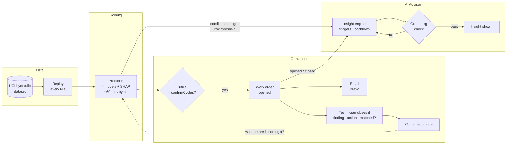
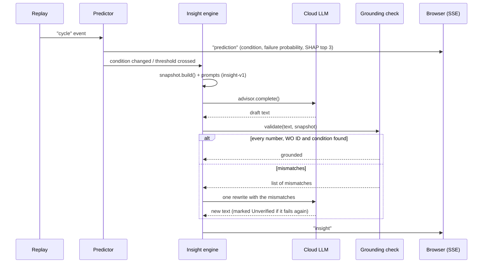
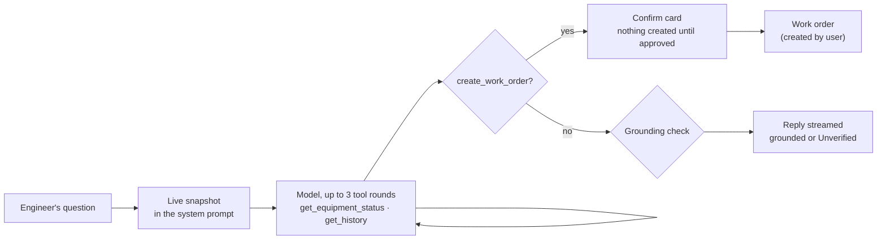

<h1 align="center">Closed Loop</h1>

<p align="center">
  <b>Predict the failure. Open the work order. Learn whether the prediction was right.</b><br>
  A predictive-maintenance dashboard for hydraulic systems, with an AI Advisor whose every number is checked against the data.
</p>

<p align="center">
  
  
  
</p>

<p align="center"><sub>built with</sub></p>

<p align="center">
  
  
  
  
  
</p>

<p align="center">
  
  
  
  
  
  
</p>

<p align="center">
  
  
  
</p>

<p align="center"><sub>Final Year Project · Universiti Teknologi PETRONAS</sub></p>

---

## Contents

1. [What it does](#what-it-does)
2. [Getting started](#getting-started)
3. [Architecture](#architecture)
4. [Deploying](#deploying)
5. [Repository layout](#repository-layout)
6. [Documentation](#documentation) · [License](#license)

---

## What it does

Built around the **UCI Hydraulic Condition Monitoring** dataset. Recorded cycles are replayed as a
live feed; each cycle is scored by the four FYP1 models (cooler, valve, pump, accumulator) with SHAP
explanations. A monitor opens a maintenance **work order** when a component turns Critical, and a
technician closes it with what they found, and whether it matched the prediction. That feeds a
**confirmation rate** (**Work orders → History**), which closes the loop.

An AI **Advisor** closes the loop for people:

<div align="center">

| Feature | What it does |
|---|---|
| **Live insights** | When a component changes condition, crosses the risk threshold, or a work order opens or closes, the Advisor writes a short explanation by itself |
| **Chat** | Ask about the live state; the Advisor can look up status and history, and propose a work order that you confirm |
| **Grounding check** | Every number, work order ID and condition in the AI's text is checked against the data it was given; failures are rewritten once and otherwise marked *Unverified* |

</div>

The Advisor answers from a **cloud model** (OpenAI, Anthropic, Gemini, Groq, OpenRouter, DeepSeek,
Ollama Cloud, or any OpenAI-compatible endpoint), chosen on the **AI model** page. With nothing set
up yet, the dashboard asks for an API key; Groq and Google Gemini both offer free ones.

For the FYP's evaluation it also has:

<div align="center">

| Tool | What it does |
|---|---|
| **Study mode** | A researcher console at `/study/admin` for the user study: two conditions (dashboard only / dashboard + AI), fixed task presets, counterbalancing, a timed task log and CSV export |
| **Evaluation harness** | `eval/` measures grounding accuracy, hallucination rate and latency per model, with the validator on and off, plus a whole-system performance run |

</div>

---

## Getting started

Everything runs directly on your machine, no Docker.

### 1. Prerequisites

<div align="center">

| Tool | Version |
|---|---|
| Python | 3.11+ |
| Node.js | 22+ |
| pnpm | latest |
| An API key | one cloud provider (Groq and Gemini have free tiers) |

</div>

### 2. Install and run

```bash
./closed-loop.sh setup    # once: packages, .env, trains the ML models (~2 min)
./closed-loop.sh start    # http://localhost:8000, then add a key on the AI model page
```

Create an account (the first one becomes the admin, or set `ADMIN_EMAILS` in `.env` to choose who).
On **AI model**, add your own key for one provider, test it and press *Use*. Press play in the top
bar: the live insights run on the key of whoever presses Play.

### 3. Commands

<div align="center">

| Command | What it does |
|---|---|
| `./closed-loop.sh setup` | Install / upgrade dependencies, create `.env`, train the models if missing. Safe to re-run |
| `./closed-loop.sh start` | Build the dashboard once and serve it with the API on one port (lightest; for demos) |
| `./closed-loop.sh dev` | Hot-reload backend (:8000) + Vite (:5173), for editing code; Vite starts once the API answers |
| `./closed-loop.sh test` | Backend tests, frontend type check and lint |
| `./closed-loop.sh status` | Does the API answer (the models are per user, on the AI model page) |
| `./closed-loop.sh reset-db` | Delete the database (recreated empty on the next start); refuses while it holds study logs unless `--force` |

</div>

Ctrl-C stops everything the command started. Something not working? See
[Troubleshooting](docs/DEVELOPMENT.md#troubleshooting).

---

## Architecture

<picture>
  <source media="(prefers-color-scheme: dark)" srcset="docs/img/architecture-dark.png">
  
</picture>

- **Frontend: S3 behind CloudFront.** The React/Vite dashboard. The browser uses the CloudFront URL as its single origin; CloudFront forwards `/api/*` to the backend (`infra/main.tf`).
- **Backend: ECS Express Mode (Fargate).** One FastAPI container runs the replay, the four scoring models with SHAP, the monitor, work orders, the insight engine, the grounding check and the chat tools. The models are trained when the image is built (`backend/Dockerfile`).
- **Database: RDS Postgres.** Private, in the same region; locally, without `DATABASE_URL`, the backend uses SQLite (`config/closed_loop.db`).
- **Email: Gmail SMTP.** Work orders, sign-ups and approvals go out through a Gmail account's App Password.
- **AI: the user's own key.** Every key belongs to a user and is encrypted at rest; there is no server key.
- **Delivery: GitHub Actions.** Runs the checks, applies migrations, and deploys each side by hand.

### The closed loop

Each lane is one part of the system; a replayed cycle travels from left to right and comes back as a
work order outcome.



### An insight, step by step



### Chat with tools



More detail (every module, the tables, model selection, secrets): **[docs/ARCHITECTURE.md](docs/ARCHITECTURE.md)**.

### Tech stack

<div align="center">

| Layer | Choice |
|---|---|
| Frontend | Vite, React 19, TypeScript, TanStack Router (file-based routes), Tailwind CSS v4, pnpm |
| Backend | FastAPI, httpx, psutil; SQLite locally, Postgres (RDS) in production |
| ML | scikit-learn, imbalanced-learn, XGBoost, SHAP |
| AI | Any OpenAI-compatible chat API, one key per user (Fernet-encrypted) |
| Auth | Email + password (scrypt) and Google sign-in; server-side sessions |
| Email | Gmail SMTP (App Password) |
| Hosting | AWS: CloudFront + S3 (dashboard) · ECS Express Mode (API) · RDS Postgres, all in Terraform (`infra/`) |
| CI / CD | GitHub Actions: checks, database migrations, hand-started deploys |

</div>

---

## Deploying

Everything runs on **AWS** (Singapore), built by Terraform in [`infra/`](infra/): the dashboard on
S3 behind CloudFront, the API on ECS Express Mode, the database on RDS Postgres. Each side is
deployed on its own by a GitHub Actions workflow you start by hand, after the checks pass. GitHub
reaches AWS through OIDC, so no AWS keys are stored anywhere. Step by step:
**[docs/DEPLOY.md](docs/DEPLOY.md)**.

<div align="center">

| Workflow | What it does |
|---|---|
| `checks.yml` | Backend tests (trains the models first), frontend type check and lint |
| `infra.yml` | Terraform plan on pull requests touching `infra/`; plan and apply when you run it |
| `deploy-frontend.yml` | Builds the dashboard, uploads it to S3, refreshes CloudFront |
| `deploy-backend.yml` | Builds the API image, pushes it to ECR, rolls ECS onto it (migrations run as it starts) |

</div>

Locally nothing changes: without `DATABASE_URL` the backend keeps using SQLite.

### Cost

What this setup costs to run for a month, on-demand, in `ap-southeast-1` (Singapore). Unit prices are
from AWS's published price list for the region (November 2026); a month is 730 hours. Prices change, so
check the [AWS Pricing Calculator](https://calculator.aws/) before relying on them.

**Always on (billed every hour, whether anyone uses the app or not)**

| # | Item | What's running | Unit price | Calculation | USD / month |
|---|---|---|---|---|---:|
| 1 | Fargate vCPU | 1 task × 0.5 vCPU (`infra/main.tf`: `cpu = "512"`) | $0.05056 per vCPU-hour | 0.5 × 0.05056 × 730 | 18.45 |
| 2 | Fargate memory | 1 task × 1 GB (`memory = "1024"`) | $0.00553 per GB-hour | 1 × 0.00553 × 730 | 4.04 |
| 3 | Load balancer (Express Mode's ALB) | 1 Application Load Balancer | $0.0252 per hour | 0.0252 × 730 | 18.40 |
| 4 | Load balancer capacity | ~0.5 LCU on average (light traffic, a few open SSE streams) | $0.008 per LCU-hour | 0.5 × 0.008 × 730 | 2.92 |
| 5 | Public IPv4 addresses | 3 for the load balancer (one per subnet of the default VPC) + 1 for the task | $0.005 per address-hour | 4 × 0.005 × 730 | 14.60 |
| 6 | RDS instance | db.t4g.micro, PostgreSQL, Single-AZ | $0.025 per hour | 0.025 × 730 | 18.25 |
| 7 | RDS storage | 20 GB gp3 (`allocated_storage = 20`) | $0.138 per GB-month | 20 × 0.138 | 2.76 |
| 8 | Secrets Manager | 2 secrets (`closed-loop/api`, `closed-loop/db`) | $0.40 per secret-month | 2 × 0.40 | 0.80 |
| | **Subtotal** | | | | **80.22** |

**Usage-based (small at FYP traffic)**

| # | Item | Assumption | Unit price | Calculation | USD / month |
|---|---|---|---|---|---:|
| 9 | ECR image storage | 10 images kept × ~0.8 GB (Python + scikit-learn, XGBoost, SHAP, trained models) | $0.10 per GB-month | 8 × 0.10 | 0.80 |
| 10 | CloudWatch Logs | ~0.5 GB written, kept 14 days | $0.70 per GB ingested + $0.03 per GB-month stored | 0.5 × 0.70 + 0.25 × 0.03 | 0.36 |
| 11 | CloudWatch alarm | 1 alarm (only with `ALERT_EMAIL` set) | $0.10 per alarm-month | 1 × 0.10 | 0.10 |
| 12 | Secrets Manager API calls | a few reads per task start | $0.05 per 10,000 | — | 0.00 |
| 13 | S3 (dashboard) | ~5 MB stored, requests come through CloudFront | $0.025 per GB-month | — | 0.00 |
| 14 | CloudFront | well under 1 TB out and 10 M requests (always-free tier); the SPA function is under 2 M invocations | free tier | — | 0.00 |
| 15 | Data transfer | load balancer → CloudFront is free; calls to the LLM and Gmail are tiny and inside the 100 GB/month free allowance | free tier | — | 0.00 |
| 16 | SNS email, AWS Budgets, KMS | first 1,000 emails, first 2 budgets and AWS-managed keys are free | free | — | 0.00 |
| 17 | Terraform state bucket | a few KB in S3 | — | — | 0.00 |
| | **Subtotal** | | | | **1.26** |

| | USD |
|---|---:|
| **Per month** | **≈ 81.48** |
| Per day | ≈ 2.68 |
| A 3-month FYP demo period | ≈ 244 |
| A 6-month period | ≈ 489 |

CloudWatch's free tier (5 GB of logs and 10 alarms a month) usually brings items 10 and 11 to $0. Outside
AWS, nothing is billed: Gmail SMTP is free (about 500 emails a day), GitHub Actions is free for public
repositories (2,000 minutes a month for private ones), and LLM calls are paid by each user on their own key.

**Where the money goes:** the load balancer and its IPv4 addresses (items 3–5, ≈ $35.92) and the database
(items 6–7, ≈ $21.01) cost more than the app itself (items 1–2, ≈ $22.49). The load balancer and addresses
are the price of ECS Express Mode's managed HTTPS.

**Ways to pay less**

| Option | Saves per month | Trade-off |
|---|---:|---|
| New-account credits | up to $200 in total | New AWS accounts get Free Tier credits for their first months |
| Scale the task to 0 between demos (`min_task_count = max_task_count = 0`, apply) | ≈ $26.14 (items 1, 2 and the task's IPv4) | The app is offline; load balancer and database still bill |
| Stop the RDS instance between demos (RDS console → Stop) | ≈ $18.25 (storage still bills) | AWS starts it again by itself after 7 days |
| RDS 1-year reserved instance, no upfront | ≈ 30% of item 6 | A one-year commitment |
| Arm (Graviton) Fargate: `cpu_architecture = "ARM64"` and build on an Arm runner | ≈ 20% of items 1–2 | XGBoost and SHAP wheels must exist for Arm |
| One small EC2 instance instead of Express Mode | ≈ $35 (items 3–5) | You manage HTTPS, restarts and deploys yourself |

The budget alert is set to **$100 a month**: it emails at 80% of the forecast and again at 100% actual.
Nothing in the setup scales by itself (one task, storage capped at 50 GB, logs kept 14 days, 10 images), so
the only way the bill jumps is a bot flood through CloudFront; an AWS WAF rate rule would stop that for
about $6 a month.

---

## Repository layout

```
closed-loop-fyp/
├── frontend/          React + Vite dashboard (TypeScript, Tailwind, TanStack Router)
├── backend/           FastAPI service: replay, predictor, monitor, work orders, insights,
│   │                  grounding check, chat tools, model selection, cloud client
│   ├── app/             the API (api/ routers, services/ logic)
│   ├── ml/              FYP1 ML pipeline: features, labels, evaluation, training, SHAP, saved models
│   ├── data/            the dataset (hydraulic_condition_monitoring_summary.csv)
│   └── tests/           pytest (stub models, no API key needed)
├── eval/              Evaluation harness: scenarios, runner, analysis, rating sheets, system performance
├── config/            Model choice, study tasks, settings, the SQLite database
│                      (keys and DB gitignored)
├── docs/              Architecture, API reference, development guide, dataset, scope
├── scripts/common.sh  Shell helpers for closed-loop.sh
├── closed-loop.sh     The one entry point for running anything
└── .env.example       Ports, cloud model, sign-in, email (copied to .env)
```

---

## Documentation

<div align="center">

| Document | What's in it |
|---|---|
| [docs/ARCHITECTURE.md](docs/ARCHITECTURE.md) | How the pieces fit, the closed loop, request flows, design decisions |
| [docs/API.md](docs/API.md) | Every backend endpoint and live event, with request and response shapes |
| [docs/DEVELOPMENT.md](docs/DEVELOPMENT.md) | Setup, configuration, settings, study mode, evaluation, checks, troubleshooting, extending it |
| [docs/DEPLOY.md](docs/DEPLOY.md) | AWS with Terraform, step by step |
| [docs/DATASET.md](docs/DATASET.md) | The hydraulic dataset: sensors, labels, structure, verification |
| [docs/FYP_NEW_SCOPE.md](docs/FYP_NEW_SCOPE.md) | The revised FYP topic, chapter by chapter |
| [backend/ml/README.md](backend/ml/README.md) | The ML pipeline and its results |
| [TODO.md](TODO.md) | The technical build plan, by milestone, with status |

</div>

## License

[MIT](LICENSE). The architecture diagram was made with [stack-diagram](https://github.com/caru-ini/stack-diagram); brand logos belong to their owners.
