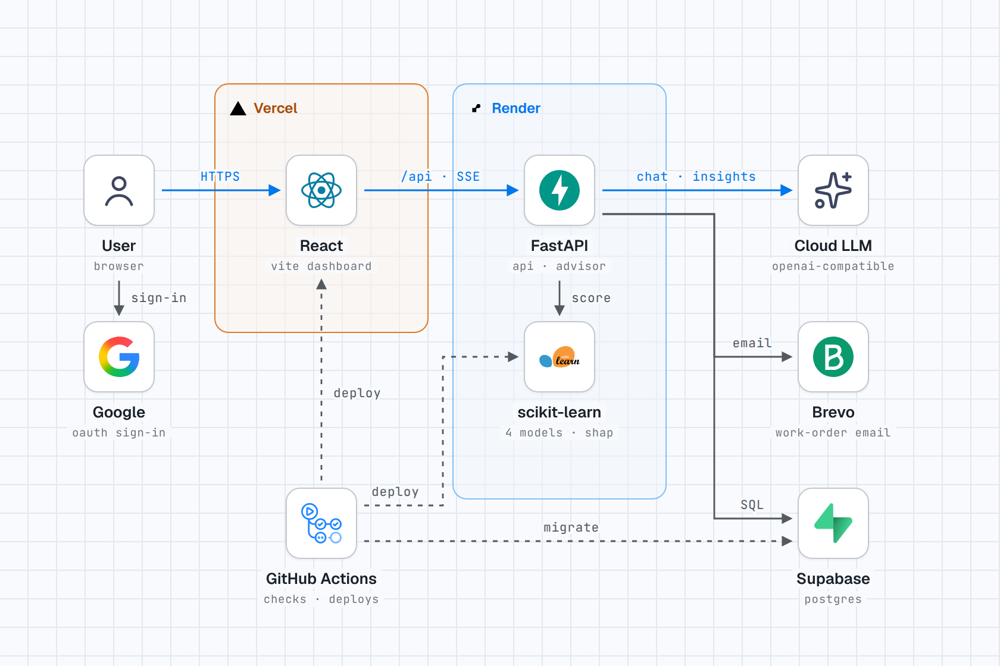
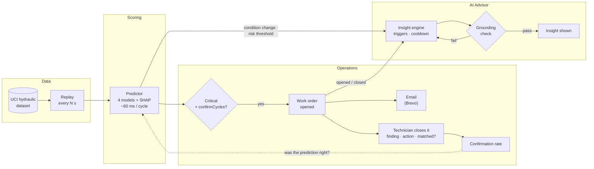
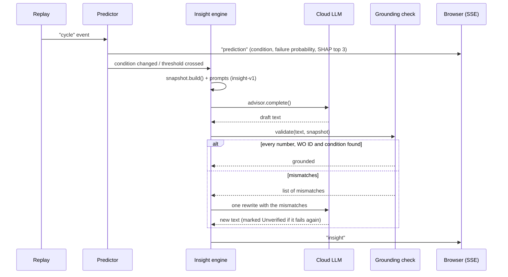
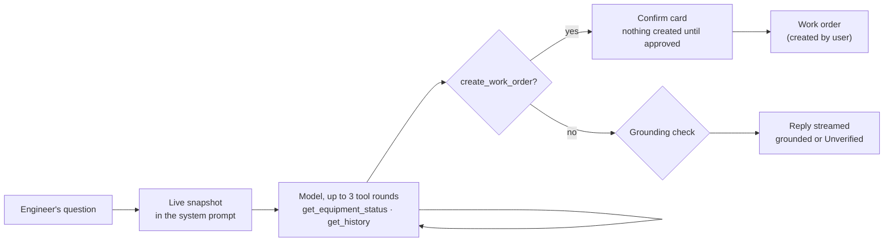

<h1 align="center">Closed Loop</h1>

<p align="center">
  <b>Predict the failure. Open the work order. Learn whether the prediction was right.</b><br>
  A predictive-maintenance dashboard for hydraulic systems, with an AI Advisor whose every number is checked against the data.
</p>

<p align="center">
  
  
  
</p>

<p align="center"><sub>built with</sub></p>

<p align="center">
  
  
  
  
  
</p>

<p align="center">
  
  
  
  
  
  
</p>

<p align="center">
  
  
  
  
</p>

<p align="center"><sub>Final Year Project · Universiti Teknologi PETRONAS</sub></p>

---

## Contents

1. [What it does](#what-it-does)
2. [Getting started](#getting-started)
3. [Architecture](#architecture)
4. [Deploying](#deploying)
5. [Repository layout](#repository-layout)
6. [Documentation](#documentation) · [License](#license)

---

## What it does

Built around the **UCI Hydraulic Condition Monitoring** dataset. Recorded cycles are replayed as a
live feed; each cycle is scored by the four FYP1 models (cooler, valve, pump, accumulator) with SHAP
explanations. A monitor opens a maintenance **work order** when a component turns Critical, and a
technician closes it with what they found, and whether it matched the prediction. That feeds a
**confirmation rate** (**Work orders → History**), which closes the loop.

An AI **Advisor** closes the loop for people:

<div align="center">

| Feature | What it does |
|---|---|
| **Live insights** | When a component changes condition, crosses the risk threshold, or a work order opens or closes, the Advisor writes a short explanation by itself |
| **Chat** | Ask about the live state; the Advisor can look up status and history, and propose a work order that you confirm |
| **Grounding check** | Every number, work order ID and condition in the AI's text is checked against the data it was given; failures are rewritten once and otherwise marked *Unverified* |

</div>

The Advisor answers from a **cloud model** (OpenAI, Anthropic, Gemini, Groq, OpenRouter, DeepSeek,
Ollama Cloud, or any OpenAI-compatible endpoint), chosen on the **AI model** page. With nothing set
up yet, the dashboard asks for an API key; Groq and Google Gemini both offer free ones.

For the FYP's evaluation it also has:

<div align="center">

| Tool | What it does |
|---|---|
| **Study mode** | A researcher console at `/study/admin` for the user study: two conditions (dashboard only / dashboard + AI), fixed task presets, counterbalancing, a timed task log and CSV export |
| **Evaluation harness** | `eval/` measures grounding accuracy, hallucination rate and latency per model, with the validator on and off, plus a whole-system performance run |

</div>

---

## Getting started

Everything runs directly on your machine, no Docker.

### 1. Prerequisites

<div align="center">

| Tool | Version |
|---|---|
| Python | 3.11+ |
| Node.js | 22+ |
| pnpm | latest |
| An API key | one cloud provider (Groq and Gemini have free tiers) |

</div>

### 2. Install and run

```bash
./closed-loop.sh setup    # once: packages, .env, trains the ML models (~2 min)
./closed-loop.sh start    # http://localhost:8000, then add a key on the AI model page
```

Create an account (the first one becomes the admin, or set `ADMIN_EMAILS` in `.env` to choose who).
On **AI model**, add your own key for one provider, test it and press *Use*. Press play in the top
bar: the live insights run on the key of whoever presses Play.

### 3. Commands

<div align="center">

| Command | What it does |
|---|---|
| `./closed-loop.sh setup` | Install / upgrade dependencies, create `.env`, train the models if missing. Safe to re-run |
| `./closed-loop.sh start` | Build the dashboard once and serve it with the API on one port (lightest; for demos) |
| `./closed-loop.sh dev` | Hot-reload backend (:8000) + Vite (:5173), for editing code; Vite starts once the API answers |
| `./closed-loop.sh test` | Backend tests, frontend type check and lint |
| `./closed-loop.sh status` | Does the API answer (the models are per user, on the AI model page) |
| `./closed-loop.sh reset-db` | Delete the database (recreated empty on the next start); refuses while it holds study logs unless `--force` |

</div>

Ctrl-C stops everything the command started. Something not working? See
[Troubleshooting](docs/DEVELOPMENT.md#troubleshooting).

---

## Architecture

<picture>
  <source media="(prefers-color-scheme: dark)" srcset="docs/img/architecture-dark.png">
  
</picture>

- **Frontend: Vercel.** The React/Vite dashboard. The browser uses the Vercel URL as its single origin; Vercel forwards `/api/*` to Render (`frontend/vercel.json`).
- **Backend: Render.** One FastAPI process runs the replay, the four scoring models with SHAP, the monitor, work orders, the insight engine, the grounding check and the chat tools. The models are trained during the Render build.
- **Database: Supabase.** Postgres in production; locally, without `DATABASE_URL`, the backend uses SQLite (`config/closed_loop.db`).
- **AI: the user's own key.** Every key belongs to a user and is encrypted at rest; there is no server key.
- **Delivery: GitHub Actions.** Runs the checks, applies migrations, and deploys each side by hand.

### The closed loop

Each lane is one part of the system; a replayed cycle travels from left to right and comes back as a
work order outcome.



### An insight, step by step



### Chat with tools



More detail (every module, the tables, model selection, secrets): **[docs/ARCHITECTURE.md](docs/ARCHITECTURE.md)**.

### Tech stack

<div align="center">

| Layer | Choice |
|---|---|
| Frontend | Vite, React 19, TypeScript, TanStack Router (file-based routes), Tailwind CSS v4, pnpm |
| Backend | FastAPI, httpx, psutil; SQLite locally, Postgres (Supabase) in production |
| ML | scikit-learn, imbalanced-learn, XGBoost, SHAP |
| AI | Any OpenAI-compatible chat API, one key per user (Fernet-encrypted) |
| Auth | Email + password (scrypt) and Google sign-in; server-side sessions |
| Email | Brevo over HTTPS (Gmail SMTP locally) |
| Hosting | Vercel (dashboard) · Render (API) · Supabase (Postgres) |
| CI / CD | GitHub Actions: checks, database migrations, hand-started deploys |

</div>

---

## Deploying

The frontend goes to **Vercel**, the backend to **Render** and the database to **Supabase**
(Postgres), each deployed on its own by a GitHub Actions workflow you start by hand, after the
checks pass. Database migrations apply themselves when a migration file changes. Step by step:
**[docs/DEPLOY.md](docs/DEPLOY.md)**.

<div align="center">

| Workflow | What it does |
|---|---|
| `checks.yml` | Backend tests (trains the models first), frontend type check and lint |
| `database.yml` | Applies Supabase migrations when a migration file changes |
| `deploy-frontend.yml` | Deploys the dashboard to Vercel |
| `deploy-backend.yml` | Triggers the Render deploy hook (auto-deploy is off) |

</div>

Locally nothing changes: without `DATABASE_URL` the backend keeps using SQLite.

---

## Repository layout

```
closed-loop-fyp/
├── frontend/          React + Vite dashboard (TypeScript, Tailwind, TanStack Router)
├── backend/           FastAPI service: replay, predictor, monitor, work orders, insights,
│   │                  grounding check, chat tools, model selection, cloud client
│   ├── app/             the API (api/ routers, services/ logic)
│   ├── ml/              FYP1 ML pipeline: features, labels, evaluation, training, SHAP, saved models
│   ├── data/            the dataset (hydraulic_condition_monitoring_summary.csv)
│   └── tests/           pytest (stub models, no API key needed)
├── eval/              Evaluation harness: scenarios, runner, analysis, rating sheets, system performance
├── config/            Model choice, study tasks, settings, the SQLite database
│                      (keys and DB gitignored)
├── docs/              Architecture, API reference, development guide, dataset, scope
├── scripts/common.sh  Shell helpers for closed-loop.sh
├── closed-loop.sh     The one entry point for running anything
├── .env.example       Ports, cloud model, sign-in, email (copied to .env)
└── Daedalus/          Reference project only, not part of this app, never modified
```

---

## Documentation

<div align="center">

| Document | What's in it |
|---|---|
| [docs/ARCHITECTURE.md](docs/ARCHITECTURE.md) | How the pieces fit, the closed loop, request flows, design decisions |
| [docs/API.md](docs/API.md) | Every backend endpoint and live event, with request and response shapes |
| [docs/DEVELOPMENT.md](docs/DEVELOPMENT.md) | Setup, configuration, settings, study mode, evaluation, checks, troubleshooting, extending it |
| [docs/DEPLOY.md](docs/DEPLOY.md) | Vercel, Render and Supabase, step by step |
| [docs/DATASET.md](docs/DATASET.md) | The hydraulic dataset: sensors, labels, structure, verification |
| [docs/FYP_NEW_SCOPE.md](docs/FYP_NEW_SCOPE.md) | The revised FYP topic, chapter by chapter |
| [backend/ml/README.md](backend/ml/README.md) | The ML pipeline and its results |
| [TODO.md](TODO.md) | The technical build plan, by milestone, with status |

</div>

## License

[MIT](LICENSE). The architecture diagram was made with [stack-diagram](https://github.com/caru-ini/stack-diagram); brand logos belong to their owners.
