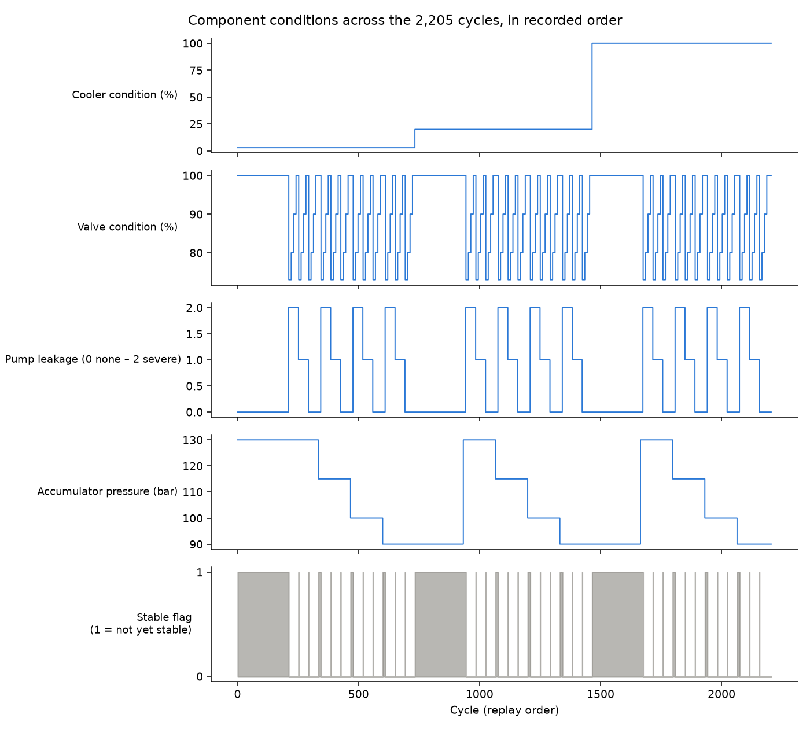
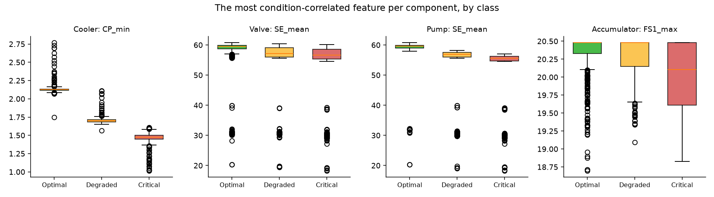

# Dataset

The project's data is **`backend/data/hydraulic_condition_monitoring_summary.csv`**: the
UCI *Condition Monitoring of Hydraulic Systems* dataset, reduced to 68
statistical features per cycle plus the condition labels. Training,
evaluation and the live replay all read this one file.

Every number on this page can be regenerated with
`cd backend && python -m ml.dataset_report` (statistics + figures) and
`cd backend && python -m ml.evaluate` (model results).

---

## 1. Source

| | |
|---|---|
| **Name** | Condition Monitoring of Hydraulic Systems |
| **Repository** | UCI Machine Learning Repository, dataset 447 — <https://doi.org/10.24432/C5CW21> |
| **Creator** | Nikolai Helwig, ZeMA gGmbH (Centre for Mechatronics and Automation Technology), Saarbrücken, Germany |
| **Donated** | April 2018 |
| **Licence** | CC BY 4.0 (free to use and redistribute with attribution, which is why the summary CSV can be committed) |
| **Type** | Real measurements from a physical test rig — not simulated |

**Cite as:**
- Helwig, N., Pignanelli, E., & Schütze, A. (2015). *Condition monitoring of hydraulic systems* [Dataset]. UCI Machine Learning Repository. https://doi.org/10.24432/C5CW21
- Helwig, N., Pignanelli, E., & Schütze, A. (2015). Condition monitoring of a complex hydraulic system using multivariate statistics. *Proc. I2MTC 2015, IEEE International Instrumentation and Measurement Technology Conference*, Pisa, Italy, paper PPS1-39. https://doi.org/10.1109/I2MTC.2015.7151267 *(the creators' requested citation)*

**Why this dataset** (FYP1 interim report §3.3): it is physically measured
rather than simulated (AI4I 2020 and NASA C-MAPSS were rejected for that), it
is multi-sensor rather than vibration-only (CWRU/IMS were rejected for that),
it covers several fault types at once, and its labels are graded severities
rather than a single failed/healthy flag.

## 2. The test rig and what a "cycle" is

The rig has a **primary working circuit** and a **secondary cooling-filtration
circuit**, connected through the oil tank. It repeats a **constant load cycle
of 60 seconds**, again and again, while the experimenters deliberately change
the condition of four components: the **cooler**, a switching **valve**, the
**pump** (internal leakage), and the hydraulic **accumulator** (gas
pre-charge pressure).

One **cycle** = one 60-second load cycle = one row in the dataset. There are
**2,205 cycles**. The raw data records every sensor throughout each cycle;
the summary reduces each sensor's 60 seconds to four numbers.

## 3. Sensors

17 channels: 14 physical sensors and 3 virtual ones computed from the others.

| Sensor | Quantity | Unit | Sampling rate | Raw values per cycle | Range of cycle means in the data |
|---|---|---|---|---|---|
| PS1 | Pressure | bar | 100 Hz | 6,000 | 155.4 – 180.9 |
| PS2 | Pressure | bar | 100 Hz | 6,000 | 104.4 – 131.6 |
| PS3 | Pressure | bar | 100 Hz | 6,000 | 0.84 – 2.02 |
| PS4 | Pressure | bar | 100 Hz | 6,000 | 0.00 – 10.21 |
| PS5 | Pressure | bar | 100 Hz | 6,000 | 8.37 – 9.98 |
| PS6 | Pressure | bar | 100 Hz | 6,000 | 8.32 – 9.86 |
| EPS1 | Motor power | W | 100 Hz | 6,000 | 2,361.7 – 2,740.6 |
| FS1 | Volume flow | l/min | 10 Hz | 600 | 2.02 – 6.72 |
| FS2 | Volume flow | l/min | 10 Hz | 600 | 8.86 – 10.40 |
| TS1 | Temperature | °C | 1 Hz | 60 | 35.3 – 57.9 |
| TS2 | Temperature | °C | 1 Hz | 60 | 40.9 – 62.0 |
| TS3 | Temperature | °C | 1 Hz | 60 | 38.2 – 59.4 |
| TS4 | Temperature | °C | 1 Hz | 60 | 30.4 – 53.1 |
| VS1 | Vibration | mm/s | 1 Hz | 60 | 0.52 – 0.84 |
| CE | Cooling efficiency (virtual) | % | 1 Hz | 60 | 17.6 – 47.9 |
| CP | Cooling power (virtual) | kW | 1 Hz | 60 | 1.06 – 2.84 |
| SE | Efficiency factor (virtual) | % | 1 Hz | 60 | 18.3 – 60.8 |

The raw dataset therefore has 43,680 values per cycle
(7 × 6,000 + 2 × 600 + 8 × 60).

## 4. Condition labels

Each cycle is annotated with the state of all four components at once (the
faults are superimposed, which is what makes the dataset hard):

| Component | Graded value | Meaning (from the dataset documentation) | Cycles | **This project's class** |
|---|---|---|---|---|
| **Cooler** (%) | 100 | full efficiency | 741 | Optimal |
| | 20 | reduced efficiency | 732 | Degraded |
| | 3 | close to total failure | 732 | Critical |
| **Valve** (%) | 100 | optimal switching behaviour | 1,125 | Optimal |
| | 90 | small lag | 360 | Degraded |
| | 80 | severe lag | 360 | Critical |
| | 73 | close to total failure | 360 | Critical |
| **Pump leakage** | 0 | no leakage | 1,221 | Optimal |
| | 1 | weak leakage | 492 | Degraded |
| | 2 | severe leakage | 492 | Critical |
| **Accumulator** (bar) | 130 | optimal pressure | 599 | Optimal |
| | 115 | slightly reduced pressure | 399 | Degraded |
| | 100 | severely reduced pressure | 399 | Critical |
| | 90 | close to total failure | 808 | Critical |

The three-class grouping (FYP1 interim report §3.3) gives these class sizes,
identical to FYP1 Table 4.1:

| Component | Optimal | Degraded | Critical | Balance |
|---|---|---|---|---|
| Cooler | 741 | 732 | 732 | balanced |
| Valve | 1,125 | 360 | 720 | Degraded under-represented |
| Pump | 1,221 | 492 | 492 | Optimal-heavy |
| Accumulator | 599 | 399 | 1,207 | Critical is 55 % — the most imbalanced |

The imbalance is why the models use SMOTE inside each training fold.

### The stable flag — note the direction

| Value | Meaning | Cycles |
|---|---|---|
| **0** | conditions were stable | 1,449 |
| **1** | static conditions **might not have been reached yet** | 756 |

So `1` means *possibly unsettled*, not "stable". Those cycles come right after
the rig's settings were changed (see §6). They are kept, not dropped (as in
FYP1), and stored as `StableFlag` in `tbl_SensorReading`.

## 5. The summary CSV

`backend/data/hydraulic_condition_monitoring_summary.csv` — 1 MB, 2,205 rows × 74 columns, no missing values, no duplicate cycles.

| Columns | Count | Content |
|---|---|---|
| `cycle` | 1 | 1 … 2,205, in recorded order (the row number of the raw files) |
| `<SENSOR>_mean`, `_std`, `_min`, `_max` | 68 | For each of the 17 sensors, in the order of §3: the mean, **population** standard deviation (ddof = 0), minimum and maximum of that sensor's values within the cycle; rounded to 4 decimals |
| `cooler_condition_pct`, `valve_condition_pct`, `pump_leakage`, `accumulator_bar` | 4 | The graded condition values of §4, exactly as in `profile.txt` |
| `stable_flag` | 1 | §4's stable flag |

**Why four statistics per sensor** (FYP1 §3.3): mean (typical level), standard
deviation (variability within the cycle), minimum and maximum (operating
boundaries) capture each sensor's behaviour over a cycle compactly; range,
skewness and kurtosis were considered and dropped as adding complexity
without improving separation of the classes.

**Verification (done 2026-10-07).** The CSV was checked against the original
UCI files: all 68 features recomputed from the 531 MB of raw data match the
CSV to within its 4-decimal rounding (largest difference 0.00005 before
rounding), the standard deviations are the population form, and the five
condition columns are identical to `profile.txt`. Training on the CSV gives
the same results as training on the unrounded raw-file features (within
±0.002 macro-F1). The raw files aren't kept in the repo; they're available from
the DOI above if the check ever needs repeating.

### Data quality notes

- **Constant features:** `PS2_min`, `PS3_min` and `SE_min` are 0 in every
  cycle (the pressure drops to zero, and the efficiency starts from zero, at
  some point in every load cycle). They carry no information; they are kept so
  the feature set stays the documented 68, and the tree models simply never
  split on them.
- **PS4 reads zero in 1,252 of 2,205 cycles**, and up to 10.2 bar in the rest.
  This follows the experimental settings rather than being missing data.
- **Low-efficiency outliers:** SE (efficiency factor) drops to about 18–40 %
  in a small number of cycles in every class (visible as outliers in Figure 2).
  These are real readings and are left in.
- **No timestamps.** The data has a cycle order but no dates or times; the
  dashboard's time axis is the cycle number. (The FYP1 Power BI trend's
  "May–Jul 2026" axis was illustrative.)

## 6. Structure across cycles — what the live replay will show

The project replays the 2,205 cycles in their recorded order as if they were
arriving live. That order is the **experiment's schedule**, not equipment
wearing out over time:

*Figure 1. Each component's graded condition and the stable flag, by cycle.*

- **Three blocks of about 735 cycles**, one per cooler level. The cooler only
  changes twice: **3 % (Critical) for cycles 1–732**, 20 % (Degraded) for
  733–1,464, then 100 % (Optimal) for 1,465–2,205. In replay order the cooler
  *recovers* rather than fails.
- **Each block starts with ~210 warm-up cycles** in which the valve is
  optimal and the pump has no leakage, and the rig has not yet stabilised
  (stable flag = 1). The accumulator keeps its own schedule: 130 bar in the
  first block's warm-up, 90 bar switching to 130 bar in the second and third.
- **Then the faults are cycled in a nested pattern:**
  - **valve** 73 → 80 → 90 → 100 % in steps of ~10 cycles (145 segments in total),
  - **pump** leakage 2 → 1 → 0 in steps of ~41 cycles (37 segments),
  - **accumulator** 130 → 115 → 100 → 90 bar in steps of 133–333 cycles (12 segments).
- **193 cycles change at least one condition**, and there are 144 distinct
  combinations of the four conditions.
- **The rig is almost never fully healthy:** all four components are Optimal
  only in cycles **1,665–1,674, 1,757 and 1,788–1,797** (21 cycles). Some
  component is degraded or critical in 99 % of the data.

**What this means for the system:**

| | Consequence |
|---|---|
| Replay | The dashboard and the AI see frequent, realistic state changes: on average one every ~11 cycles, so a demo at 1–2 s per cycle shows activity within seconds. |
| Monitor (M6) | Replaying from cycle 1, the **cooler is Critical immediately** and a work order opens at once. For a demo that starts calm, seek to **cycle 1,665** (the first all-Optimal cycle); valve faults begin about 10 cycles later. |
| Insights (M7) | Valve changes every ~10 cycles; insights must be **debounced**, or a small local model will fall behind. |
| Evaluation (M10) | Scenario snapshots can be drawn from known transitions (e.g. the first accumulator drop to 90 bar at cycle 600; the cooler change at 733). |
| Report | Say plainly that the replay follows the experimental schedule; it demonstrates a live pipeline on real recorded data, not a real degradation timeline. |

## 7. Which features carry the signal

Strongest single-feature associations with each component's graded condition
(absolute Spearman rank correlation, constant features excluded):

| Component | Top features (\|ρ\|) | Reading |
|---|---|---|
| Cooler | CP_min 0.94, CE_mean 0.94, CE_min 0.94, CP_mean 0.94 | Cooling power and cooling efficiency directly reflect cooler condition — an "easy" target |
| Valve | SE_mean 0.51, FS1_mean 0.42, PS2_std 0.35, EPS1_mean 0.21 | No single feature is decisive; the model needs combinations (it still reaches 0.98 macro-F1) |
| Pump | SE_mean 0.85, FS1_mean 0.85, EPS1_mean 0.50, SE_std 0.49 | Leakage lowers efficiency and flow |
| Accumulator | FS1_max 0.44, PS3_max 0.39, PS2_mean 0.30, PS1_mean 0.28 | The hardest target (as the creators also report); weak individual signals |

*Figure 2. The most correlated feature for each component, split by class.
The cooler separates cleanly on one feature; the accumulator does not.*

These single-feature correlations are a different measure from the trained
models' SHAP importance (`backend/ml/results/shap_<component>.png`), which ranks what
the model actually used; both agree on the cooler (cooling power) and the
pump (efficiency and flow).

## 8. How the project uses the dataset

| Where | Uses |
|---|---|
| `backend/ml/features.py` | `load_summary()` / `load_features()` read the CSV; the only reader |
| `backend/ml/labels.py` | Maps the graded values to Optimal / Degraded / Critical (§4) and checks the class counts |
| `backend/ml/evaluate.py`, `backend/ml/train.py` | Part A evaluation and the four saved models (results: `backend/ml/results/metrics.md`) |
| Backend replay (M3) | Streams one row per cycle into `tbl_SensorReading`: the 68 features, the 17 `_mean` values for the Sensor Feed, the stable flag |
| `tbl_Prediction.TrueCondition` | The label for each replayed cycle, kept for evaluation only — **never shown to the AI or the dashboard** |

## 9. Model results on this dataset (Part A)

Repeated stratified 5-fold cross-validation × 3 repeats (15 folds); macro-F1
mean ± sd. Reproduces FYP1 Table 4.2 (baselines exactly; models within ±0.005).

| Component | Rule-based baseline | Best model | Best macro-F1 | Macro PR-AUC |
|---|---|---|---|---|
| Cooler | 0.555 | XGBoost | 0.999 ± 0.002 | 1.000 |
| Valve | 0.460 | Random Forest | 0.984 ± 0.006 | 0.997 |
| Pump | 0.550 | Random Forest | 0.995 ± 0.003 | 1.000 |
| Accumulator | 0.419 | XGBoost | 0.990 ± 0.007 | 1.000 |

Full tables, significance tests and confusion matrices: `backend/ml/results/metrics.md`.
