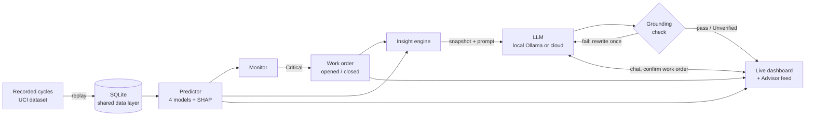
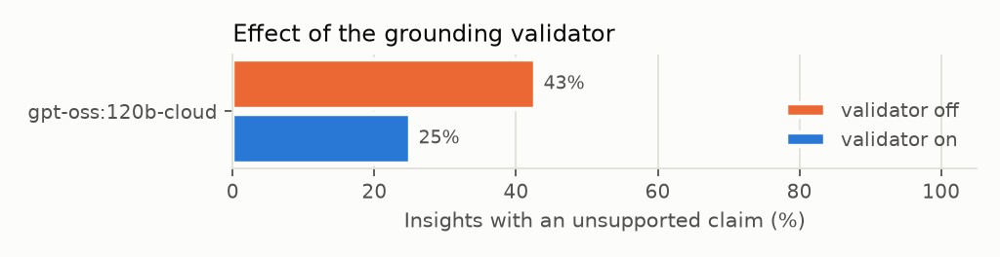

# FYP2 Progress Report

**Title:** Design and Development of a Web-Based Predictive Maintenance Dashboard with Live, Data-Grounded AI Insights Using Local and Cloud Language Models
**Student:** Sarah Khalilah binti Mohd Fauzi (22005955) · **Programme:** Bachelor of Information Technology (Hons), UTP
**Supervisor:** AP Ts Dr Mohd Anuaruddin bin Ahmadon · **Date:** 20 October 2026

---

## 1. Project Overview

Maintenance dashboards show sensor data but leave the user to interpret it, and failure-prediction models produce results that are not explained or acted on. This project builds **Closed Loop**, a self-hosted web system in which machine-learning prediction, a live dashboard, an AI Advisor and maintenance work orders share one data layer. The system uses the UCI Condition Monitoring of Hydraulic Systems dataset (2,205 load cycles, 17 sensors), replayed as a live stream. Each cycle is scored for four components (cooler, valve, pump, accumulator). Critical predictions open work orders automatically. A large language model (LLM) explains changes in plain language and answers questions. The LLM can run **locally** through Ollama, so data stays on site, or through a **cloud** API.

**Change of scope from FYP1.** The FYP1 design used Microsoft Power Platform and Copilot Studio. That plan depended on premium licences and tenant permissions that could not be guaranteed, and the agent was "design only". FYP2 replaces it with a self-built web stack. All the FYP1 machine-learning work is kept. The change also gives the project two research angles the old platform could not support: **grounding** (checking every AI statement against the data) and a comparison of **local and cloud** LLMs.

**Objectives.**
- **O1 Predict:** an ML failure-prediction model on multi-sensor data that handles class imbalance, is benchmarked against a baseline and is explained with SHAP.
- **O2 Build:** a closed-loop web system covering ingestion, live scoring, the dashboard, grounded AI insights, chat and work-order automation.
- **O3 Evaluate:** (A) predictive performance, (B) AI grounding accuracy, latency and the local-vs-cloud trade-off, and (C) a user study comparing the dashboard alone with the dashboard plus AI.

## 2. System Architecture

The system has a React + TypeScript frontend and a FastAPI backend with SQLite, and runs on a normal laptop with a single command (`./closed-loop.sh start`). Figure 1 shows how one recorded cycle moves through the loop.

*Figure 1: The closed loop, from a replayed sensor cycle to prediction, work order, grounded AI insight and the live dashboard.*

The **insight engine** runs when a component changes condition, crosses the risk threshold, or has a work order opened or closed. It builds a structured snapshot of what the dashboard currently shows and asks the LLM for a short explanation. The **grounding check** then compares every number, work-order ID and condition in the reply against that snapshot. If a value does not match, the model is asked to rewrite the reply once. If the rewrite still fails, the insight is shown with an *Unverified* label. The **Advisor chat** uses the same snapshot. Through tools it can look up live status and history, and it can propose a work order, which is created only after the user confirms it.

## 3. Progress to Date

Work is tracked in twelve technical milestones (M1–M12). **M1–M9 are complete.** M10 (evaluation) and M11 (user study) are built and waiting on their final runs, and M12 (hardening) is partly done.

| Milestone | Status | Key outcome |
|---|---|---|
| M1 ML pipeline | Done | Rebuilt from FYP1. Reproduces Table 4.1 exactly and Table 4.2 to within ±0.005 macro-F1 |
| M2 Data layer | Done | SQLite schema with 6 tables and a single query module |
| M3 Replay + live stream | Done | Play, pause, step, speed and seek; events pushed to the browser over SSE |
| M4 Live prediction | Done | 4 models + SHAP at about **59 ms per cycle**; all 2,205 cycles replayed with no wiring errors |
| M5 Dashboard | Done | KPI tiles, component cards, risk-trend chart, SHAP "why" bars, sensor feed, light/dark themes |
| M6 Work orders | Done | Opened automatically on Critical, closed on recovery, manual raise/close, audit trail |
| M7 Live insights | Done | Triggers, coalescing, cooldown, insight feed in the Advisor panel |
| M8 Grounding check | Done | Value-level check, one retry, verified badge |
| M9 Advisor chat | Done | Tool use, confirm-before-create, fallback without tools for small models |
| M10 Evaluation harness | Built; runs in progress | 50 fixed scenarios; cloud run 246 of 300 rows complete |
| M11 Study mode | Built | Two conditions, counterbalancing, timed task log, CSV export |
| M12 Hardening | Partial | One-command setup/start, 62 automated tests passing, documentation |

**Predictive performance (Part A).** The cross-validation results (repeated stratified 5-fold × 3) are close to the FYP1 results. Every model beats the rule-based baseline by a wide margin (paired t-test, p < 10⁻²³).

| Component | Best model | CV macro-F1 | Baseline macro-F1 | Top SHAP features |
|---|---|---|---|---|
| Cooler | XGBoost | 0.999 ± 0.002 | 0.555 | CP_min, CP_mean, CE_mean |
| Valve | Random Forest | 0.984 ± 0.006 | 0.460 | PS2_std, FS1_mean, PS1_std |
| Pump | Random Forest | 0.995 ± 0.003 | 0.550 | FS1_mean, SE_mean, SE_std |
| Accumulator | XGBoost | 0.990 ± 0.007 | 0.419 | FS2_mean, SE_max, TS1_min |

**Local and low-resource operation.** The system runs on a 4-core, 8 GB laptop with no GPU. With `qwen3:1.7b` on the CPU, a verified insight takes about 30 s and a chat answer that uses tools takes about 12 s. If no model is set up, the dashboard can install and start Ollama itself, with no admin rights needed. Cloud providers (OpenAI, Anthropic, Gemini, Groq, OpenRouter and others) can be selected from the Models page.

**Preliminary AI evaluation (Part B).** The first official run used the cloud model `gpt-oss:120b-cloud` on the 50 scenarios, with the grounding check switched on and off (Figure 2). With the check on, the share of insights containing at least one unsupported value fell from **42.6 % to 25.0 %**, and mean grounding accuracy rose from 93.6 % to 96.2 %. The cost was a 0.9 s increase in median latency (2.7 s to 3.6 s). The largest improvement came from transitions to *Degraded* (70 % to 10 %). Transitions to *Critical* are still the hardest case (60 %). Most of the remaining errors are invented work-order IDs, which tells us where to improve the prompt next.

*Figure 2: Hallucination rate with the grounding check off and on (gpt-oss:120b-cloud, 50 scenarios, preliminary).*

## 4. Problems Encountered and Solutions

- **Licensing risk of the Power Platform:** replaced by a self-hosted stack with no tenant dependency.
- **Small local models on limited hardware:** context, output length, thread count and keep-alive time were made configurable. A "rest between insights" setting keeps the model free for chat, and a no-tools chat mode lets very small models respond in one call.
- **GPU driver failures under WSL:** switched to the CPU build of XGBoost. The dataset is small, so CPU training takes about 20 s.
- **LLM stating wrong values:** addressed with the grounding check and one rewrite. Remaining errors are measured and shown to the user rather than hidden.

## 5. Remaining Work and Timeline

| Task | Target |
|---|---|
| Finish the official cloud run; run local models (e.g. `qwen3:1.7b`, `gemma3:1b`) for the local-vs-cloud comparison (RQ2) | Weeks 9–10 |
| Two raters score insight usefulness; compute Cohen's κ | Week 10 |
| Dry run of the user study, then the main study (about 20 participants, within-subjects; task accuracy, time, SUS, NASA-TLX) | Weeks 10–12 |
| M12: end-to-end test and long-replay soak test | Week 12 |
| Analyse Parts B and C; write the final report and prepare the viva | Weeks 13–14 |

## 6. Conclusion

The core system is complete and working. Live replay, prediction, the dashboard, automated work orders, grounded AI insights and the Advisor chat all run together as one closed loop, on either a local or a cloud model. The FYP1 models have been reproduced, and early evaluation results show that the grounding check clearly reduces hallucinated values. The remaining work is mainly running the evaluations: the local-model runs, the ratings and the user study, followed by analysis and writing up.
