<!--
  DISSERTATION SOURCE (Markdown). Formatting rules (Times New Roman 12, 1.5 spacing, 40 mm left margin,
  page numbers, TOC page numbers) are applied when this is converted to Word — see docs/dissertation/README.md.
  Items marked [TO FILL] need results that do not exist yet; everything else is final draft text.
-->

<div align="center">

**DESIGN AND DEVELOPMENT OF A WEB-BASED PREDICTIVE MAINTENANCE DASHBOARD WITH LIVE, DATA-GROUNDED AI INSIGHTS USING CLOUD LANGUAGE MODELS**

by

**SARAH KHALILAH BINTI MOHD FAUZI**

**22005955**

Dissertation submitted in partial fulfilment of the requirements for the
Bachelor of Information Technology (Hons)

[TO FILL: semester of submission, e.g. JANUARY 2027]

Universiti Teknologi PETRONAS
32610 Seri Iskandar
Perak Darul Ridzuan

</div>

\newpage

## CERTIFICATION OF APPROVAL

**Design and Development of a Web-Based Predictive Maintenance Dashboard with Live, Data-Grounded AI Insights Using Cloud Language Models**

by

Sarah Khalilah binti Mohd Fauzi
22005955

A project dissertation submitted to the
Information Technology Programme
Universiti Teknologi PETRONAS
in partial fulfilment of the requirements for the
BACHELOR OF INFORMATION TECHNOLOGY (Hons)

Approved by,

\_\_\_\_\_\_\_\_\_\_\_\_\_\_\_\_\_\_\_\_\_\_\_\_\_\_\_\_\_\_

(AP Ts Dr Mohd Anuaruddin bin Ahmadon)

UNIVERSITI TEKNOLOGI PETRONAS
SERI ISKANDAR, PERAK
[TO FILL: month and year]

\newpage

## CERTIFICATION OF ORIGINALITY

This is to certify that I am responsible for the work submitted in this project, that the original work is my own except as specified in the references and acknowledgements, and that the original work contained herein have not been undertaken or done by unspecified sources or persons.

\_\_\_\_\_\_\_\_\_\_\_\_\_\_\_\_\_\_\_\_\_\_\_\_\_\_\_\_\_\_

SARAH KHALILAH BINTI MOHD FAUZI

\newpage

## ABSTRACT

Predictive maintenance promises earlier and cheaper intervention, but in practice two gaps remain: dashboards leave maintenance staff to interpret charts and probabilities themselves, and failure-prediction models are rarely connected to the explanation and action that should follow. Large language models (LLMs) can explain data in plain language, yet they are known to state values that are not in the data, which is unacceptable when they describe the condition of equipment. This project designed, built and evaluated Closed Loop, a web-based predictive maintenance system in which machine-learning prediction, a live dashboard, LLM-generated insights and maintenance work orders operate on one shared data layer. The UCI Condition Monitoring of Hydraulic Systems dataset (2,205 load cycles, 17 sensors, four components) is replayed as a live stream; every cycle is scored by four trained classifiers with SHAP explanations, a Critical prediction opens a work order automatically, and a cloud LLM, reached through an OpenAI-compatible interface, explains each change. Every number, work-order identifier and condition in an LLM reply is checked against a structured snapshot of the dashboard; a failed check triggers one rewrite, and a reply that still fails is labelled Unverified. The project followed CRISP-DM. Random Forest and XGBoost models reached a macro-F1 of 0.984–0.999 under repeated stratified cross-validation, against 0.419–0.555 for a rule-based baseline (p < 10⁻²³). A block-aware cross-validation, added because the dataset is recorded in long runs of near-identical cycles, showed that random folds overstate performance for the valve (0.768) and accumulator (0.830), while the cooler (0.996) and pump (0.986) generalise. On 50 frozen scenarios, gpt-oss-120b, given the snapshot, stated an unsupported value in 1 of 68 insights without the check and in none with it, at a median of 2.7 s per insight. The evaluation also exposed a parsing defect in the check, which had made an earlier reported reduction from 42.6 % to 25.0 % largely an artefact; the defect was fixed and the stored insights were re-scored. [TO FILL: one sentence on the small-versus-large model comparison (RQ2).] For RQ1, a counterbalanced within-subjects user study was designed and built into the system, and its scoring and statistical pipeline was validated end to end on a synthetic data set of 160 randomly generated task attempts (20 synthetic profiles); because these data contain no real participants, RQ1 remains open and the study itself is future work. The work shows that a validated, grounded LLM layer can be embedded in a predictive maintenance loop, and that its errors can be measured and shown to the user rather than hidden.

\newpage

## ACKNOWLEDGEMENTS

[TO FILL — personal text, one page or less. Suggested points: the supervisor, AP Ts Dr Mohd Anuaruddin bin Ahmadon, for guidance through the change of platform between FYP1 and FYP2; the FYP coordinator and examiners; the two raters of the insight-usefulness study; family and friends.]

\newpage

## TABLE OF CONTENTS

[Generated in Word: References → Table of Contents, after the headings have been styled. It must list the certification, abstract, acknowledgements, every chapter heading and sub-heading, the references and every appendix with its title, with page numbers.]

## LIST OF FIGURES

Figure 3.1 CRISP-DM phases as applied in this project
Figure 3.2 Component conditions across the 2,205 cycles, in recorded order
Figure 3.3 Closed Loop system architecture
Figure 4.1 Mean absolute SHAP values, valve model
Figure 4.2 Mean absolute SHAP values, cooler, pump and accumulator models
Figure 4.3 Best macro-F1 per component, random versus block-aware cross-validation
Figure 4.4 Rig overview page
Figure 4.5 Component page (valve)
Figure 4.6 Work-order queue
Figure 4.7 AI model page
Figure 4.8 Advisor panel with live insights, grounding badges and a work-order confirmation
Figure 4.9 Researcher console for the user study
Figure 4.10 Effect of the grounding check on the hallucination rate
Figure 4.11 Hallucination rate against median latency per model

## LIST OF TABLES

Table 1.1 Objectives, research questions and deliverables
Table 2.1 Published results on the UCI hydraulic dataset
Table 2.2 Hallucination mitigation approaches compared with this project's grounding check
Table 2.3 Related work compared with this project
Table 3.1 Sensor channels
Table 3.2 Target labels and class counts
Table 3.3 Main data tables of the shared data layer
Table 3.4 Insight triggers
Table 3.5 Tools and platform
Table 3.6 Evaluation plan
Table 3.7 Project milestones
Table 4.1 Part A: cross-validated macro-F1 and macro PR-AUC (random folds)
Table 4.2 Held-out confusion matrices, best model per component
Table 4.3 Part A with block-aware cross-validation
Table 4.4 This project compared with published results
Table 4.5 Part B: insight quality per validator setting
Table 4.6 Part B: hallucination rate by scenario category
Table 4.7 Part B: small versus large model comparison
Table 4.8 Part C: pipeline validation on synthetic data (not participant results)
Table 4.9 Part C: measures and their status
Table 4.10 Part D: system performance
Table 4.11 Progress against objectives

## ABBREVIATIONS AND NOMENCLATURES

| Term | Meaning |
|---|---|
| API | Application Programming Interface |
| CBM | Condition-Based Maintenance |
| CRISP-DM | Cross-Industry Standard Process for Data Mining |
| CV | Cross-Validation |
| IIoT | Industrial Internet of Things |
| LLM | Large Language Model |
| LR | Logistic Regression |
| NASA-TLX | NASA Task Load Index |
| PdM | Predictive Maintenance |
| PR-AUC | Area Under the Precision–Recall Curve |
| RAG | Retrieval-Augmented Generation |
| RF | Random Forest |
| RQ | Research Question |
| SHAP | SHapley Additive exPlanations |
| SMOTE | Synthetic Minority Over-sampling Technique |
| SSE | Server-Sent Events |
| SUS | System Usability Scale |
| UCI | University of California, Irvine (Machine Learning Repository) |
| WO | Work Order |
| XGB | XGBoost (eXtreme Gradient Boosting) |
| Cycle | One 60-second load cycle of the hydraulic test rig; the unit of replay and prediction |
| Condition block | A run of consecutive cycles recorded at the same combination of the four component conditions |
| Grounded | An LLM reply whose every checked value appears in the snapshot it was given |
| Snapshot | The structured (JSON) description of the dashboard state given to the LLM |
| Synthetic data | Data generated at random by a script, containing no responses from real people or agents; used here only to validate the user-study analysis pipeline |

\newpage

# CHAPTER 1: INTRODUCTION

## 1.1 BACKGROUND

A hydraulic system is made of interdependent components: pumps generate flow, valves control direction and pressure, coolers remove heat, and accumulators store energy and damp pressure fluctuations. Because these components are coupled mechanically and thermally, the degradation of one affects the others. A less efficient cooler raises the oil temperature, which increases the thermal and mechanical stress on the valves and the pump and accelerates their wear. An undetected minor fault can therefore escalate into a larger and more costly failure elsewhere in the circuit.

The cost of such a failure grows with the time it remains undetected, which is the premise of condition-based maintenance (CBM) and predictive maintenance (PdM). Instead of servicing equipment after it fails (reactive maintenance) or at fixed intervals regardless of its state (preventive maintenance), CBM and PdM use sensor data to assess the actual health of equipment and to intervene when the data indicate that it is needed [1], [2], [3]. Machine-learning classifiers trained on multi-sensor data are now a common way to estimate that health [2], [4].

Accurate prediction alone, however, does not maintain anything. A model that identifies a degrading valve is valuable only if the result reaches the right person promptly, in a form that person can understand and act on [5], [6]. This requires a system that extends beyond prediction to explanation, alerting and the initiation of maintenance work. It also requires an interface that both technical and non-technical staff can question.

Large language models (LLMs) offer a new way to provide such an interface. They can turn a table of probabilities and sensor values into a short explanation in plain language and can answer follow-up questions. Industrial analytics tools have begun to embed them for this purpose [7], and recent work proposes LLM-based agents for predictive maintenance [8], [9]. LLMs, however, are known to produce fluent statements that are not supported by their input, a behaviour described as hallucination [10], [11]. In a maintenance setting, an explanation that reports a wrong failure probability or an invented work-order number is worse than no explanation. Any LLM layer placed over maintenance data must therefore be grounded in that data and checked against it.

This project implements such a system as a self-hosted web application named Closed Loop. It combines machine-learning failure prediction, an interactive dashboard, an LLM that generates live, data-grounded insights and answers questions, and automated maintenance work orders. All of these share one data layer, so the dashboard, the AI and the workflow always describe the same state of the equipment. The LLM is reached through a standard, OpenAI-compatible interface, so a cheaper or more capable model can be substituted without changing the system. This matters because a monitoring system calls the model on every significant event, and hosted models differ widely in cost and latency [12], [13].

## 1.2 PROBLEM STATEMENT

The problem addressed by this project has five parts.

1. **Maintenance is still largely reactive or schedule-based.** Servicing equipment after failure or at fixed intervals delays the response to developing faults and forgoes the economic and safety benefits of CBM [1], [2].
2. **Detection is not connected to action.** Because hydraulic components are coupled, a fault in one spreads to others; detecting it is useful only if detection leads directly to a maintenance response [5], [6].
3. **Tools are disconnected.** Dashboards, predictive models and alerting are typically separate systems with separate data, so what the model predicts, what the dashboard shows and what the work-order system records can disagree [3], [8].
4. **Dashboards do not explain themselves.** Reading charts, comparing values and tracing causes is a cognitive load that falls on maintenance technicians, who may not have an analytics background. An LLM interface has been shown to reduce perceived workload for simple industrial decision tasks, but it was evaluated as an alternative to a dashboard rather than as part of one [14].
5. **LLM statements are not verified against the data.** LLMs can state plausible but wrong values [10], [11]. Existing maintenance and analytics work rarely checks LLM statements against the underlying data, and it rarely asks how small (and therefore how cheap and fast) a model can be before its explanations become unreliable.

These problems lead to three research questions:

- **RQ1.** Do live, data-grounded AI insights improve task accuracy and reduce workload compared with the same dashboard without them?
- **RQ2.** How closely can a small, low-cost cloud language model match a large one in grounding accuracy and latency when explaining predictive maintenance data?
- **RQ3.** How much does supplying the AI with a structured data snapshot and validating its output reduce incorrect values in its statements?

## 1.3 OBJECTIVES

The general objective of this project is to design, develop and evaluate a web-based predictive maintenance system in which machine-learning prediction, an overview dashboard, data-grounded AI insights from a cloud language model, and automated maintenance workflows operate as a single closed loop on a shared data layer. The specific objectives are:

- **O1 — Predict.** To develop a machine-learning failure-prediction model on real multi-sensor hydraulic data that addresses class imbalance, is benchmarked against a rule-based baseline, and is explained with SHAP feature attribution.
- **O2 — Build.** To design and implement a web-based closed-loop system that replays and scores sensor data, presents it on a live dashboard, generates grounded natural-language insights with a switchable cloud language model, and raises maintenance work orders automatically and on request.
- **O3 — Evaluate.** To evaluate (A) predictive performance against the baseline, (B) the grounding accuracy, latency and small-versus-large model trade-off of the AI insights, and (C) the effect of the AI insights on users' task accuracy, completion time, usability and workload compared with the dashboard alone.

Table 1.1 maps the objectives to the research questions and to the deliverables of each project phase.

<div align="center">Table 1.1: Objectives, research questions and deliverables</div>

| Objective | Research question | FYP1 deliverable | FYP2 deliverable |
|---|---|---|---|
| O1 Predict | — | Feature pipeline; model ladder evaluated against the baseline; SHAP for the cooler | Models rebuilt in the project repository; SHAP for all four components; block-aware validation |
| O2 Build | — | Architecture and data contracts designed (Power Platform) | Web system built: replay, live scoring, dashboard, work-order automation, insight engine with grounding check, Advisor chat with tools |
| O3 Evaluate | RQ1, RQ2, RQ3 | Part A executed; Parts B and C designed | Part B (AI quality, validator effect, model size) executed; Part C (user study) built, with its analysis pipeline validated on synthetic data; Part D (system performance) |

## 1.4 SCOPE OF STUDY

The project boundary was set so that the work is feasible within the two semesters of the final year project.

**In scope:**

- Four hydraulic components (cooler, valve, pump and accumulator) of one test rig.
- The UCI Condition Monitoring of Hydraulic Systems dataset [15], replayed in recorded order as a live stream and scored on arrival.
- A web application comprising the dashboard, AI insight feed, Advisor chat and work orders, with user accounts and administrator approval.
- Cloud language models reached through OpenAI-compatible APIs; the provider and model are chosen by configuration.
- Grounding validation of every AI-generated insight and chat answer.
- Evaluation Parts A to D as defined in Section 3.8. For Part C, the scope of FYP2 is the study protocol, its implementation in the system and the validation of its analysis pipeline on synthetic data.

**Out of scope:**

- Running the Part C user study with human participants, which could not be completed within the FYP2 timeline; it is future work, and its protocol is ready.
- Live connection to physical plant sensors; the replay stands in for them.
- Equipment beyond the four components, and datasets other than the one named above.
- Training or fine-tuning language models; models are used as provided.
- Remaining-useful-life regression; the task is condition classification.
- Production deployment on factory infrastructure.

**Change of platform from FYP1.** The FYP1 design used Microsoft Power BI, Power Automate and Copilot Studio around a Dataverse data layer. That design depended on premium licences and tenant permissions that could not be guaranteed, and its conversational agent was a design only. FYP2 replaced the platform with a self-built web stack. All FYP1 machine-learning work and the hub-and-spoke idea of one shared data layer were kept. The change also made two research angles possible that the managed platform did not allow: verifying every AI statement against the data (RQ3) and comparing model sizes (RQ2).

## 1.5 ORGANISATION OF THE REPORT

Chapter 2 reviews the literature on predictive maintenance, hydraulic fault diagnosis, validation practice, explainability, LLMs in maintenance, hallucination and grounding, model size, AI in analytics tools, and human–AI decision support, and identifies the research gap. Chapter 3 describes the methodology: CRISP-DM, the dataset, the modelling and validation procedure, the system architecture, the AI layer and the evaluation plan. Chapter 4 presents and discusses the results of each evaluation part. Chapter 5 concludes, answers the research questions and recommends future work.

\newpage

# CHAPTER 2: LITERATURE REVIEW

This chapter reviews the work on which the project builds and identifies the gap it addresses. Sources were taken from peer-reviewed journals and conference proceedings where possible. Every bibliographic record was checked against its DOI registration (Crossref or DataCite) before inclusion. Preprints and vendor documentation are used only where no peer-reviewed equivalent exists, and they are labelled as such.

## 2.1 CONDITION-BASED AND PREDICTIVE MAINTENANCE

Jardine, Lin and Banjevic [1] established the framework that most later work uses: CBM consists of data acquisition, data processing and maintenance decision-making, and the decision step is supported by diagnostics (identifying a fault that has occurred) and prognostics (anticipating one before it occurs). Their review is old, but it remains the reference definition, and its emphasis on the decision step is still relevant. Carvalho et al. [2] systematically reviewed machine-learning methods for PdM and found that supervised classifiers, Random Forest in particular, dominate the applied literature. They also found that most studies stop at reporting model accuracy. Zonta et al. [3] reviewed PdM in the context of Industry 4.0 and reached a similar conclusion from the systems side: the analytical models are well studied, while their integration into operational processes is less so. El Hammoumi et al. [4] compared knowledge-based, physics-based and data-driven PdM approaches and noted the trend towards hybrid approaches; this project is data-driven, and its reliance on a single data source is acknowledged as a limitation in Chapter 5.

The decision step has been studied in its own right. Bousdekis et al. [5] reviewed prognostic-based decision support for CBM and argued that a prediction is useful only when it is translated into a maintenance action and a time to act. Ansari, Glawar and Nemeth [16] went further with a prescriptive maintenance model that recommends actions, not only predictions. Christou et al. [6] demonstrated an end-to-end industrial IoT platform that made PdM "actionable" in two factories by connecting sensing, analytics and operational processes.

Taken together, these sources agree that a PdM system should be judged by whether its predictions lead to timely action, not only by its accuracy. However, they treat the human operator mostly as the recipient of a recommendation. None of them studies how explanations affect what the operator does, or what happens when the explanation itself is wrong. This project keeps the prediction-to-action loop that Bousdekis et al. and Christou et al. describe, and adds an explanation layer whose correctness is checked and measured.

## 2.2 MACHINE LEARNING FOR HYDRAULIC FAULT DIAGNOSIS

The dataset used in this project was introduced by Helwig, Pignanelli and Schütze [15], [17]. It records 2,205 load cycles of a hydraulic test rig whose cooler, valve, pump and accumulator were set to graded fault levels. Helwig et al. classified the conditions with feature extraction and linear discriminant analysis (LDA). Schneider, Helwig and Schütze [18] later automated feature extraction and selection for this and similar condition-monitoring datasets. The dataset has since become a common benchmark. Table 2.1 summarises published per-component results; the first five rows are taken from the comparison table of Tao et al. [19].

<div align="center">Table 2.1: Published results on the UCI hydraulic dataset</div>

| Study | Method | Validation | Metric | Cooler | Valve | Pump | Accumulator |
|---|---|---|---|---:|---:|---:|---:|
| Helwig et al. [17], as reported in [19] | LDA | as reported in [19] | Accuracy (%) | 100.00 | 100.00 | 98.00 | 90.40 |
| Liu, as reported in [19] | LDA + HKELM | as reported in [19] | Accuracy (%) | 99.94 | 99.98 | 99.91 | 98.31 |
| Wang et al., as reported in [19] | PCC + NCA + deep learning | as reported in [19] | Accuracy (%) | 99.91 | 100.00 | 99.77 | 98.70 |
| Zhang et al., as reported in [19] | Deep transfer learning | as reported in [19] | Accuracy (%) | 100.00 | 100.00 | 98.20 | 96.40 |
| Huang et al., as reported in [19] | Multi-rate CNN | as reported in [19] | Accuracy (%) | 100.00 | 100.00 | 98.98 | 99.35 |
| Tao et al. [19] | Multi-sensor CNN | 5-fold CV | Accuracy (%) | 100.00 | 100.00 | 99.94 | 99.96 |
| Song et al. [20] | RF feature elimination + XGBoost | single train/test split | Macro-F1 | 1.000 | 0.932 | 0.982 | 0.967 |
| Enejor et al. [21] | Random Forest, random 4-fold | random folds | Accuracy | 0.999 | 0.991 | 0.996 | 0.991 |
| Enejor et al. [21] | Random Forest, block-aware 4-fold | grouped folds | Accuracy | 0.954 | 0.869 | 0.996 | 0.804 |

Three observations follow from Table 2.1. First, almost every method reports near-perfect results for the cooler and valve, and the differences between methods appear in the pump and especially the accumulator, which are consistently the hardest targets. Second, the studies use different metrics (accuracy or macro-F1), different label groupings and different validation schemes, so their numbers are not directly comparable; a difference of a fraction of a percentage point between two rows should not be read as one method being better. Third, the last two rows show that the validation scheme itself can change the result by more than any choice of model. This is discussed in Section 2.3.

Other studies on the same data address related tasks. Kim and Heo [22] treated each component as an anomaly-detection problem (normal versus not normal) with feature selection by Spearman, Pearson and Boruta, and reported Random Forest test accuracies of 0.884 for the cooler and 0.959–0.961 for the other components. Mallak and Fathi [23] combined an LSTM autoencoder for fault detection with supervised classifiers for diagnosis, but reported results aggregated over all faults rather than per component. Song et al. [20] used Random Forest recursive feature elimination before XGBoost, which supports this project's choice of tree ensembles. Random Forest [24] and gradient-boosted trees [25] are well suited to tabular sensor features of this size.

Class imbalance is a recurring issue in fault diagnosis because fault states are less common than normal operation. Chen et al. [26] reviewed imbalance in fault diagnosis and distinguished imbalance between classes from imbalance within a class. The standard remedy for tabular data is the Synthetic Minority Over-sampling Technique (SMOTE) [27], which interpolates new minority-class samples. SMOTE must be fitted only on training data; applied before the split, it leaks information about the test set into training. This project applies it inside each training fold (Section 3.3).

## 2.3 VALIDATION OF MODELS ON TIME-ORDERED DATA

Data leakage, where information that would not be available at prediction time reaches the model during training or evaluation, has been identified as a widespread cause of inflated results. Kapoor and Narayanan [28] surveyed leakage across machine-learning-based science and identified it as a major driver of irreproducible, over-optimistic findings. Roberts et al. [29] showed that when observations are structured in time, space or groups, random cross-validation places near-identical neighbours on both sides of a split. They recommended blocked or grouped cross-validation, which keeps each group entirely in either the training or the test fold.

The UCI hydraulic dataset has exactly this structure. The rig was held at each combination of component conditions for a run of consecutive cycles (Figure 3.2 in Chapter 3), so neighbouring cycles are near-duplicates. Enejor et al. [21] made this point for this dataset specifically: with random folds, a Random Forest scored 0.991 on the valve and accumulator, but with folds that kept whole condition blocks together it scored 0.869 and 0.804 (Table 2.1). Their reported gap reached 26.8 percentage points for one model on the valve. That paper appeared in a journal of limited standing, so it is used here only alongside the peer-reviewed sources above. The point it makes, however, can be tested directly, and Chapter 4 does so. Most of the studies in Table 2.1 do not state whether their folds respect the block structure, so their reported results should be read as upper bounds.

## 2.4 EXPLAINABLE AI FOR PREDICTIVE MAINTENANCE

A classifier that outputs only "Critical" gives a technician little to act on. SHapley Additive exPlanations (SHAP) [30] attribute an individual prediction to its input features using Shapley values from cooperative game theory, and TreeSHAP [31] computes these exactly and efficiently for tree ensembles such as Random Forest and XGBoost. Vollert, Atzmueller and Theissler [32] surveyed interpretable machine learning from the PdM perspective and argued that explanations are needed for trust, for debugging models and for deriving maintenance actions. Cummins et al. [33] reviewed explainable PdM more broadly and found SHAP to be among the most widely used methods. They also noted that explanations are rarely evaluated with the people who are meant to use them.

These sources support the use of SHAP in this project: the top SHAP drivers of each prediction are shown on the dashboard and passed to the LLM, so its explanation can say why a component changed. They also expose a limitation that this project addresses. SHAP describes the model's reasoning, but when an LLM restates that reasoning in prose, nothing guarantees that the prose matches the attribution or the sensor values. SHAP makes an explanation possible; it does not make a generated explanation correct.

## 2.5 LARGE LANGUAGE MODELS AND AGENTS IN MAINTENANCE

Jiang and Hu [8] proposed a conceptual framework for AI-agent-enabled PdM with diagnostic, scheduling, evaluation and digital-twin simulation agents, using retrieval-augmented generation and LLM-based diagnosis. Di Maggio [9] reviewed LLM-based agents for PdM and concluded that their current value lies mainly in information and decision support, while autonomous action needs stronger reliability, explainability and governance. Both works are conceptual or review papers. Neither evaluates an implemented system against a baseline, and neither reports how often the agent states something wrong.

Tool use is the mechanism by which an LLM agent acts. ReAct [34] interleaves reasoning with calls to external tools, so the model can look up information instead of relying on its own parameters. Soori et al. [35] reviewed AI-based decision support in Industry 4.0 and named data quality, integration complexity and real-time operation as the main barriers to adoption.

This literature supports two design decisions in this project. First, the LLM is placed in a decision-support role: it explains and answers, and it can look up live status and history through tools. Second, its single action, creating a work order, is a proposal that a person must confirm, which follows Di Maggio's call for governance of autonomous actions [9].

## 2.6 HALLUCINATION AND GROUNDING

Ji et al. [10] defined hallucination in natural language generation as content that is nonsensical or unfaithful to the provided source. They distinguished intrinsic hallucination, which contradicts the source, from extrinsic hallucination, which cannot be verified from it. Huang et al. [11] updated the taxonomy for LLMs, separating factuality errors (conflict with world knowledge) from faithfulness errors (conflict with the user's input or context). In this project the relevant category is faithfulness: an insight should state only what is in the snapshot of the dashboard it was given.

The most established way to reduce hallucination is to supply the evidence the model should use. Retrieval-augmented generation (RAG) [36] conditions generation on retrieved documents. Data-to-text generation does the same with structured input, and the ToTTo benchmark [37] showed that even models trained for table-to-text generation produce statements unsupported by the table. Supplying evidence therefore helps, but it does not ensure faithfulness.

A second group of methods checks or revises the output after generation. Table 2.2 compares them with the approach taken in this project.

<div align="center">Table 2.2: Hallucination mitigation approaches compared with this project's grounding check</div>

| Approach | What it checks against | How it checks | Corrects the output? |
|---|---|---|---|
| SelfCheckGPT [38] | Other samples from the same model | Consistency across sampled answers | No (detection only) |
| FActScore [39] | A knowledge source | Precision of atomic facts | No (evaluation metric) |
| Chain-of-Verification [40] | The model's own answers to verification questions | The model plans and answers checks | Yes, by the model |
| RARR [41] | Retrieved web evidence | Research, then revision | Yes, by the model |
| Self-Refine [42] | The model's own feedback | Iterative self-critique | Yes, by the model |
| This project | The snapshot the model was given | Deterministic comparison of numbers, work-order IDs and conditions | One rewrite by the model, then an Unverified label |

Most of these methods rely on the model, or another model, to judge correctness, because in open-domain generation the ground truth is not available in a structured form. In a monitoring dashboard the situation is different: the exact values the model should use are known, because the system gave them to it. A deterministic check is therefore possible, cheap and independent of the model being checked. Its limitation is the mirror image of its strength. It can verify values against the snapshot, but not whether the reasoning that connects them is sound. Chapter 4 shows examples of both.

## 2.7 MODEL SIZE, COST AND LATENCY

Kaplan et al. [43] showed that language-model loss falls as a power law with model size, data and compute, which explains why larger models are generally more capable. Capability on a narrow, constrained task, however, is not the same as general capability. Chen, Zaharia and Zou [12] showed that a cascade that sends each query first to a cheaper model, and to a larger one only when needed, can match the best single model at a fraction of the cost. Belcak et al. [13] argued that small language models are sufficient, and more economical, for most of the repetitive, narrowly scoped calls that agentic systems make. Both of these are preprints, and both concern general tasks rather than grounded explanations of sensor data.

The question matters for a monitoring system because insights are generated on every significant event, and each call has a price and a latency. If a small model can explain a structured snapshot as faithfully as a large one, especially with a grounding check catching its errors, the system becomes cheaper and faster to run. No study was found that measures this for grounded explanations of maintenance data, which is the motivation for RQ2.

## 2.8 AI-GENERATED INSIGHTS IN ANALYTICS TOOLS

Commercial business-intelligence tools now generate narrative summaries of dashboards. Copilot for Power BI, for example, summarises report pages and answers questions about the data in natural language [7] (vendor documentation, not peer-reviewed). In research, LIDA [44] uses an LLM to summarise a dataset, propose analysis goals and generate visualisations, and InsightPilot [45] uses an LLM to direct automated data exploration and report insights.

This work shows that embedding an LLM in an analytics interface is a mainstream direction. However, these tools present generated text without a visible check of the values it states, and they are evaluated on whether the insights are interesting or the charts valid, not on whether every number in the narrative matches the data. They also do not connect the insight to an operational action. This project places the LLM inside a dashboard in the same way, but makes the check of every stated value part of the pipeline and shows its result to the user.

## 2.9 DASHBOARDS, CONVERSATIONAL INTERFACES AND TRUST

Figliè et al. [14] compared an LLM-based conversational interface with a graphical dashboard in a mixed factorial experiment with 134 industrial decision-makers across tasks of increasing complexity. The conversational interface reduced perceived workload and was faster on simpler tasks, but it did not give a consistent accuracy advantage, and its benefit narrowed as tasks became more complex. The authors concluded that conversational support is neither a replacement for dashboards nor a cure-all. The study is a preprint, but it is the closest to this project in design. Its limitation, from this project's point of view, is that it compared the two interfaces as alternatives. This project combines them: the dashboard remains, and the AI is added to it.

Combining them raises the question of reliance. Parasuraman and Riley [46] described misuse (over-reliance) and disuse (under-reliance) of automation, and Lee and See [47] argued that trust should be calibrated to the automation's actual reliability. Bansal et al. [48] found that AI explanations increased people's acceptance of AI recommendations whether or not the recommendations were correct, so explanations did not by themselves produce better joint decisions. Amershi et al. [49] proposed guidelines for human–AI interaction, including making clear how well the system can do what it does. The Verified and Unverified labels in this project follow from this literature: they tell the user, for each AI statement, whether its values were confirmed against the data.

## 2.10 EVALUATION INSTRUMENTS

The System Usability Scale (SUS) [50] is a ten-item questionnaire scored from 0 to 100. Bangor, Kortum and Miller [51] analysed a large body of SUS results and provided benchmarks for interpreting scores. The NASA Task Load Index (NASA-TLX) [52] measures perceived workload on six subscales (mental, physical and temporal demand, performance, effort and frustration). Hart [53] reviewed twenty years of its use, including the common unweighted ("raw") variant. Both instruments were used by Figliè et al. [14], which makes this project's results comparable with theirs.

Agreement between two raters on an ordinal scale is measured with Cohen's kappa [54] or its weighted form [55], which gives partial credit for near-agreement. McHugh [56] cautioned that the conventional thresholds for interpreting kappa are lenient and proposed stricter ones. For comparing models across cross-validation folds, Nadeau and Bengio [57] showed that the standard paired t-test underestimates the variance, because the training sets of different folds overlap; p-values from it should therefore be read as optimistic.

## 2.11 RESEARCH GAP

Table 2.3 compares the closest related work with this project (✓ present, ✗ absent, — not stated in the source).

<div align="center">Table 2.3: Related work compared with this project</div>

| Work | Real sensor data | Validated ML model | SHAP / XAI | Closed loop to work order | LLM explanations | Values checked against data | Evaluated against a dashboard | Model size compared |
|---|---|---|---|---|---|---|---|---|
| Christou et al. [6] | ✓ | — | ✗ | ✓ | ✗ | ✗ | ✗ | ✗ |
| Tao et al. [19] and Table 2.1 studies | ✓ | ✓ | ✗ | ✗ | ✗ | ✗ | ✗ | ✗ |
| Jiang and Hu [8] | ✗ (conceptual) | ✗ | ✗ | ✓ (designed) | ✓ | ✗ | ✗ | ✗ |
| Di Maggio [9] | ✗ (review) | ✗ | ✗ | ✗ | ✓ | ✗ | ✗ | ✗ |
| Figliè et al. [14] | — | ✗ | ✗ | ✗ | ✓ | ✗ | ✓ (as alternatives) | ✗ |
| Copilot for Power BI [7] | ✓ | ✗ | ✗ | ✗ | ✓ | ✗ | ✗ | ✗ |
| **This project** | ✓ | ✓ | ✓ | ✓ | ✓ | ✓ | ✓ (combined) | ✓ |

Each element of the problem has been studied, but largely in isolation. Christou et al. demonstrate a closed loop without a natural-language layer. The hydraulic studies optimise accuracy without explanation or action, and most do not state whether their validation respects the dataset's block structure. Jiang and Hu and Di Maggio describe LLM agents for maintenance that were not implemented or evaluated on real data. Figliè et al. compare conversational and graphical support as alternatives rather than combining them, on tasks not backed by a validated predictive model. Commercial dashboards add AI summaries but do not verify the values they state. No work was found that combines a validated predictive model on real data, a dashboard with proactive AI insights whose stated values are checked against the data, an automated alert-to-action workflow and a measured choice of model size, evaluated against a dashboard-only baseline. Objective O1 establishes the predictive foundation (and tests its validity under block-aware validation), O2 builds the grounded closed loop, and O3 measures what the AI layer adds and how small a model can be while remaining accurate.

\newpage

# CHAPTER 3: METHODOLOGY

## 3.1 RESEARCH METHODOLOGY: CRISP-DM

The project followed the Cross-Industry Standard Process for Data Mining (CRISP-DM) [58], a six-phase process whose iterative character is widely reported in applied work [59]. Figure 3.1 shows the phases as applied here. Two feedback loops were exercised in practice. In FYP1, an exploratory run produced a misleading result because the train–test split had not been stratified, which led back to data preparation. In FYP2, the block structure of the dataset was found to make random folds optimistic, which led to the block-aware validation in Section 3.3.3. The deployment phase, which in FYP1 meant batch scoring into a Power Platform data layer, became live scoring inside the web system. The AI layer was given its own build-and-measure loop: prompt and validator changes were evaluated on a frozen scenario set (Part B) before being kept.

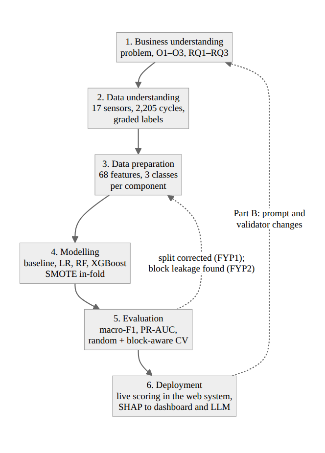

<div align="center">Figure 3.1: CRISP-DM phases as applied in this project</div>

## 3.2 DATASET AND DATA PREPARATION

### 3.2.1 Dataset Selection

Three alternatives were rejected in FYP1. The AI4I 2020 and NASA C-MAPSS datasets are simulated rather than measured. The CWRU and IMS bearing datasets contain vibration only, which does not suit a multi-sensor system. The UCI Condition Monitoring of Hydraulic Systems dataset [15], [17] was selected because it is physically measured, multi-sensor, multi-component and labelled with graded conditions rather than a binary failure flag. It contains 2,205 load cycles of 60 seconds each, has no missing values and is published under a CC BY 4.0 licence. Table 3.1 lists its sensor channels.

<div align="center">Table 3.1: Sensor channels</div>

| Sensor | Quantity | Unit | Sampling rate |
|---|---|---|---|
| PS1–PS6 | Pressure | bar | 100 Hz |
| EPS1 | Motor power | W | 100 Hz |
| FS1–FS2 | Volume flow | l/min | 10 Hz |
| TS1–TS4 | Temperature | °C | 1 Hz |
| VS1 | Vibration | mm/s | 1 Hz |
| CE, CP, SE | Cooling efficiency, cooling power, efficiency factor (virtual) | %, kW, % | 1 Hz |

### 3.2.2 Feature Extraction and Labels

Each sensor records a time series per cycle. For each of the 17 sensors and each cycle, four statistics were computed (mean, standard deviation, minimum and maximum), giving a matrix of 2,205 rows by 68 features. In FYP1 these four were chosen from a pool of seven (with range, skewness and kurtosis) as the best balance of information and complexity. The graded condition values were grouped into three ordinal classes per component, Optimal, Degraded and Critical, as shown in Table 3.2. The class counts match the FYP1 interim report exactly and are asserted by the code on every run.

<div align="center">Table 3.2: Target labels and class counts</div>

| Component | Optimal | Degraded | Critical |
|---|---|---|---|
| Cooler (efficiency, %) | 100 (741) | 20 (732) | 3 (732) |
| Valve (switching, %) | 100 (1,125) | 90 (360) | 80, 73 (720) |
| Pump (internal leakage) | 0 (1,221) | 1 (492) | 2 (492) |
| Accumulator (pressure, bar) | 130 (599) | 115 (399) | 100, 90 (1,207) |

The cooler and pump are close to balanced. The valve's Degraded class is under-represented, and the accumulator is the most imbalanced target, with Critical making up 55 % of the cycles.

### 3.2.3 Block Structure of the Data

Figure 3.2 plots the four conditions in recorded order. The rig was held at each combination of conditions for a run of consecutive cycles before the next combination was set. Grouping consecutive cycles with identical conditions gives 194 condition blocks, with a mean length of 11.4 cycles (minimum 1, maximum 210). This structure is what makes neighbouring cycles near-duplicates and random cross-validation optimistic (Section 2.3). It is also what makes the replay realistic: conditions persist for a while, then change.

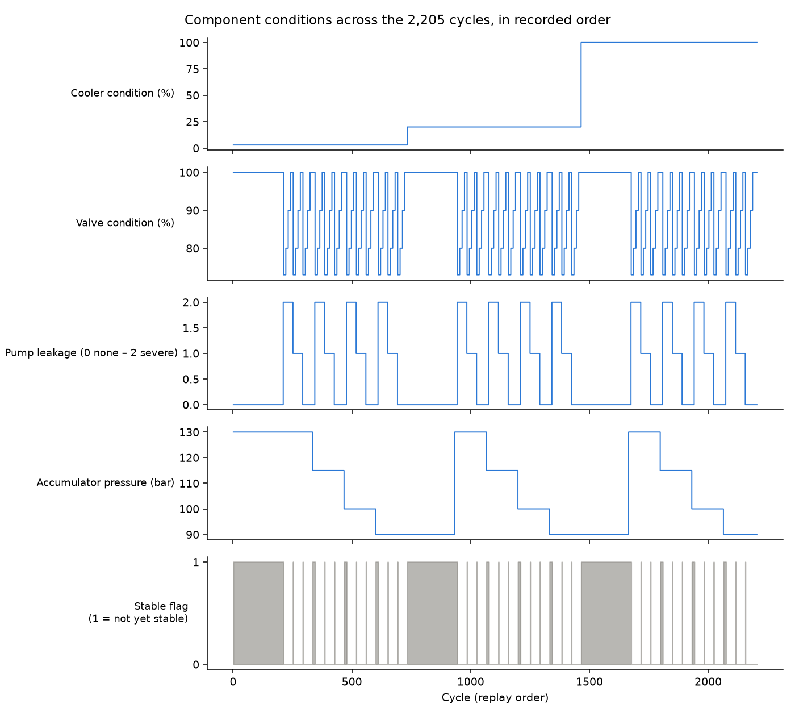

<div align="center">Figure 3.2: Component conditions across the 2,205 cycles, in recorded order</div>

## 3.3 MODELLING AND VALIDATION

### 3.3.1 Model Ladder

Four models were trained per component:

1. **Rule-based baseline:** a decision stump (a tree of depth 1), representing a single-threshold rule.
2. **Logistic regression (LR):** a linear reference.
3. **Random Forest (RF)** [24] with 300 trees.
4. **XGBoost (XGB)** [25] with 300 trees, depth 6 and learning rate 0.1.

Each model, except the baseline, was a pipeline of standardisation, SMOTE [27] and the classifier. Because SMOTE is part of the pipeline, it is fitted only on each training fold and never sees the test fold. The baseline was not resampled, because a fixed threshold rule is not trained on resampled data. A fixed random seed made every run reproducible.

### 3.3.2 Metrics and Statistical Tests

The primary metric was the macro-averaged F1 score, which weights each class equally and is therefore not dominated by the majority class:

$$\text{F1}_c = \frac{2 \, P_c \, R_c}{P_c + R_c}, \qquad \text{macro-F1} = \frac{1}{3}\sum_{c \in \{O, D, C\}} \text{F1}_c \tag{3.1}$$

where $P_c$ and $R_c$ are the precision and recall of class $c$. The macro-averaged area under the precision–recall curve (PR-AUC), computed one-versus-rest, was reported alongside. The best model per component was compared with the baseline using a paired t-test on per-fold macro-F1 and the effect size Cohen's $d$:

$$d = \frac{\bar{\Delta}}{s_{\Delta}} \tag{3.2}$$

where $\bar{\Delta}$ and $s_{\Delta}$ are the mean and standard deviation of the per-fold differences. Because folds share training data, this test is known to be optimistic [57], so p-values are reported only as supporting evidence. Confusion matrices were produced on a held-out, stratified 20 % split (441 cycles).

### 3.3.3 Random and Block-Aware Cross-Validation

Two validation schemes were run with the same models, folds and metrics:

- **Random folds** (as in FYP1): repeated stratified 5-fold cross-validation, three repeats, 15 folds in total.
- **Block-aware folds** (added in FYP2): stratified group 5-fold cross-validation over the 194 condition blocks, repeated three times with the blocks reshuffled, 15 folds in total. No block appears in both the training and the test fold, so a model cannot be scored on cycles whose near-identical neighbours it was trained on.

The comparison between the two schemes is a result in itself (Section 4.2.4). An automated test confirms that no block is ever split across a training and a test fold.

### 3.3.4 Explanation

After evaluation, the best model per component was refitted on all the data and explained with TreeSHAP [31]. Global importance is reported as the mean absolute SHAP value per feature. During live scoring, the three features with the largest SHAP contribution towards the predicted class are stored with each prediction and shown on the dashboard. Each prediction also records a failure probability, defined as

$$p_{\text{fail}} = P(\text{Degraded}) + P(\text{Critical}) = 1 - P(\text{Optimal}) \tag{3.3}$$

and a confidence band from the top class probability (High at 0.9 or above, Medium at 0.7 or above, otherwise Low).

## 3.4 SYSTEM ARCHITECTURE

The FYP1 hub-and-spoke principle was kept: one shared data layer is the hub, and every other part reads from or writes to it. Figure 3.3 shows the implemented architecture.

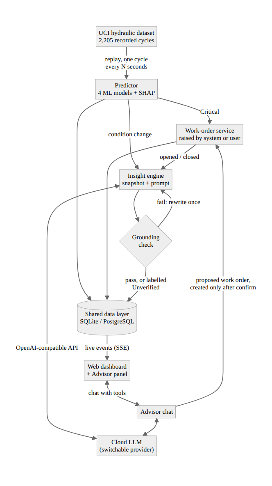

<div align="center">Figure 3.3: Closed Loop system architecture</div>

The system has five layers:

1. **Ingestion and replay.** The dataset is loaded once. The replay writes one cycle at a time to the data layer at a configurable speed (for example, one cycle every two seconds). It can be played, paused, stepped, sped up or moved to any cycle; moving back deletes later readings and their predictions, so the timeline stays consistent.
2. **Intelligence.** The predictor scores every new cycle with the four component models, computes the SHAP drivers and writes one prediction per component.
3. **Analytics.** The web dashboard shows the rig overview, a page per component, the work-order queue and the sensor channels. It is updated live through server-sent events (SSE).
4. **Insight and conversation.** The insight engine explains changes as they happen. The Advisor chat answers questions and can propose a work order. Both use the same snapshot and the same grounding check (Section 3.6).
5. **Automation.** The monitor opens a work order when a component is predicted Critical, linked to the prediction that triggered it. Users can raise and close work orders by hand. A technician closing a work order records what was found, the action taken and whether it matched the prediction.

The AI sees only what the operator sees. The snapshot is built from the same queries as the dashboard and never includes the dataset's true labels, which are stored only for evaluation.

## 3.5 DATA LAYER

The shared data layer runs on SQLite on a single machine and on PostgreSQL when deployed. Schema changes are numbered migration files applied automatically. Table 3.3 lists the main tables; account, session and key tables are omitted.

<div align="center">Table 3.3: Main data tables of the shared data layer</div>

| Table | One row per | Written by |
|---|---|---|
| tbl_Equipment | Component (four seeded rows) | Database set-up |
| tbl_SensorReading | Replayed cycle: 68 features and 17 sensor means | Replay |
| tbl_Prediction | Component per cycle: condition, class probabilities, failure probability, confidence, SHAP top three, true condition (evaluation only) | Predictor |
| tbl_WorkOrder | Work order: component, who raised it (system:monitor or user), the triggering prediction, status | Work-order service |
| tbl_WorkOrderOutcome | Closed work order: finding, action, whether it matched the prediction | Work-order service |
| tbl_Insight | AI text: trigger, model, prompt version, exact snapshot, grounding result, attempts, latency | Insight engine, chat |
| tbl_StudyLog | User-study task: participant, condition, task, duration, answer, correctness | Study mode |

The audit trail from FYP1 is preserved: every work order records whether the system or a person created it and which prediction caused it, and every insight stores the exact snapshot it was generated from, so any statement can be re-checked later.

## 3.6 THE AI LAYER

### 3.6.1 Triggers

The insight engine generates an insight when one of the events in Table 3.4 occurs. Triggers arriving while an insight is being generated, or during a short cooldown after it (10 seconds by default), are merged into the next insight. This keeps the number of model calls low and keeps the model available for chat.

<div align="center">Table 3.4: Insight triggers</div>

| Trigger | Example |
|---|---|
| Condition change | Valve: Optimal → Critical at cycle 1,077 |
| Risk threshold crossed | Failure probability crosses 50 % in either direction |
| Work order opened or closed | WO-0002 opened for the pump |
| Summary on request | The user presses "Summarise now" |

### 3.6.2 The Snapshot and Prompt

The model never receives raw sensor files. It receives a compact JSON snapshot of what the dashboard shows: the cycle number, each component's condition, failure probability and change since the previous cycle, the SHAP top drivers with their sensor values and units, the open work orders, and one line describing each triggering event. The system prompt (Appendix C) asks for two to four plain sentences that name the component and the change, give the failure probability and top driver with its value, and suggest one maintenance action. It instructs the model to use only numbers from the snapshot. Each prompt has a version identifier that is stored with every output, so prompt changes can be distinguished in the evaluation.

### 3.6.3 The Grounding Check

After generation, a deterministic validator extracts every claim from the text and checks it against the snapshot:

- **Numbers** must equal a number in the snapshot to the precision the text writes. A number $x$ written with $k$ decimal places matches a snapshot value $v$ if

$$|x - v| \le 0.5 \times 10^{-k} \tag{3.4}$$

  so "97 %" matches 96.8 but "97.5 %" does not.
- **Work-order identifiers** (WO-…) must appear in the snapshot.
- **Conditions:** a sentence that names exactly one component may call it only a condition it is in, changed from, or that a tool reported for it.

List numbering, sensor codes such as PS2 and small bare counts (10 or less) are ignored. If any claim fails, the model is sent the list of unsupported values and asked once to rewrite the insight. If the rewrite also fails, the insight is shown with an Unverified label instead of being hidden, following the guidance that users should be shown how reliable a system's output is [49]. The check does not verify that a number belongs to the component its sentence names, or that the reasoning connecting the values is sound; Section 4.4 discusses examples.

### 3.6.4 Advisor Chat and Tools

The Advisor answers questions using the same snapshot. When the model supports tool calls [34], it can call three tools: current status of a component, its history, and a proposal to create a work order. A proposal appears as a confirmation card, and nothing is created until the user confirms. Confirmed work orders record the user as their creator. This completes the dual invocation path designed in FYP1, with the system creating work orders by rule and a person creating them through the Advisor. Chat answers are grounding-checked like insights, against the snapshot plus the tool results.

### 3.6.5 Cloud Model Access

All providers (OpenAI, Anthropic, Gemini, Groq, OpenRouter, DeepSeek and Ollama Cloud) are reached through the OpenAI-compatible chat-completions interface, so one client serves all of them, and the model is chosen by configuration. Each user saves their own API key, which is stored encrypted, and chooses their own model. The live insights use the key and model of the user driving the replay. The AI model page states that the current readings are sent to the provider with every request.

## 3.7 TOOLS AND PLATFORM

Table 3.5 lists the tools used and their roles.

<div align="center">Table 3.5: Tools and platform</div>

| Tool | Role |
|---|---|
| Python, scikit-learn, imbalanced-learn, XGBoost, SHAP | Feature extraction, model training and evaluation, explanation |
| FastAPI | Backend API, replay, predictor, monitor, insight engine, SSE stream |
| SQLite / PostgreSQL (Supabase) | Shared data layer (local / deployed) |
| React, TypeScript, Vite, Tailwind CSS, TanStack Router | Web dashboard |
| OpenAI-compatible APIs | Cloud language models from any listed provider |
| pytest, GitHub Actions | Automated tests on every change |
| Render, Vercel | Deployment of the backend and frontend |
| Playwright | Browser automation used for the screenshots in Chapter 4 |

A self-built stack removed the licensing and tenant dependencies of the FYP1 platform, made every layer inspectable and measurable (which Part B requires), and allowed the language model to be changed by configuration.

## 3.8 EVALUATION PLAN

Table 3.6 summarises the four evaluation parts.

<div align="center">Table 3.6: Evaluation plan</div>

| Part | Question | Data | Measures | Analysis |
|---|---|---|---|---|
| A. Predictive performance | Do the models beat the baseline, and do they generalise beyond the condition blocks? (O1) | 2,205 cycles | Macro-F1, macro PR-AUC, confusion matrices, SHAP | Random and block-aware 15-fold CV; paired t-test, Cohen's d |
| B. AI insight quality | How faithful, complete, fast and useful are the insights; what does the check add; how small can the model be? (RQ2, RQ3) | 50 frozen scenarios, each run with the check on and off, 3 repeats per model | Grounding accuracy, hallucination rate, coverage, latency, usefulness (two raters) | Per model and setting; weighted Cohen's kappa |
| C. User study | Do grounded insights improve task performance and reduce workload? (RQ1) | Protocol: about 20 participants, within-subjects. FYP2: 160 synthetic attempts (20 synthetic profiles × 8 tasks) to validate the analysis | Task accuracy, effort (steps), completion time, SUS, NASA-TLX | Exact McNemar on paired attempts; Wilcoxon signed-rank with effect size r; Cohen's kappa between two scorers |
| D. System performance | Is the live loop fast and stable? (O2) | Full 2,205-cycle replay | Scoring latency, memory over time, insight latency | Median, 90th percentile, trend |

### 3.8.1 Part B: AI Insight Quality

The scenario set was built by replaying all 2,205 cycles through the system's own code and saving, at chosen moments, exactly the snapshot the insight engine would have sent. There are 50 scenarios, ten in each of five categories: a component turning Degraded, turning Critical, recovering to Optimal, a steady state with a persisting fault, and an all-clear state. The set was frozen before the first official run. The expected answer for each scenario is what the dashboard showed (the predicted condition), never the true label, because the question is whether the AI reports the dashboard faithfully.

Each scenario was run with the grounding check on and off; with the check off, the final text is still checked afterwards, so it still receives a score. The metrics are:

- **Grounding accuracy:** matched claims divided by checked claims, per insight.
- **Hallucination rate:** the share of insights with at least one unsupported claim.
- **First-attempt hallucination rate:** the same for the first attempt; with the check on, this equals the rewrite rate.
- **Coverage:** whether the insight names the expected component and condition.
- **Latency:** time to first token and total time, including a rewrite.
- **Usefulness:** a blind sample of about 60 insights rated from 1 to 5 by two raters on a fixed rubric (Appendix D), with agreement measured by quadratic-weighted Cohen's kappa [55].

For RQ2, at least one small model (for example, Llama 3.1 8B) and one large model (for example, Llama 3.3 70B) from the same provider are run on the same scenarios and prompts, alongside the gpt-oss-120b run reported in Chapter 4. Runs are sequential, because parallel calls would distort the latency measurements, and each model receives one discarded warm-up call.

### 3.8.2 Part C: User Study

The study uses a within-subjects design with two conditions: the dashboard only (the Advisor panel is not rendered and insights are off) and the dashboard with AI (insights and chat, with the panel pinned open). Each participant completes two parallel task sets, A and B, of four tasks each, one set per condition. The tasks range from simple lookup ("Which components are in Critical condition right now?") through history to diagnosis ("The cooler's condition changed. Why, and what should the maintenance team check?"), mirroring the complexity levels of Figliè et al. [14]. The order of conditions and task sets is counterbalanced across participants in four rotating orders. Each task resets the replay to a fixed starting cycle and steps it to a fixed end cycle, so every participant sees the same history. The researcher console (Figure 4.9) starts and stops the timer and records the answer and its correctness. After each condition, participants complete the SUS and the raw NASA-TLX. Appendix B lists the tasks and reference answers. Ethics approval is required before recruitment.

**Scoring.** Answers are scored against the reference answers on a fixed rubric. Lookup tasks (1 and 2) are scored 1 or 0: every component or value must be right, and a probability may differ by one percentage point. The history task (3) is scored 1 only if the work-order identifier, the component and the reason are all right. The diagnosis task (4) is scored 0–2 (2 = correct change, correct driver and a sensible check; 1 = partly right; 0 = wrong) and counts as correct only at 2. An empty answer or a task abandoned at the step limit scores 0. The scoring sheet is shuffled and contains neither the participant nor the condition, so that two scorers can score blind. Their agreement on correct versus incorrect is reported as Cohen's kappa [54] and interpreted with McHugh's thresholds [56]. Disagreements are resolved by discussion.

**Analysis.** Each participant attempts task k (1–4) once in each condition, as A_k in one and B_k in the other, so the outcomes form paired attempts. Accuracy is compared with an exact McNemar test on these pairs. Effort (interaction steps) is compared with a Wilcoxon signed-rank test on the mean per participant, with effect size r. SUS and NASA-TLX are compared with a Wilcoxon signed-rank test. All of this is implemented in `eval/analyse_study.py`, which produces the tables of Section 4.5 directly from the exported log.

**Validation of the pipeline on synthetic data.** The study could not be run with participants within the FYP2 timeline. So that the analysis is not used for the first time on real data, the whole pipeline (log format, blind scoring sheet, two-scorer agreement, the paired tests and the report) was run on a synthetic data set generated by `eval/synthetic_study.py`. The generator creates 20 synthetic profiles. Each completes Set A in one condition and Set B in the other, in alternating order, giving 160 task attempts. For each attempt, an answer is drawn at random from a hand-written bank of good, partly right, wrong and unsure answers to that task. The same bank and the same weights are used in both conditions, so **the true difference between the conditions is zero by construction**. Step counts, Advisor messages, times and a 7 % chance of giving up are also drawn at random. Two synthetic scorer files are generated, the second copying the first in about 80 % of items and otherwise applying a stricter rule. The synthetic data contain no responses from any person or agent. They test whether the pipeline runs correctly and whether it wrongly reports an effect where none exists; they say nothing about RQ1. The data set is stored with the project (`docs/dissertation/data/`) and can be regenerated from a fixed seed (20261111).

### 3.8.3 Part D: System Performance

A full replay of 2,205 cycles is run against the deployed configuration while a client listens to the live stream like a browser. For each cycle, the client records the time from the cycle event to that cycle's prediction event, the backend's memory every 100 cycles and, with insights on, each insight's latency.

## 3.9 PROJECT MILESTONES

Table 3.7 lists the technical milestones used to track FYP2.

<div align="center">Table 3.7: Project milestones</div>

| Milestone | Content | Status |
|---|---|---|
| M1 | ML pipeline rebuilt from FYP1; results reproduced | Complete |
| M2 | Shared data layer and query module | Complete |
| M3 | Replay and live stream | Complete |
| M4 | Live prediction with SHAP | Complete |
| M5 | Dashboard | Complete |
| M6 | Work-order automation | Complete |
| M7 | Live insights | Complete |
| M8 | Grounding check | Complete |
| M9 | Advisor chat with tools | Complete |
| M10 | Evaluation harness (Parts B and D) | Built; runs in progress |
| M11 | Study mode (Part C) | Built; analysis validated on synthetic data; study with participants to run |
| M12 | Hardening, accounts, deployment | Complete [TO FILL: confirm] |

\newpage

# CHAPTER 4: RESULTS AND DISCUSSION

This chapter presents the results of the four evaluation parts defined in Section 3.8 and discusses them against the objectives and the literature. Part A (Section 4.2) is complete. The system itself (Section 4.3) is built and deployed. Part B (Section 4.4) has a complete run for one large model and is awaiting the small-model run. For Part C (Section 4.5), the user study is built into the system, and its analysis pipeline has been validated on synthetic data. The study has not been run with participants, so Section 4.5 reports a check of the method, not results for RQ1. Part D (Section 4.6) has its procedure ready, and its table is marked [TO FILL].

## 4.1 DATA PREPARATION RESULTS

Running the extraction pipeline on all 2,205 cycles and 17 sensors produced a feature matrix of exactly 2,205 rows by 68 columns, with no missing values. The class counts in Table 3.2 match the FYP1 interim report exactly, and this is checked automatically every time the models are evaluated or trained. The replay of all 2,205 cycles through the live pipeline completed with every cycle scored for all four components and no wiring errors.

## 4.2 PART A: PREDICTIVE PERFORMANCE

### 4.2.1 Random-Fold Cross-Validation

Table 4.1 shows the macro-F1 and macro PR-AUC of each model under repeated stratified 5-fold cross-validation (15 folds), the protocol used in FYP1.

<div align="center">Table 4.1: Part A: cross-validated macro-F1 and macro PR-AUC (random folds, mean ± SD over 15 folds)</div>

| Component | Baseline | Logistic Regression | Random Forest | XGBoost | Best | p (best vs baseline) | Cohen's d |
|---|---|---|---|---|---|---|---|
| Cooler | 0.555 ± 0.001 / 0.666 | 0.999 ± 0.002 / 0.996 | 0.999 ± 0.002 / 1.000 | **0.999** ± 0.002 / 1.000 | XGB | 9.5 × 10⁻³⁹ | 449.0 |
| Valve | 0.460 ± 0.013 / 0.459 | 0.916 ± 0.015 / 0.954 | **0.984** ± 0.006 / 0.997 | 0.980 ± 0.007 / 0.997 | RF | 8.1 × 10⁻²⁴ | 38.5 |
| Pump | 0.550 ± 0.003 / 0.654 | 0.993 ± 0.005 / 0.994 | **0.995** ± 0.003 / 1.000 | 0.994 ± 0.004 / 1.000 | RF | 9.3 × 10⁻³⁰ | 102.4 |
| Accumulator | 0.419 ± 0.011 / 0.439 | 0.900 ± 0.016 / 0.948 | 0.989 ± 0.004 / 0.999 | **0.990** ± 0.007 / 1.000 | XGB | 3.6 × 10⁻²⁴ | 40.8 |

Every model beat the rule-based baseline by a wide margin. The tree ensembles reached a macro-F1 of 0.984–0.999, and the baseline reached 0.419–0.555. The results reproduce FYP1 Table 4.2 to within ±0.005 macro-F1, with the baseline row reproduced exactly, which confirms that the pipeline was rebuilt correctly in the project repository. The very large effect sizes mostly reflect how weak the baseline is: a single threshold can separate only two of the three classes, so it can never recognise the third. The p-values come from a paired t-test on overlapping folds, which is optimistic [57], but the gap is far too large for this to change the conclusion.

Table 4.2 summarises the confusion matrices of the best model and the baseline on the held-out 20 % split (441 cycles). The full matrices are in Appendix E.

<div align="center">Table 4.2: Held-out confusion matrices, best model per component (recall per class, n = 441)</div>

| Component | Model | Recall Optimal | Recall Degraded | Recall Critical | Errors |
|---|---|---:|---:|---:|---:|
| Cooler | Baseline | 100 % | 100 % | 0 % | 146 |
| Cooler | XGBoost | 100 % | 100 % | 100 % | 0 |
| Valve | Baseline | 75 % | 0 % | 82 % | 155 |
| Valve | Random Forest | 99 % | 97 % | 100 % | 5 |
| Pump | Baseline | 99 % | 0 % | 100 % | 102 |
| Pump | Random Forest | 100 % | 99 % | 100 % | 2 |
| Accumulator | Baseline | 36 % | 0 % | 99 % | 160 |
| Accumulator | XGBoost | 99 % | 98 % | 98 % | 7 |

The baseline's failure pattern is informative. For every component it collapses one class into another and leaves the Degraded class unrecognised in three of the four components. Degraded is exactly the early-warning state that predictive maintenance exists to catch, so a single-threshold rule cannot meet Objective O1, while every learned model can.

### 4.2.2 Explanation with SHAP

Figure 4.1 shows the global SHAP importance for the valve model, and Figure 4.2 shows the other three components.

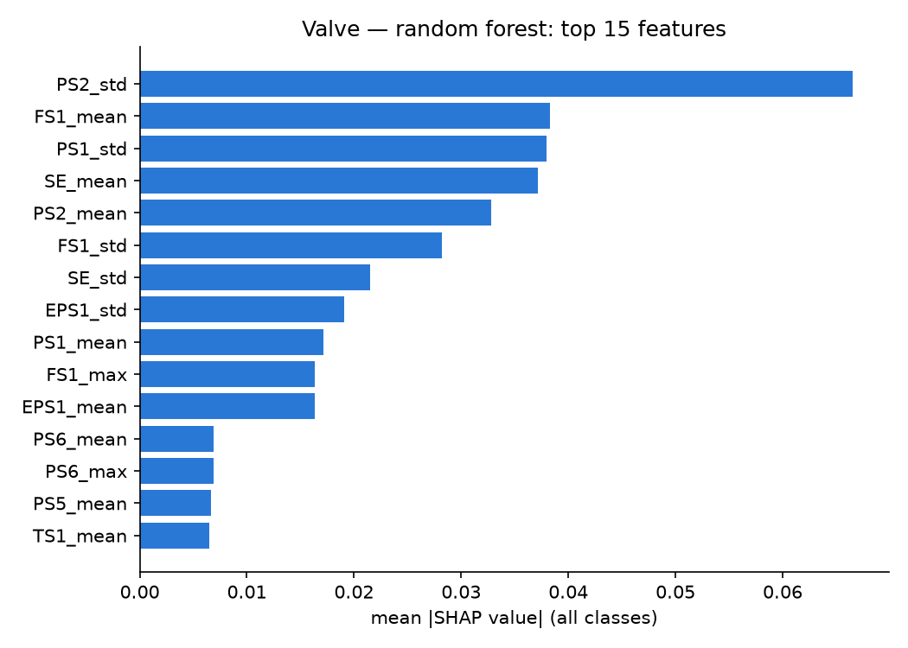

<div align="center">Figure 4.1: Mean absolute SHAP values, valve model (Random Forest)</div>

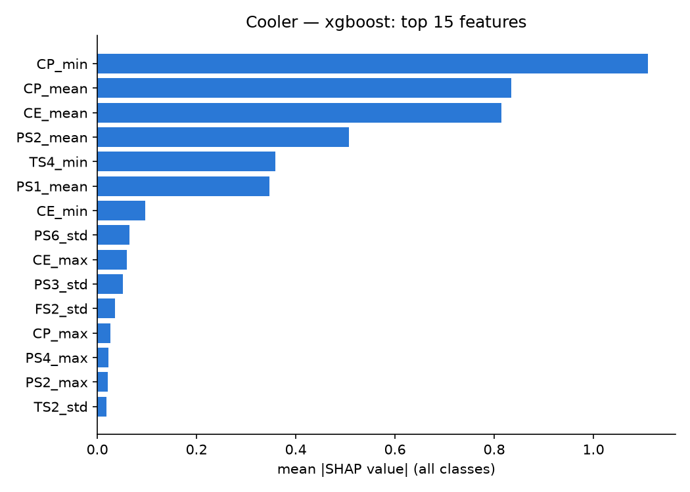
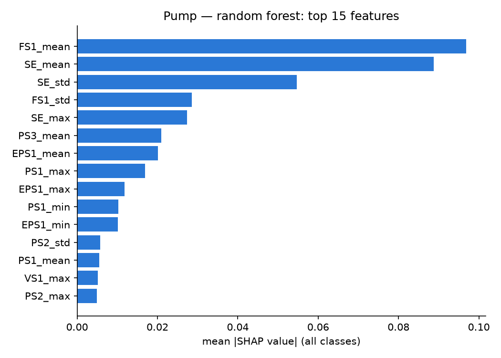
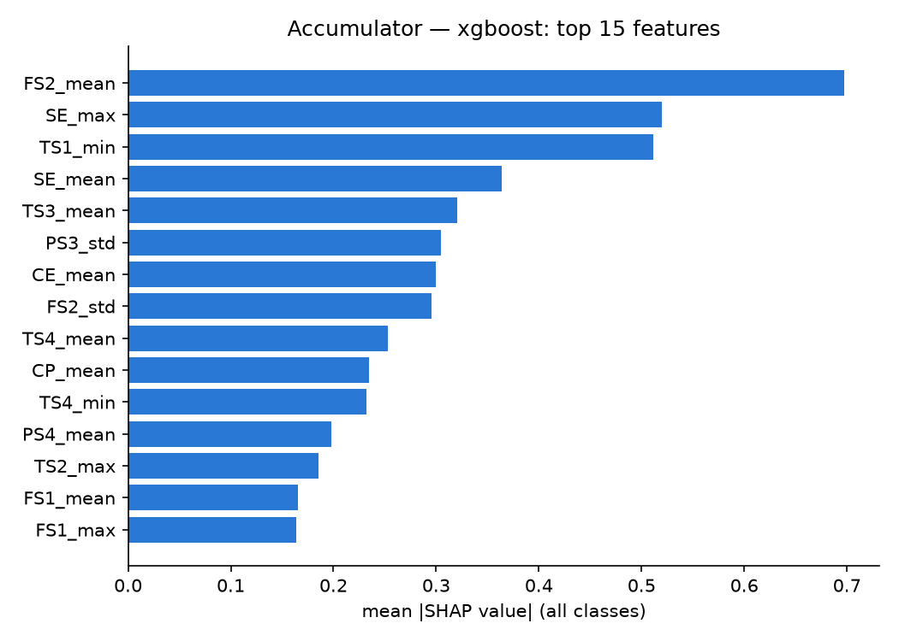

<div align="center">Figure 4.2: Mean absolute SHAP values, cooler (XGBoost), pump (Random Forest) and accumulator (XGBoost) models</div>

The strongest drivers are physically sensible for three of the four components:

- **Cooler:** cooling power (CP_min, CP_mean) and cooling efficiency (CE_mean) are direct measurements of the cooler's performance.
- **Valve:** the variability of pressure at PS2 and PS1 (PS2_std, PS1_std) reflects the valve's switching behaviour, and the mean flow at FS1 reflects how much flow it passes.
- **Pump:** the mean flow at FS1 and the efficiency factor (SE_mean, SE_std) fall as internal leakage increases, because the pump delivers less flow for the same input.
- **Accumulator:** the top drivers (FS2_mean, SE_max, TS1_min) are indirect. A loss of accumulator pre-charge pressure has no dedicated sensor; it affects flow, efficiency and temperature only through its damping effect on the circuit.

This difference foreshadows the next result. The components whose top drivers are direct physical measurements generalise beyond the recorded condition blocks, and the component with only indirect drivers does not.

### 4.2.3 Block-Aware Cross-Validation

Table 4.3 repeats the evaluation with the block-aware folds described in Section 3.3.3, and Figure 4.3 compares the best model per component under the two schemes.

<div align="center">Table 4.3: Part A with block-aware cross-validation (macro-F1 / macro PR-AUC, mean ± SD over 15 folds)</div>

| Component | Baseline | Logistic Regression | Random Forest | XGBoost | Best | p (best vs baseline) | Cohen's d |
|---|---|---|---|---|---|---|---|
| Cooler | 0.533 ± 0.019 / 0.660 | 0.986 ± 0.016 / 0.994 | 0.956 ± 0.082 / 1.000 | **0.996** ± 0.004 / 1.000 | XGB | 2.9 × 10⁻²² | 29.8 |
| Valve | 0.367 ± 0.124 / 0.412 | 0.743 ± 0.124 / 0.795 | 0.625 ± 0.081 / 0.683 | **0.768** ± 0.057 / 0.823 | XGB | 6.1 × 10⁻⁹ | 3.2 |
| Pump | 0.542 ± 0.020 / 0.644 | 0.974 ± 0.020 / 0.969 | **0.986** ± 0.012 / 0.999 | 0.976 ± 0.016 / 0.998 | RF | 7.7 × 10⁻²⁰ | 20.0 |
| Accumulator | 0.266 ± 0.048 / 0.349 | 0.812 ± 0.048 / 0.869 | 0.828 ± 0.156 / 0.885 | **0.830** ± 0.156 / 0.881 | XGB | 5.8 × 10⁻⁹ | 3.2 |

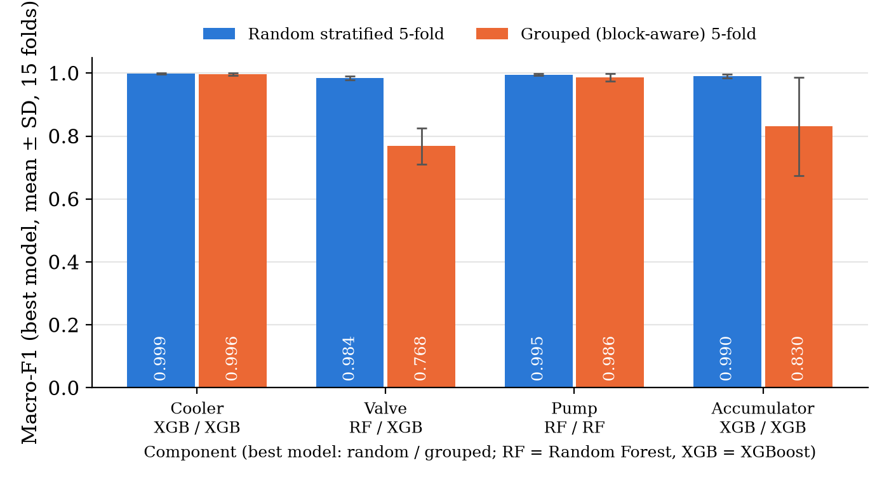

<div align="center">Figure 4.3: Best macro-F1 per component, random versus block-aware cross-validation</div>

The two schemes agree for the cooler (0.999 and 0.996) and the pump (0.995 and 0.986). They disagree sharply for the valve (0.984 and 0.768) and the accumulator (0.990 and 0.830). The models still beat the baseline significantly under block-aware validation, so Objective O1 is met under both schemes, but the size of the advantage is much smaller for those two components.

### 4.2.4 Discussion of Part A

The block-aware results change how the Part A numbers should be interpreted. With random folds, almost every test cycle has near-identical neighbours from the same condition block in the training set, so a model can score well by recognising which block a cycle belongs to rather than by recognising the fault. Block-aware folds remove that shortcut and ask a harder, more realistic question: can the model classify a combination of conditions it has not seen during training? In deployment, that is the question that matters.

Three findings follow.

1. **Generalisation follows physics.** The cooler and pump faults change a directly measured quantity (cooling power, delivered flow), and their models generalise. The valve and accumulator faults appear only as subtler patterns in pressure variability and damping, and their models partly learned the operating point instead. This agrees with the SHAP analysis in Section 4.2.2.
2. **Random Forest overfits the blocks most.** On the valve, Random Forest fell from 0.984 to 0.625, below logistic regression (0.743). Fully grown trees memorise near-duplicate neighbours well, which is an advantage under random folds and a weakness otherwise. XGBoost, with depth-limited trees, held up better (0.768). The valve model deployed in the live system is the Random Forest selected under random folds, so the block-aware result recommends replacing it with XGBoost (Chapter 5).
3. **Accumulator performance depends heavily on the fold.** Its standard deviation across folds (±0.156) shows that some held-out condition blocks are classified well and others poorly, which is what would be expected when certain combinations of conditions are absent from training.

Table 4.4 places these results beside the literature.

<div align="center">Table 4.4: This project compared with published results</div>

| Study | Validation | Metric | Cooler | Valve | Pump | Accumulator |
|---|---|---|---:|---:|---:|---:|
| Tao et al. [19] (MS-CNN) | 5-fold, random | Accuracy | 1.000 | 1.000 | 0.999 | 1.000 |
| Song et al. [20] (RFRFE + XGB) | Single split | Macro-F1 | 1.000 | 0.932 | 0.982 | 0.967 |
| Enejor et al. [21] (RF) | 4-fold, random | Accuracy | 0.999 | 0.991 | 0.996 | 0.991 |
| **This project** (best model) | 5-fold × 3, random | Macro-F1 | 0.999 | 0.984 | 0.995 | 0.990 |
| Enejor et al. [21] (RF) | 4-fold, block-aware | Accuracy | 0.954 | 0.869 | 0.996 | 0.804 |
| **This project** (RF) | 5-fold × 3, block-aware | Macro-F1 | 0.956 | 0.625 | 0.986 | 0.828 |
| **This project** (best model) | 5-fold × 3, block-aware | Macro-F1 | 0.996 | 0.768 | 0.986 | 0.830 |

Under random folds, this project's results are in the same near-perfect range as the published work. The small differences between rows are within what different metrics, label groupings and splits would produce, so no row should be read as clearly better than another. Under block-aware folds, the Random Forest results agree closely with Enejor et al. for the cooler (0.956 against 0.954), pump (0.986 against 0.996) and accumulator (0.828 against 0.804). This independent agreement supports their finding. The valve gap is larger here (0.625 against 0.869), which is plausibly due to the metric: macro-F1 weights the small Degraded class equally, whereas accuracy is dominated by the majority Optimal class.

The deviation from most of the literature is therefore not in the models but in the validation. The near-perfect valve and accumulator results reported for this dataset, including this project's own FYP1 results, are best read as upper bounds that hold for conditions represented in training. This is consistent with the leakage literature [28], [29], and it is the most important methodological finding of Part A.

## 4.3 SYSTEM IMPLEMENTATION (O2)

The complete closed loop was implemented and deployed: replay, live scoring with SHAP, the dashboard, automatic and manual work orders, the insight engine with the grounding check, and the Advisor chat with tools and confirmation. Scoring one cycle (four models plus SHAP) took about 59 ms on a laptop CPU, far below the replay interval. The backend has 107 automated tests that run on every change, covering the replay, predictor, monitor, work orders, grounding check, insight engine, chat tools, study mode, authentication and database migrations. They run against both SQLite and PostgreSQL.

The screenshots in this section were captured from the running system with a scripted browser after the replay had been stepped from cycle 1,040 to 1,079, a period in which the valve and pump became Critical and the cooler and accumulator were Degraded.

Figure 4.4 shows the rig overview. The subtitle states the main finding in one sentence, the drawing places each component in the hydraulic loop with its condition and failure probability, and the activity feed lists recent condition changes. Below, one card per component shows the time in the current condition, the top SHAP driver with its value and any open work order, followed by the failure-probability trend. The overview answers the question "how bad is it right now?" without requiring the user to open any detail page.

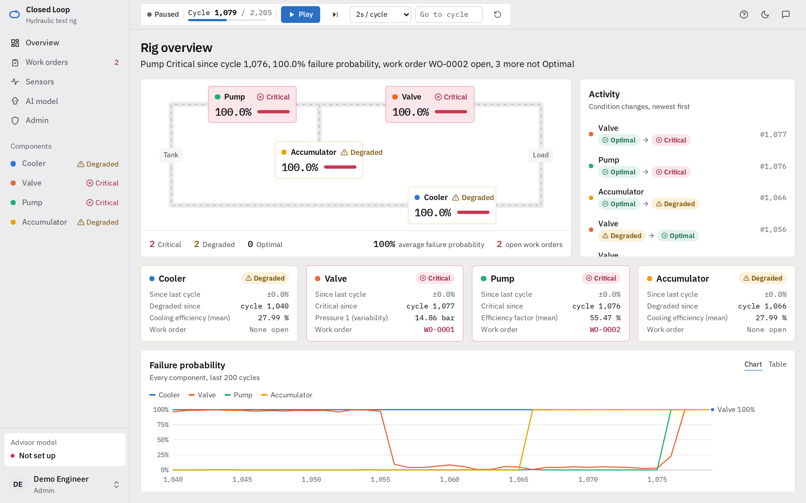

<div align="center">Figure 4.4: Rig overview page (cycle 1,079)</div>

Figure 4.5 shows a component page. It answers "why?": the current state and class probabilities, the top three SHAP drivers with their sensor values, the related sensors, the risk history and the condition changes.

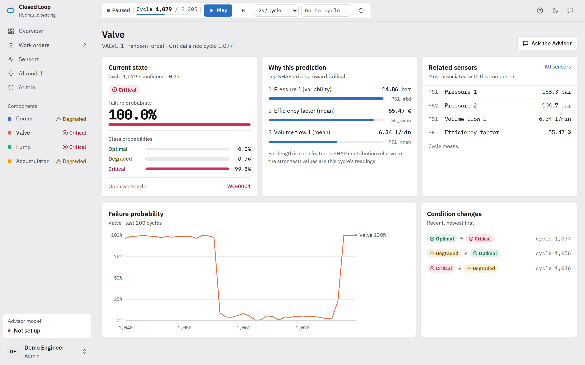

<div align="center">Figure 4.5: Component page (valve)</div>

Figure 4.6 shows the work-order queue. Both work orders were raised by the system (badge "System") at the cycle on which the component became Critical. Each note records the failure probability and the top driver that caused it, which preserves the audit trail designed in FYP1.

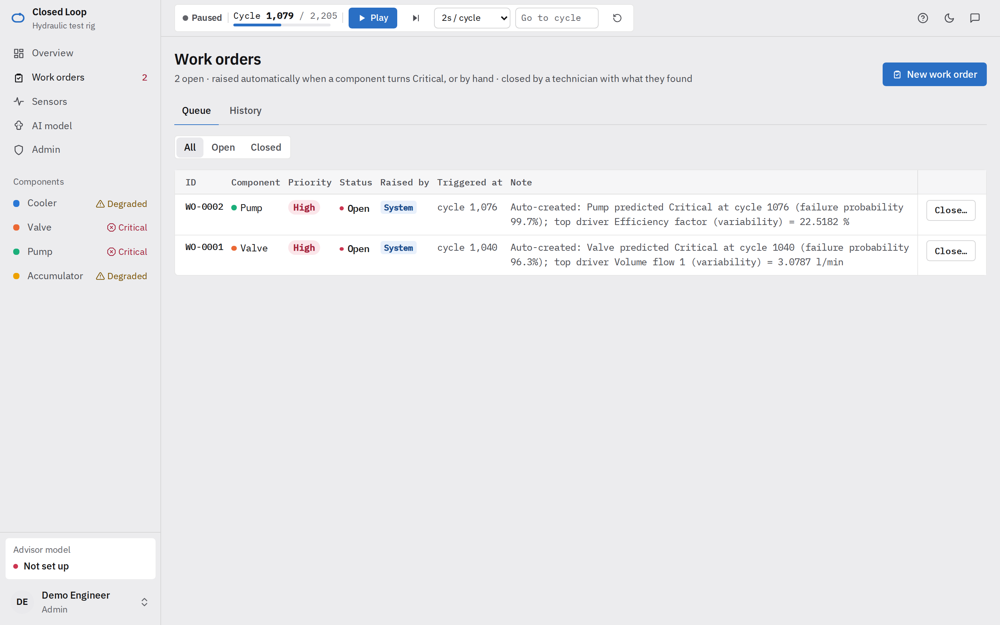

<div align="center">Figure 4.6: Work-order queue</div>

Figure 4.7 shows the AI model page, on which each user adds their own API key for any of the supported providers and chooses the model. The page states that each answer sends the current readings to the provider.

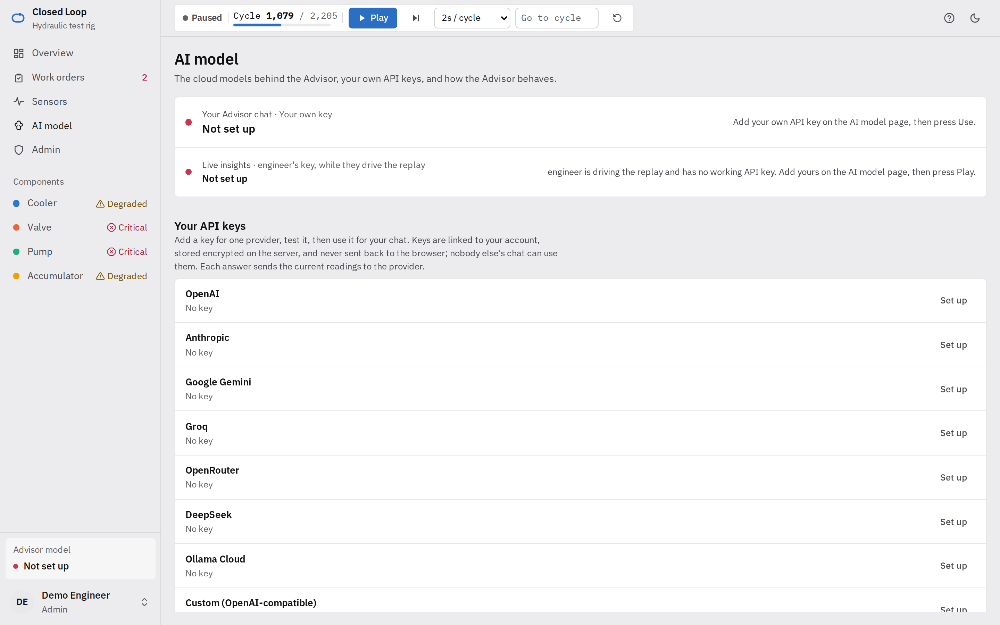

<div align="center">Figure 4.7: AI model page</div>

[TO FILL — Figure 4.8: screenshot of the Advisor panel with a configured model, showing (a) a live insight with its Verified badge, (b) an insight labelled Unverified, and (c) a chat answer that proposes a work order with its confirmation card. Capture it from the deployed system after adding an API key on the AI model page.]

<div align="center">Figure 4.8: Advisor panel with live insights, grounding badges and a work-order confirmation [TO FILL]</div>

Figure 4.9 shows the researcher console used for the user study (Part C). It computes each participant's counterbalanced order, starts each task at its preset cycle, times it and logs the answer.

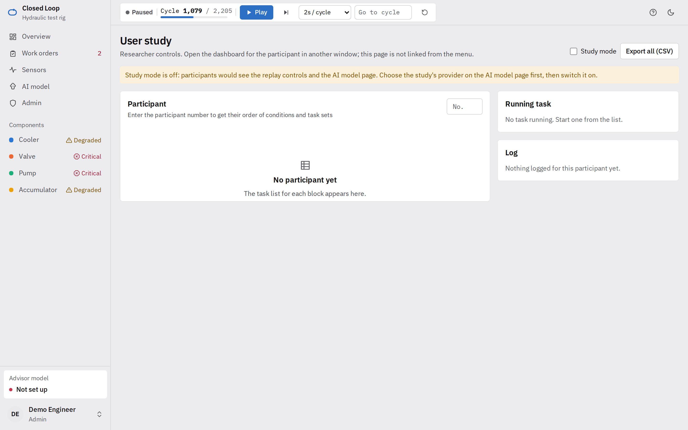

<div align="center">Figure 4.9: Researcher console for the user study</div>

## 4.4 PART B: AI INSIGHT QUALITY

### 4.4.1 A Defect Found in the Grounding Check

The first official run used gpt-oss-120b through Ollama Cloud on the 50 frozen scenarios. As first analysed, and as reported in the FYP2 progress report, it showed that 42.6 % of insights contained an unsupported value with the check off and 25.0 % with it on. While the results were being prepared for this chapter, the most frequent unsupported "claims" were found to be four-digit numbers such as 0044 and 0019. Every one of the 65 such claims was the digit part of a work-order identifier that was present in the snapshot. The model writes identifiers with a typographic non-breaking hyphen (Unicode U+2011, "WO‑0044") in 65 of its 137 texts. The check recognised only the ASCII hyphen, so it did not see an identifier and instead checked "0044" as a bare number, which it could not find.

The defect was fixed at its source: the check now reads every typographic hyphen and dash as an ASCII hyphen, and a regression test covers it. Because each run stores its final text and the exact snapshot, all 136 stored insights were re-scored with the corrected check without calling the model again. The corrected results are reported below. One limitation of the re-scoring applies. With the check on, the original run asked the model for a rewrite whenever the defective check failed, so 29 of the 68 insights in that setting were rewritten unnecessarily. Their final texts are scored correctly here, but the extra latency of those rewrites is included in the timings.

This episode is itself a result. A deterministic check is only as reliable as its parser, and an over-strict check is not harmless: in the live system, the defect would have labelled 17 of 68 correct insights (25 %) as Unverified, and Lee and See [47] show that such false alarms erode appropriate trust. The check therefore needs its own evaluation, which the storage of every snapshot made possible.

### 4.4.2 Results for the Large Model

Table 4.5 shows the corrected results. The run contains 136 insights: all 50 scenarios once in each setting, plus 18 scenarios a second time.

<div align="center">Table 4.5: Part B: insight quality per validator setting (gpt-oss-120b, corrected check)</div>

| Validator | Insights | Grounding accuracy | Hallucination rate | Coverage | First token (median / p90) | Total time (median / p90) |
|---|---:|---|---:|---:|---|---|
| Off | 68 | 99.8 % ± 1.7 | 1.5 % (1 of 68) | 98.5 % | 2.3 s / 3.8 s | 2.7 s / 4.3 s |
| On | 68 | 100.0 % ± 0.0 | 0.0 % | 98.5 % | 2.1 s / 3.5 s | 3.6 s / 5.5 s |
| As first reported (defective check) | 68 / 68 | 93.6 % / 96.2 % | 42.6 % / 25.0 % | 98.5 % | — | — |

<div align="center">Table 4.6: Part B: hallucination rate by scenario category (corrected check)</div>

| Category | Insights (off / on) | Hallucination off | Hallucination on | Coverage |
|---|---|---:|---:|---:|
| All clear | 20 / 20 | 0 % | 0 % | 100 % |
| Steady (fault persists) | 18 / 18 | 0 % | 0 % | 94.4 % |
| To Critical | 10 / 10 | 10 % | 0 % | 100 % |
| To Degraded | 10 / 10 | 0 % | 0 % | 100 % |
| To Optimal | 10 / 10 | 0 % | 0 % | 100 % |

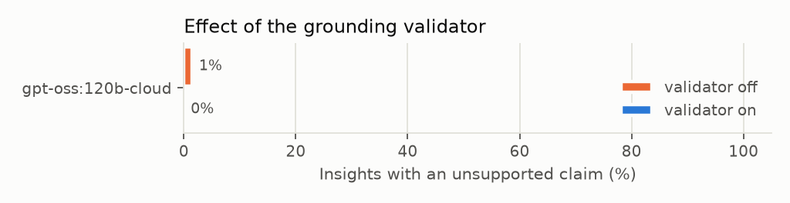

<div align="center">Figure 4.10: Effect of the grounding check on the hallucination rate (gpt-oss-120b, corrected check)</div>

With the snapshot supplied, the large model stated almost no unsupported values. Grounding accuracy was 99.8 % with the check off, and only one insight of 68 failed. That one is a false alarm rather than a hallucination: "the Pump degraded from Optimal to Critical" uses "degraded" as a verb, and the check read it as a claim that the pump is in the Degraded condition. The model also named the expected component and condition in 98.5 % of insights; the misses were in the steady category, where nothing changed. Median total latency was 2.7 s with the check off and 3.6 s with it on; the difference comes from the unnecessary rewrites caused by the defect.

### 4.4.3 Discussion of Part B

For RQ3, the evidence so far points to the snapshot rather than the validator as the main source of faithfulness. Supplying the model with exactly the values it should use, in a compact structured form, was enough for a large model to state them correctly in virtually every case. This agrees with the grounding literature [36], [37]: evidence in the input is the strongest control on unfaithful output. With a large model, the validator's contribution was not to correct errors but to verify their absence and make that visible.

Two observations qualify this.

1. **The check measures values, not meaning.** One insight in the run stated that "the Valve worsened from Critical to Degraded at cycle 1097". Every value in it is correct, so it passes the check, but the direction is wrong, because Critical to Degraded is an improvement. This is the kind of reasoning error that SelfCheckGPT- or Chain-of-Verification-style methods [38], [40] target and that a value check cannot detect. It is also why the dashboard's own badges, not the AI's sentence, remain the authoritative display of condition.
2. **The validator's value should appear with smaller models.** A large model that rarely errs leaves the check little to do. The research question it answers (RQ3) therefore depends on the small-model run of RQ2, in which errors are expected to be more frequent [43].

[TO FILL — Section 4.4.4 after the small-model run.] Table 4.7 is the template for RQ2. Run `eval/run.py` with one small and one large model from the same provider (for example, `groq/llama-3.1-8b-instant` and `groq/llama-3.3-70b-versatile`), then `eval/analyse.py` over all result files. Report the hallucination rate with the check off (the model's own faithfulness), with the check on (what users see), the rewrite rate and the latencies. Figure 4.11 (the trade-off chart produced by `analyse.py`) then shows each model as a point of hallucination rate against median latency.

<div align="center">Table 4.7: Part B: small versus large model comparison (RQ2) [TO FILL]</div>

| Model | Size | Hallucination (check off) | Hallucination (check on) | Rewrite rate | Coverage | Median total latency | Usefulness (mean, 1–5) |
|---|---|---:|---:|---:|---:|---:|---:|
| Small model [TO FILL] | [TO FILL] | | | | | | |
| Large model [TO FILL] | [TO FILL] | | | | | | |
| gpt-oss-120b | 120B | 1.5 % | 0.0 % | 42.6 %* | 98.5 % | 3.6 s | [TO FILL] |

\* Inflated by the defect described in Section 4.4.1; a re-run with the corrected check will give the true rewrite rate.

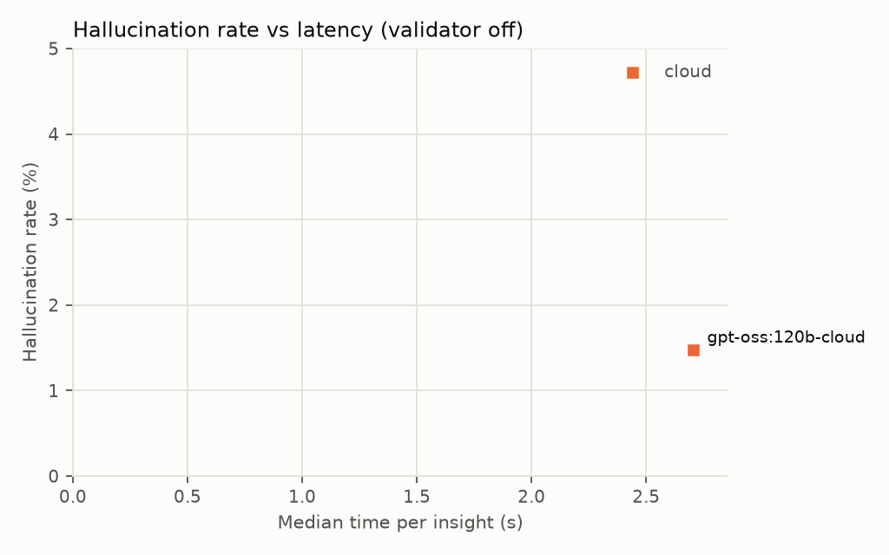

<div align="center">Figure 4.11: Hallucination rate against median latency per model [TO FILL: regenerate after the small-model run]</div>

[TO FILL — usefulness ratings: mean score per model from the two raters and the quadratic-weighted Cohen's kappa between them, interpreted with McHugh's thresholds [56].]

## 4.5 PART C: USER STUDY (RQ1)

The user study has not been run with participants, so **this section contains no results for RQ1**. It reports instead the validation of the study's analysis pipeline on the synthetic data set described in Section 3.8.2: 160 randomly generated task attempts from 20 synthetic profiles, in which the true difference between the conditions is zero by construction. Every number in Table 4.8 describes the output of a random generator, not the behaviour of people or of the system's users.

### 4.5.1 Pipeline Validation on Synthetic Data

The synthetic log was passed through the same steps a real study export would take. A shuffled scoring sheet was produced without the profile or the condition, the two scorer files were compared, and `eval/analyse_study.py` produced the report. Every step ran without error. Each of the 20 profiles had exactly four paired attempts (task k in each condition), which gave 80 pairs for the McNemar test, and the counterbalancing was balanced: 40 attempts in each combination of condition and task set. Table 4.8 shows the output.

<div align="center">Table 4.8: Part C: pipeline validation on synthetic data (not participant results)</div>

| Measure (synthetic) | Dashboard only | Dashboard + AI | Paired test |
|---|---:|---:|---|
| Accuracy, lookup (tasks 1–2) | 65 % (26/40) | 65 % (26/40) | McNemar 10 vs 10, p = 1.000 |
| Accuracy, history (task 3) | 35 % (7/20) | 65 % (13/20) | McNemar 1 vs 7, p = 0.070 |
| Accuracy, diagnosis (task 4) | 50 % (10/20) | 50 % (10/20) | McNemar 4 vs 4, p = 1.000 |
| Accuracy, all tasks | 54 % (43/80) | 61 % (49/80) | McNemar 15 vs 21, p = 0.405 |
| Steps per task, median (IQR) | 9 (5–13) | 8 (5–12) | Wilcoxon, n = 20, p = 0.294, r = 0.23 |
| Advisor messages per task, median (IQR) | 0 (0–0) | 3.5 (2–5) | — |
| Median time per task | 121 s | 140 s | — |
| Gave up | 5 | 6 | — |

*McNemar "a vs b": a = pairs correct only with the dashboard alone, b = pairs correct only with the AI. Cohen's kappa between the two synthetic scorer files on correct versus incorrect was 0.987 (one disagreement in 160 items, resolved in the first file's* final *column).*

### 4.5.2 What the Validation Shows

**The pipeline did not report an effect that does not exist.** Answers in both conditions come from the same random bank, so a correct pipeline should find no reliable difference, and it found none. Overall accuracy differed by seven points (54 % against 61 %), and the paired test gave p = 0.405. Steps differed by one in the median, with p = 0.294.

**Random data alone produced a large apparent effect on one task.** On the history task, synthetic accuracy was 35 % with the dashboard alone and 65 % with the AI, a 30-point gap with p = 0.070 on only 8 discordant pairs. This gap is pure noise. It shows how easily a single task level with 20 pairs can produce a difference that looks meaningful, and it is the reason the real study must report the overall paired test and its effect size first, and treat differences per task level as exploratory. The same applies to the profile labels. The generator assigns the four labels (novice, experienced technician, engineer, sceptic) in rotation and gives them no behaviour, yet their synthetic accuracy with the AI ranged from 40 % to 75 %. Differences of this size between subgroups of five should not be read as effects in the real study either.

**The agreement figure tests the code, not the scorers.** The kappa of 0.987 confirms that agreement is computed correctly and that disagreements are carried through to the final score. It is high only because the second synthetic scorer copies the first in most items. It says nothing about how consistently real people apply the rubric.

**What the synthetic data cannot provide.** No SUS or NASA-TLX scores were generated. Perceived usability and workload cannot be meaningfully simulated, and the instruments are reserved for the real study. Over-reliance [46], [48] cannot be examined either: the synthetic answers were not produced in response to any AI statement. Table 4.9 summarises the status of every Part C measure.

<div align="center">Table 4.9: Part C: measures and their status</div>

| Measure | Instrument or source | Analysis | Status |
|---|---|---|---|
| Task accuracy | Scored answers (Section 3.8.2), two blind scorers | Exact McNemar on paired attempts; Cohen's kappa | Pipeline validated on synthetic data; to be collected |
| Effort | Interaction steps, page visits and chat turns, logged automatically | Wilcoxon signed-rank, effect size r | Pipeline validated on synthetic data; to be collected |
| Completion time | Researcher console timer | Median per condition | Logged by the console; to be collected |
| Usability | SUS [50], interpreted with Bangor et al. [51] | Wilcoxon signed-rank | Instrument ready; to be collected |
| Workload | Raw NASA-TLX [52], [53] | Wilcoxon signed-rank, overall and per subscale | Instrument ready; to be collected |
| Over-reliance | Stored chat and insights for each wrong AI-condition answer | Count and share of AI-condition errors | To be collected |

### 4.5.3 Discussion of Part C

RQ1 cannot be answered from this work. What Part C does deliver is a study that is ready to run. The conditions are implemented in the system, the tasks and reference answers are fixed (Appendix B), every task starts from the same replayed history, and the scoring and analysis have been run end to end. The one weakness this exposed is that the per-task-level comparisons are noisy at the planned sample size of about 20, so the real study's primary analysis will be the overall paired test.

When the study is run, the results will be compared with Figliè et al. [14], who found a conversational interface faster than a dashboard on simple tasks, with no consistent accuracy advantage. A combined interface like this one may keep that speed benefit on lookup tasks without losing the dashboard's accuracy on diagnosis. The logged chat turns and insights will show whether any accuracy gain can be attributed to use of the AI. The stored conversations will show whether wrong answers in the AI condition came from AI statements.

## 4.6 PART D: SYSTEM PERFORMANCE

[TO FILL — run `eval/system_perf.py` for a full replay against the deployed configuration.]

<div align="center">Table 4.10: Part D: system performance [TO FILL]</div>

| Measure | Median | 90th percentile | Maximum |
|---|---:|---:|---:|
| Scoring latency (cycle → prediction event) | | | |
| Insight latency (trigger → stored insight) | | | |
| Backend memory over 2,205 cycles (start → end) | | | |

## 4.7 PROGRESS AGAINST OBJECTIVES

<div align="center">Table 4.11: Progress against objectives</div>

| Objective | Status | Evidence |
|---|---|---|
| O1 Predict | Complete | Models beat the baseline under both validation schemes (Tables 4.1 and 4.3); SHAP for all four components (Figures 4.1 and 4.2); block-aware validation added and its implications documented |
| O2 Build | Complete | Closed loop implemented, tested (107 tests) and deployed (Section 4.3) |
| O3 Evaluate | Part A complete; Part B partly complete; Part C built and its analysis validated on synthetic data; Part D pending | Part B large-model run complete and re-scored after a defect fix (Section 4.4); Part C pipeline validated on 160 synthetic attempts (Section 4.5); small-model run, ratings, the user study with participants and the performance run to do |

\newpage

# CHAPTER 5: CONCLUSION AND RECOMMENDATIONS

## 5.1 CONCLUSION

This project set out to close the loop between predictive maintenance models, the people who must act on them and the actions themselves, and to make the language model that explains the data accountable to that data. Closed Loop, a web-based system in which prediction, a live dashboard, LLM-generated insights and maintenance work orders operate on one shared data layer, was designed, built, deployed and evaluated on the UCI Condition Monitoring of Hydraulic Systems dataset.

**O1 (Predict) was achieved.** Random Forest and XGBoost models reached a macro-F1 of 0.984–0.999 against 0.419–0.555 for a rule-based baseline, which cannot recognise the Degraded early-warning state at all for three of the four components. SHAP identified physically meaningful drivers, and these drivers are passed to the LLM as the basis of its explanations. The most significant finding of Part A was methodological. Because the dataset is recorded in 194 blocks of near-identical cycles, random cross-validation overstates generalisation. Under block-aware validation, the cooler (0.996) and pump (0.986) models held up, but the valve (0.768) and accumulator (0.830) models did not, which agrees with an independent study [21] and with the general leakage literature [28], [29]. The near-perfect valve and accumulator results reported for this dataset, including this project's own FYP1 results, should therefore be treated as upper bounds.

**O2 (Build) was achieved.** The complete loop runs live: replay, scoring with SHAP in about 59 ms per cycle, the dashboard, automatic work orders on Critical predictions, LLM insights checked against a snapshot of the dashboard, and an Advisor chat that can look up status and history and propose work orders that a person confirms. The LLM is reached through one OpenAI-compatible interface, so the provider and model are a configuration choice. The system is covered by 107 automated tests and is deployed.

**O3 (Evaluate) is partly achieved.** Part A is complete. In Part B, the large-model run showed that, given a structured snapshot, gpt-oss-120b stated unsupported values in only 1 of 68 insights with the check off and none with it on. Part B also uncovered a defect in the grounding check, which mistook typographic hyphens in work-order identifiers for unsupported numbers. The defect made the first reported result (42.6 % falling to 25.0 %) almost entirely an artefact. It was fixed, a regression test was added, and the stored insights were re-scored. [TO FILL: the small-model result (RQ2) and the usefulness ratings.] For Part C, the user study was implemented in the system and its scoring and analysis pipeline was validated on 160 synthetic task attempts in which the conditions do not differ by construction. The pipeline correctly found no reliable overall difference (p = 0.405). The validation also showed that a single task level can produce a large spurious gap (30 points on the history task) at the planned sample size. The study has not been run with participants.

The research questions are answered as follows:

- **RQ1** (do grounded insights improve task accuracy and reduce workload?): not answered. The study that answers it is designed, implemented and has a validated analysis pipeline, but it has not been run with participants. The synthetic data used for the validation contain no evidence about RQ1, in either direction.
- **RQ2** (how closely can a small model match a large one?): [TO FILL after the small-model run.] The large-model baseline for the comparison is near-perfect grounding at a median of 2.7 s per insight without the check.
- **RQ3** (how much do the snapshot and the check reduce incorrect values?): with a large model, the snapshot alone kept unsupported values to 1.5 % of insights, and the check removed the remainder. The check's main contribution with a large model is to verify and show that the values are correct, not to correct them. Its corrective value is expected to appear with smaller models (RQ2). The check verifies values, not reasoning: an insight that described an improvement as "worsened" passed it.

## 5.2 LIMITATIONS

- **One dataset, one rig, replayed.** The data are real measurements, but they are replayed rather than streamed from a plant, and they cover four components of a single test rig. The block-aware results show that generalisation to unseen operating conditions is the main open question for two of the four components.
- **Re-scored rather than re-run Part B.** The corrected large-model results come from re-scoring stored texts. The latency and rewrite figures with the check on still include rewrites triggered by the defect.
- **The grounding check is value-level.** It does not verify that a number belongs to the component its sentence names, or that the reasoning is sound, and it can raise false alarms when a condition word is used as a verb.
- **Dependence on a third-party provider.** The AI layer needs a reachable cloud provider, and the current readings are sent to it with each request, which some sites will not accept.
- **Statistical caveats.** The paired t-test over overlapping folds is optimistic [57]. The planned user study has about 20 participants, which limits its power to detect small effects; the synthetic validation showed that differences at a single task level are unreliable at this size.
- **RQ1 is unanswered.** The user study was not run with participants within the FYP2 timeline. Part C was validated only on synthetic data, which tests the analysis method and contains no evidence about users. The usability and workload instruments (SUS, NASA-TLX) have therefore not yet been applied.

## 5.3 RECOMMENDATIONS AND FUTURE WORK

1. **Run the Part C user study with participants**, after ethics approval, using the protocol, study mode and validated analysis pipeline already built (Sections 3.8.2 and 4.5). Report the overall paired test with its effect size as the primary result, and SUS and NASA-TLX per condition. A simulation with LLM agents operating the real interface (`eval/sim_users.py`) can complement it, but cannot replace it, because agents cannot report usability or workload.
2. **Replace the deployed valve model with XGBoost** and select all component models under block-aware validation, because the Random Forest chosen under random folds generalised worst (0.625).
3. **Re-run Part B with the corrected check** for gpt-oss-120b, to obtain the true rewrite rate and latency, and complete the small-versus-large comparison.
4. **Extend the grounding check to version 2:** tie each number to the component its sentence names, treat condition words used as verbs correctly, and add a check that a stated change of condition has the right direction.
5. **Test the check itself** on a labelled set of correct and incorrect insights, reporting its precision and recall as a detector, since Section 4.4.1 showed that a defective check can mislead as much as a hallucinating model.
6. **Use a model cascade** [12]: a small model for routine insights, escalating to a larger one only when the check fails twice.
7. **Connect live sensors** (for example, through MQTT or OPC UA) and evaluate on a second dataset, to test generalisation beyond one rig.
8. **Offer a private model option** (a model hosted on site) for organisations that cannot send operational data to a cloud provider.
9. **Add remaining-useful-life estimation** alongside condition classification, so that work orders can be scheduled by expected time to failure as well as by condition.

\newpage

# REFERENCES

[1] A. K. S. Jardine, D. Lin, and D. Banjevic, "A review on machinery diagnostics and prognostics implementing condition-based maintenance," *Mechanical Systems and Signal Processing*, vol. 20, no. 7, pp. 1483–1510, 2006, doi: 10.1016/j.ymssp.2005.09.012.

[2] T. P. Carvalho, F. A. A. M. N. Soares, R. Vita, R. P. Francisco, J. P. Basto, and S. G. S. Alcalá, "A systematic literature review of machine learning methods applied to predictive maintenance," *Computers & Industrial Engineering*, vol. 137, Art. no. 106024, 2019, doi: 10.1016/j.cie.2019.106024.

[3] T. Zonta, C. A. da Costa, R. da Rosa Righi, M. J. de Lima, E. S. da Trindade, and G. P. Li, "Predictive maintenance in the Industry 4.0: A systematic literature review," *Computers & Industrial Engineering*, vol. 150, Art. no. 106889, 2020, doi: 10.1016/j.cie.2020.106889.

[4] Z. El Hammoumi, D. Tebr, Y. Charkaoui, I. Satauri, and O. El Beqqali, "Predictive maintenance approaches: A systematic literature review," *Engineering Proceedings*, vol. 112, no. 1, Art. no. 70, 2025, doi: 10.3390/engproc2025112070.

[5] A. Bousdekis, B. Magoutas, D. Apostolou, and G. Mentzas, "Review, analysis and synthesis of prognostic-based decision support methods for condition based maintenance," *Journal of Intelligent Manufacturing*, vol. 29, no. 6, pp. 1303–1316, 2018, doi: 10.1007/s10845-015-1179-5.

[6] I. T. Christou, N. Kefalakis, A. Zalonis, J. Soldatos, and R. Bröchler, "End-to-end industrial IoT platform for actionable predictive maintenance," *IFAC-PapersOnLine*, vol. 53, no. 3, pp. 173–178, 2020, doi: 10.1016/j.ifacol.2020.11.028.

[7] Microsoft, "Copilot for Power BI overview," Microsoft Learn (vendor documentation, not peer-reviewed). [Online]. Available: https://learn.microsoft.com/en-us/power-bi/create-reports/copilot-introduction (accessed Nov. 8, 2026).

[8] W. Jiang and F. Hu, "Artificial intelligence agent-enabled predictive maintenance: Conceptual proposal and basic framework," *Computers*, vol. 14, no. 8, Art. no. 329, 2025, doi: 10.3390/computers14080329.

[9] L. G. Di Maggio, "Toward autonomous LLM-based AI agents for predictive maintenance: State of the art, challenges, and future perspectives," *Applied Sciences*, vol. 15, no. 21, Art. no. 11515, 2025, doi: 10.3390/app152111515.

[10] Z. Ji et al., "Survey of hallucination in natural language generation," *ACM Computing Surveys*, vol. 55, no. 12, pp. 1–38, 2023, doi: 10.1145/3571730.

[11] L. Huang et al., "A survey on hallucination in large language models: Principles, taxonomy, challenges, and open questions," *ACM Transactions on Information Systems*, vol. 43, no. 2, pp. 1–55, 2025, doi: 10.1145/3703155.

[12] L. Chen, M. Zaharia, and J. Zou, "FrugalGPT: How to use large language models while reducing cost and improving performance," arXiv preprint, 2023, doi: 10.48550/arXiv.2305.05176.

[13] P. Belcak et al., "Small language models are the future of agentic AI," arXiv preprint, 2025, doi: 10.48550/arXiv.2506.02153.

[14] R. Figliè, S. Caputo, A. Serrano, D. Mikhaylova, T. Turchi, and D. Mazzei, "Neither replacement nor panacea: Comparing LLM-based conversational and graphical decision support in industrial tasks," arXiv preprint, 2026, doi: 10.48550/arXiv.2605.31287.

[15] N. Helwig, E. Pignanelli, and A. Schütze, "Condition monitoring of hydraulic systems," UCI Machine Learning Repository, 2015. [Dataset]. doi: 10.24432/C5CW21.

[16] F. Ansari, R. Glawar, and T. Nemeth, "PriMa: A prescriptive maintenance model for cyber-physical production systems," *International Journal of Computer Integrated Manufacturing*, vol. 32, no. 4–5, pp. 482–503, 2019, doi: 10.1080/0951192X.2019.1571236.

[17] N. Helwig, E. Pignanelli, and A. Schütze, "Condition monitoring of a complex hydraulic system using multivariate statistics," in *Proc. 2015 IEEE Int. Instrumentation and Measurement Technology Conf. (I2MTC)*, Pisa, Italy, 2015, pp. 210–215, doi: 10.1109/I2MTC.2015.7151267.

[18] T. Schneider, N. Helwig, and A. Schütze, "Industrial condition monitoring with smart sensors using automated feature extraction and selection," *Measurement Science and Technology*, vol. 29, no. 9, Art. no. 094002, 2018, doi: 10.1088/1361-6501/aad1d4.

[19] H. Tao, P. Jia, X. Wang, and L. Wang, "Real-time fault diagnosis for hydraulic system based on multi-sensor convolutional neural network," *Sensors*, vol. 24, no. 2, Art. no. 353, 2024, doi: 10.3390/s24020353.

[20] Z. Song et al., "Hydraulic systems fault diagnosis based on random forests recursive feature elimination and XGBoost," *Journal of Physics: Conference Series*, vol. 2569, no. 1, Art. no. 012056, 2023, doi: 10.1088/1742-6596/2569/1/012056.

[21] E. Enejor, N. Ibigbami, I. Lawal, T. Adeoti, A. Adesoye, and S. Ajibesin, "An uncertainty-calibrated ensemble framework for fault diagnosis in industrial hydraulic power units: Rethinking stacked neural architectures," *Automation, Control and Intelligent Systems*, vol. 14, no. 3, pp. 59–72, 2026, doi: 10.11648/j.acis.20261403.12.

[22] D. Kim and T.-Y. Heo, "Anomaly detection with feature extraction based on machine learning using hydraulic system IoT sensor data," *Sensors*, vol. 22, no. 7, Art. no. 2479, 2022, doi: 10.3390/s22072479.

[23] A. Mallak and M. Fathi, "Sensor and component fault detection and diagnosis for hydraulic machinery integrating LSTM autoencoder detector and diagnostic classifiers," *Sensors*, vol. 21, no. 2, Art. no. 433, 2021, doi: 10.3390/s21020433.

[24] L. Breiman, "Random forests," *Machine Learning*, vol. 45, no. 1, pp. 5–32, 2001, doi: 10.1023/A:1010933404324.

[25] T. Chen and C. Guestrin, "XGBoost: A scalable tree boosting system," in *Proc. 22nd ACM SIGKDD Int. Conf. Knowledge Discovery and Data Mining*, San Francisco, CA, USA, 2016, pp. 785–794, doi: 10.1145/2939672.2939785.

[26] H. Chen, J. Wei, H. Huang, Y. Yuan, and J. Wang, "Review of imbalanced fault diagnosis technology based on generative adversarial networks," *Journal of Computational Design and Engineering*, vol. 11, no. 5, pp. 99–124, 2024, doi: 10.1093/jcde/qwae075.

[27] N. V. Chawla, K. W. Bowyer, L. O. Hall, and W. P. Kegelmeyer, "SMOTE: Synthetic minority over-sampling technique," *Journal of Artificial Intelligence Research*, vol. 16, pp. 321–357, 2002, doi: 10.1613/jair.953.

[28] S. Kapoor and A. Narayanan, "Leakage and the reproducibility crisis in machine-learning-based science," *Patterns*, vol. 4, no. 9, Art. no. 100804, 2023, doi: 10.1016/j.patter.2023.100804.

[29] D. R. Roberts et al., "Cross-validation strategies for data with temporal, spatial, hierarchical, or phylogenetic structure," *Ecography*, vol. 40, no. 8, pp. 913–929, 2017, doi: 10.1111/ecog.02881.

[30] S. M. Lundberg and S.-I. Lee, "A unified approach to interpreting model predictions," in *Advances in Neural Information Processing Systems 30 (NeurIPS 2017)*, 2017, pp. 4765–4774. [Online]. Available: https://proceedings.neurips.cc/paper_files/paper/2017/hash/8a20a8621978632d76c43dfd28b67767-Abstract.html

[31] S. M. Lundberg et al., "From local explanations to global understanding with explainable AI for trees," *Nature Machine Intelligence*, vol. 2, no. 1, pp. 56–67, 2020, doi: 10.1038/s42256-019-0138-9.

[32] S. Vollert, M. Atzmueller, and A. Theissler, "Interpretable machine learning: A brief survey from the predictive maintenance perspective," in *Proc. 26th IEEE Int. Conf. Emerging Technologies and Factory Automation (ETFA)*, 2021, pp. 1–8, doi: 10.1109/ETFA45728.2021.9613467.

[33] L. Cummins et al., "Explainable predictive maintenance: A survey of current methods, challenges and opportunities," *IEEE Access*, vol. 12, pp. 57574–57602, 2024, doi: 10.1109/ACCESS.2024.3391130.

[34] S. Yao et al., "ReAct: Synergizing reasoning and acting in language models," in *Proc. 11th Int. Conf. Learning Representations (ICLR)*, 2023, doi: 10.48550/arXiv.2210.03629.

[35] M. Soori, F. K. Ghaleh Jough, R. Dastres, and B. Arezoo, "AI-based decision support systems in Industry 4.0, a review," *Journal of Economy and Technology*, vol. 4, pp. 206–225, 2026, doi: 10.1016/j.ject.2024.08.005.

[36] P. Lewis et al., "Retrieval-augmented generation for knowledge-intensive NLP tasks," in *Advances in Neural Information Processing Systems 33 (NeurIPS 2020)*, 2020, pp. 9459–9474.

[37] A. P. Parikh et al., "ToTTo: A controlled table-to-text generation dataset," in *Proc. 2020 Conf. Empirical Methods in Natural Language Processing (EMNLP)*, 2020, pp. 1173–1186, doi: 10.18653/v1/2020.emnlp-main.89.

[38] P. Manakul, A. Liusie, and M. J. F. Gales, "SelfCheckGPT: Zero-resource black-box hallucination detection for generative large language models," in *Proc. 2023 Conf. Empirical Methods in Natural Language Processing (EMNLP)*, 2023, pp. 9004–9017, doi: 10.18653/v1/2023.emnlp-main.557.

[39] S. Min et al., "FActScore: Fine-grained atomic evaluation of factual precision in long form text generation," in *Proc. 2023 Conf. Empirical Methods in Natural Language Processing (EMNLP)*, 2023, pp. 12076–12100, doi: 10.18653/v1/2023.emnlp-main.741.

[40] S. Dhuliawala et al., "Chain-of-verification reduces hallucination in large language models," in *Findings of the Association for Computational Linguistics: ACL 2024*, 2024, pp. 3563–3578, doi: 10.18653/v1/2024.findings-acl.212.

[41] L. Gao et al., "RARR: Researching and revising what language models say, using language models," in *Proc. 61st Annu. Meeting of the Association for Computational Linguistics (Vol. 1: Long Papers)*, 2023, pp. 16477–16508, doi: 10.18653/v1/2023.acl-long.910.

[42] A. Madaan et al., "Self-Refine: Iterative refinement with self-feedback," in *Advances in Neural Information Processing Systems 36 (NeurIPS 2023)*, 2023, pp. 46534–46594, doi: 10.52202/075280-2019.

[43] J. Kaplan et al., "Scaling laws for neural language models," arXiv preprint, 2020, doi: 10.48550/arXiv.2001.08361.

[44] V. Dibia, "LIDA: A tool for automatic generation of grammar-agnostic visualizations and infographics using large language models," in *Proc. 61st Annu. Meeting of the Association for Computational Linguistics (Vol. 3: System Demonstrations)*, 2023, pp. 113–126, doi: 10.18653/v1/2023.acl-demo.11.

[45] P. Ma et al., "InsightPilot: An LLM-empowered automated data exploration system," in *Proc. 2023 Conf. Empirical Methods in Natural Language Processing: System Demonstrations*, 2023, pp. 346–352, doi: 10.18653/v1/2023.emnlp-demo.31.

[46] R. Parasuraman and V. Riley, "Humans and automation: Use, misuse, disuse, abuse," *Human Factors*, vol. 39, no. 2, pp. 230–253, 1997, doi: 10.1518/001872097778543886.

[47] J. D. Lee and K. A. See, "Trust in automation: Designing for appropriate reliance," *Human Factors*, vol. 46, no. 1, pp. 50–80, 2004, doi: 10.1518/hfes.46.1.50_30392.

[48] G. Bansal et al., "Does the whole exceed its parts? The effect of AI explanations on complementary team performance," in *Proc. 2021 CHI Conf. Human Factors in Computing Systems*, 2021, pp. 1–16, doi: 10.1145/3411764.3445717.

[49] S. Amershi et al., "Guidelines for human-AI interaction," in *Proc. 2019 CHI Conf. Human Factors in Computing Systems*, Glasgow, U.K., 2019, pp. 1–13, doi: 10.1145/3290605.3300233.

[50] J. Brooke, "SUS: A 'quick and dirty' usability scale," in *Usability Evaluation in Industry*, P. W. Jordan, B. Thomas, B. A. Weerdmeester, and I. L. McClelland, Eds. London, U.K.: Taylor & Francis, 1996, pp. 189–194.

[51] A. Bangor, P. T. Kortum, and J. T. Miller, "An empirical evaluation of the System Usability Scale," *International Journal of Human–Computer Interaction*, vol. 24, no. 6, pp. 574–594, 2008, doi: 10.1080/10447310802205776.

[52] S. G. Hart and L. E. Staveland, "Development of NASA-TLX (Task Load Index): Results of empirical and theoretical research," in *Human Mental Workload* (Advances in Psychology, vol. 52), P. A. Hancock and N. Meshkati, Eds. Amsterdam, The Netherlands: North-Holland, 1988, pp. 139–183, doi: 10.1016/S0166-4115(08)62386-9.

[53] S. G. Hart, "NASA-Task Load Index (NASA-TLX); 20 years later," *Proceedings of the Human Factors and Ergonomics Society Annual Meeting*, vol. 50, no. 9, pp. 904–908, 2006, doi: 10.1177/154193120605000909.

[54] J. Cohen, "A coefficient of agreement for nominal scales," *Educational and Psychological Measurement*, vol. 20, no. 1, pp. 37–46, 1960, doi: 10.1177/001316446002000104.

[55] J. Cohen, "Weighted kappa: Nominal scale agreement provision for scaled disagreement or partial credit," *Psychological Bulletin*, vol. 70, no. 4, pp. 213–220, 1968, doi: 10.1037/h0026256.

[56] M. L. McHugh, "Interrater reliability: The kappa statistic," *Biochemia Medica*, vol. 22, no. 3, pp. 276–282, 2012, doi: 10.11613/BM.2012.031.

[57] C. Nadeau and Y. Bengio, "Inference for the generalization error," *Machine Learning*, vol. 52, no. 3, pp. 239–281, 2003, doi: 10.1023/A:1024068626366.

[58] R. Wirth and J. Hipp, "CRISP-DM: Towards a standard process model for data mining," in *Proc. 4th Int. Conf. Practical Applications of Knowledge Discovery and Data Mining*, Manchester, U.K., 2000, pp. 29–39.

[59] C. Schröer, F. Kruse, and J. M. Gómez, "A systematic literature review on applying CRISP-DM process model," *Procedia Computer Science*, vol. 181, pp. 526–534, 2021, doi: 10.1016/j.procs.2021.01.199.

\newpage

# APPENDICES

## Appendix A. Reproducing the Results

All commands are run from the repository root.

```bash
./closed-loop.sh setup                              # install, train the models
cd backend
.venv/bin/python -m ml.evaluate                     # Part A, random folds   → ml/results/metrics.md
.venv/bin/python -m ml.evaluate --grouped           # Part A, block-aware    → ml/results/metrics_grouped.md
.venv/bin/python -m ml.train                        # best models + SHAP figures
.venv/bin/python -m pytest -q                       # automated tests
cd ..
backend/.venv/bin/python eval/run.py --user <account> \
    --models cloud:groq/llama-3.1-8b-instant,cloud:groq/llama-3.3-70b-versatile --out rq2
backend/.venv/bin/python eval/rate.py eval/results/rq2.csv --n 60        # blind rating sheet
backend/.venv/bin/python eval/analyse.py eval/results/*.csv --ratings eval/results/rq2-ratings.csv
./closed-loop.sh start   # in a second terminal, then:
backend/.venv/bin/python eval/system_perf.py --yes --speed 0.2           # Part D
backend/.venv/bin/python eval/synthetic_study.py   # Part C pipeline validation → eval/sim/runs/synthetic/report.md
```

## Appendix B. User Study Tasks

| Task | Level | Replay | Question | Reference answer |
|---|---|---|---|---|
| A1 | Lookup | 200 → 214 | Which components are in Critical condition right now? | Cooler, Pump and Valve (the Accumulator is Optimal). |
| A2 | Lookup | 222 → 234 | What is the valve's current failure probability, and since which cycle has it been in its current condition? | About 98 % (98.3 %); Degraded since cycle 232 (it improved from Critical). |
| A3 | History | 1137 → 1150 | Which work order was closed in this period, for which component, and why was it closed? | WO-0001 for the Valve; closed automatically at cycle 1148 because the valve recovered to Optimal. |
| A4 | Diagnosis | 722 → 736 | The cooler's condition changed. Why, and what should the maintenance team check? | Critical → Degraded at cycle 733; main driver is cooling efficiency (mean) ≈ 28 %, still low. Check the cooler / heat exchanger. |
| B1 | Lookup | 1066 → 1080 | Which components are in Critical condition right now? | Pump and Valve (the Cooler and Accumulator are Degraded). |
| B2 | Lookup | 1435 → 1447 | What is the valve's current failure probability, and since which cycle has it been in its current condition? | About 97 % (96.7 %); Degraded since cycle 1445 (it improved from Critical). |
| B3 | History | 1311 → 1324 | Which work order was closed in this period, for which component, and why was it closed? | WO-0001 for the Valve; closed automatically at cycle 1322 because the valve recovered to Optimal. |
| B4 | Diagnosis | 1972 → 1984 | The pump's condition changed. Why, and what should the maintenance team check? | Critical → Degraded at cycle 1982; main driver is volume flow 1 (mean) ≈ 6.5 l/min, below normal. Check the pump for internal leakage / reduced delivery. |

[TO FILL when the study is run: attach the participant information sheet, consent form, SUS and NASA-TLX forms as used.]

The synthetic validation data set of Section 4.5 is stored in `docs/dissertation/data/`. `equipment_assessment_responses.csv` holds the 160 scored attempts, `response_review_sheet.csv` the shuffled blind sheet, `experiment_assignments.csv` the key from each item to its profile and condition, and `reviewer_alpha.csv` and `reviewer_beta.csv` the two synthetic scorer files. It contains no data from real people.

## Appendix C. Insight Prompt (insight-v1)

```text
You are the maintenance Advisor for a hydraulic test rig. You receive a JSON snapshot of what
the monitoring dashboard shows right now; "events" says what just happened.

Write 2 to 4 plain sentences for the maintenance engineer:
- name the component and say what changed (from which condition to which), with the cycle number;
- give its failure probability and its top driver, with the value and unit;
- suggest one concrete maintenance action.

Rules: use only numbers that appear in the snapshot, with their units (you may round them). Never invent
values, cycle numbers or work order IDs. Mention a work order only by an ID from the snapshot.
No headings, no bullet points, no preamble.
```

Rewrite request, sent once after a failed check: "These are not in the snapshot: <list>. Rewrite the insight using only values from the snapshot."

## Appendix D. Usefulness Rating Rubric

| Score | Meaning |
|---|---|
| 5 | Correct, specific (component, change, driver with value) and a sensible action |
| 4 | Correct and useful, missing one of those |
| 3 | Correct but vague, or useful with a minor slip |
| 2 | Partly wrong or not actionable |
| 1 | Wrong or misleading |

Raters see what happened in the scenario and the insight text, but not the model that wrote it.

## Appendix E. Held-Out Confusion Matrices

Rows are true classes and columns predicted classes (Optimal, Degraded, Critical); n = 441.

| Component, model | True Optimal | True Degraded | True Critical |
|---|---|---|---|
| Cooler, baseline | 148 / 0 / 0 | 0 / 147 / 0 | 0 / 146 / 0 |
| Cooler, XGBoost | 148 / 0 / 0 | 0 / 147 / 0 | 0 / 0 / 146 |
| Valve, baseline | 168 / 0 / 57 | 28 / 0 / 44 | 26 / 0 / 118 |
| Valve, Random Forest | 222 / 1 / 2 | 0 / 70 / 2 | 0 / 0 / 144 |
| Pump, baseline | 241 / 0 / 3 | 1 / 0 / 98 | 0 / 0 / 98 |
| Pump, Random Forest | 243 / 1 / 0 | 0 / 98 / 1 | 0 / 0 / 98 |
| Accumulator, baseline | 43 / 0 / 77 | 0 / 0 / 80 | 3 / 0 / 238 |
| Accumulator, XGBoost | 119 / 0 / 1 | 2 / 78 / 0 | 0 / 4 / 237 |

## Appendix F. Example Insights with Their Grounding Records

**Example 1 (scenario to_critical-0211, check off).** "At cycle 211 the Pump degraded from Optimal to Critical. Its failure probability is now about 99.7 % and the leading driver is the efficiency factor variability at 22.57 %. Perform the high-priority action in work order WO‑0002, such as replacing the pump's wear parts and re-calibrating its flow sensor."
Corrected check: 5 of 6 claims matched; flagged "Pump: Degraded". This is a false alarm, because "degraded" is used as a verb. With the defective check, the identifier WO‑0002 (written with a non-breaking hyphen) would also have been flagged as the number "0002".

**Example 2 (scenario to_degraded-1097, check on, rewritten once).** "The Valve worsened from Critical to Degraded at cycle 1097. Its failure probability is 97 % and the dominant driver is Pressure 2 variability at 46.34 bar. Perform a pressure-relief inspection and replace the valve seal to address the high variability."
Check: 5 of 5 claims matched (grounded). However, "worsened" is wrong, because Critical to Degraded is an improvement. This is a reasoning error that a value-level check cannot detect.
