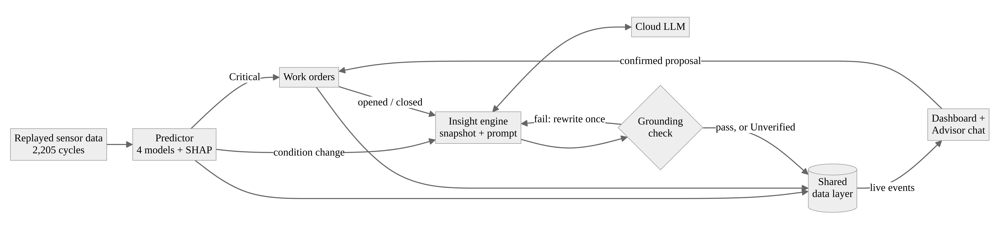
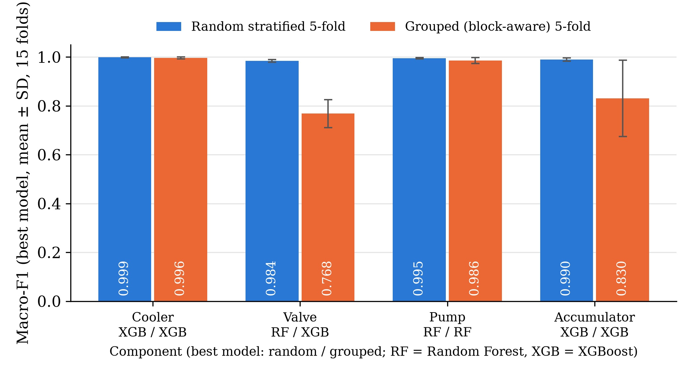

<!--
  TECHNICAL PAPER SOURCE (FYP 2). Word version: TECHNICAL_PAPER.docx (formatted to the FYP2 rules).
  [TO FILL] marks results that do not exist yet; keep each short so the paper stays within 6 pages.
-->

**Data-Grounded Language-Model Insights for a Closed-Loop Predictive Maintenance Dashboard**

Sarah Khalilah binti Mohd Fauzi¹\*, Mohd Anuaruddin bin Ahmadon¹

¹Universiti Teknologi PETRONAS, 32610 Seri Iskandar, Perak Darul Ridzuan, Malaysia

\*Corresponding author: [TO FILL: e-mail address]

# ABSTRACT

Predictive maintenance dashboards leave staff to interpret probabilities themselves, and predictions are rarely connected to the explanation and action that should follow. Large language models can explain such data, but may state values that are not in it. This work presents Closed Loop, a web system in which machine-learning prediction, a live dashboard, language-model insights and maintenance work orders share one data layer. A hydraulic test-rig dataset of 2,205 load cycles is replayed live; four classifiers with SHAP explanations score each cycle, a Critical prediction opens a work order, and a cloud language model explains each change. Every number, work-order identifier and condition in an insight is checked against a snapshot of the dashboard; failures trigger one rewrite, then an Unverified label. Random Forest and XGBoost reached a macro-F1 of 0.984–0.999 against 0.419–0.555 for a rule-based baseline. A block-aware cross-validation, needed because the data form 194 blocks of near-identical cycles, showed that random folds overstate valve (0.768) and accumulator (0.830) performance, while the cooler (0.996) and pump (0.986) generalise. On 50 frozen scenarios, a 120-billion-parameter model given the snapshot stated an unsupported value in 1 of 68 insights without the check and none with it, at a median of 2.7 s. The evaluation also exposed a parsing defect in the check that had made an earlier reported result largely an artefact. [TO FILL: one sentence on the small-versus-large model result.] A within-subjects user study is implemented, and its analysis pipeline was validated on synthetic data; it has not yet been run with participants. Language-model explanations can thus be embedded in a maintenance loop with their errors measured and shown.

**Keywords:** hallucination; SHAP; hydraulic condition monitoring; cross-validation leakage; work orders; XGBoost

# 1. INTRODUCTION

Predictive maintenance acts on condition data before equipment fails, and machine learning is now its main analytical tool [1], [2]. Two gaps remain in practice. A dashboard of probabilities still leaves the engineer to work out what changed, why and what to do, and predictions are often not connected to the action that should follow. Platforms that close the loop to a work order exist [3], but do not explain their outputs in plain language. Large language models (LLMs) can, and LLM agents for maintenance have been proposed [4], [5], but LLMs state content unsupported by their input [6], which is unacceptable when describing equipment condition.

This work asks: (RQ1) do live, data-grounded insights improve task accuracy and reduce workload compared with the same dashboard without them; (RQ2) how closely can a small cloud model match a large one in grounding accuracy and latency; and (RQ3) how much do a structured snapshot and output validation reduce incorrect values? The objectives are validated predictive models (O1), a closed loop with grounded insights and work orders (O2), and its evaluation (O3), on one public dataset replayed as a live stream.

# 2. LITERATURE REVIEW

The UCI hydraulic dataset [7] is a standard benchmark with four simultaneously varied faults. Published classifiers report near-perfect results on it, for example 0.999–1.000 accuracy for a multi-sensor CNN [8] and 0.932–1.000 macro-F1 for feature-selected XGBoost [9], mostly under random splits. Enejor et al. [10] showed that splitting by operating condition lowers valve and accumulator accuracy markedly, consistent with the wider literature on evaluation leakage [11], [12]. SHAP [13] is the usual way to explain such models in maintenance [14].

Hallucination is reduced most reliably by placing evidence in the input [15], [16]; detectors such as SelfCheckGPT [17] find remaining errors by sampling, at extra cost per answer. For structured operational data, where every legitimate value is known in advance, a deterministic check is cheaper and fully explainable, but it has not been evaluated in maintenance. Small models may suffice for narrow tasks at much lower cost [18]. Figliè et al. [19] compared conversational and graphical decision support as alternatives and found the conversational one faster on simple tasks without a consistent accuracy gain. No work was found that combines a validated model on real sensor data, proactive LLM insights checked against the data, an alert-to-work-order loop and a measured choice of model size, evaluated against a dashboard-only baseline.

# 3. METHODOLOGY

The project followed CRISP-DM [20]; Figure 1 shows the system.

## 3.1 Data and Models

The 2,205 cycles of 17 sensors [7] were reduced to 68 features (four statistics per sensor), and each component's labels were grouped into Optimal, Degraded and Critical. Per component, a single-threshold baseline, logistic regression, Random Forest [21] and XGBoost [22] were compared by macro-F1 under stratified 5-fold cross-validation repeated three times, with SMOTE [23] inside each training fold and a paired t-test against the baseline [24]. The cycles form 194 contiguous blocks with identical fault settings, so a random test cycle almost always has near-identical neighbours in training. A second, block-aware evaluation therefore used StratifiedGroupKFold with the block as the group.

## 3.2 Grounded Insights

Each replayed cycle is scored for all four components with SHAP top drivers in about 59 ms, and a Critical prediction opens a work order. A condition change, a failure probability crossing 50 % or a work-order event triggers an insight. The LLM, reached through an OpenAI-compatible interface, receives a JSON snapshot of the dashboard (conditions, probabilities, top drivers with values and units, open work orders, events) and is asked for two to four sentences using only snapshot values. A deterministic validator then checks every claim. A number $x$ written with $k$ decimals matches a snapshot value $v$ if

$$|x - v| \le 0.5 \times 10^{-k} \tag{1}$$

so "97 %" matches 96.8 but "97.5 %" does not. Work-order identifiers must exist in the snapshot, and a sentence naming one component may give it only a condition it is in or changed from. On failure, the model is asked once to rewrite; a reply that still fails is shown labelled Unverified. An Advisor chat uses the same snapshot and can propose work orders, which are created only after the user confirms.

## 3.3 Evaluation

Insight quality was measured on 50 scenarios (ten each: to Degraded, to Critical, to Optimal, steady fault, all clear), captured from the system's own replay and frozen before the first run, each with the validator on and off. Metrics were grounding accuracy (matched over checked claims), hallucination rate (insights with an unsupported claim), coverage (expected component and condition named) and latency. A within-subjects user study (about 20 participants, counterbalanced lookup, history and diagnosis tasks) compares the dashboard with and without the AI layer on accuracy, time, SUS and NASA-TLX. It has not yet been run with participants. Its scoring and paired tests (exact McNemar, Wilcoxon signed-rank) were validated on 160 synthetic task attempts generated at random with no true difference between the conditions.

# 4. RESULTS

## 4.1 Predictive Performance

Table 1 Best macro-F1 per component (mean ± SD over 15 folds)

| Component | Baseline | Random folds | Block-aware folds | RF, block-aware |
|---|---:|---:|---:|---:|
| Cooler | 0.555 | 0.999 ± 0.002 (XGB) | 0.996 ± 0.004 (XGB) | 0.956 |
| Valve | 0.460 | 0.984 ± 0.006 (RF) | 0.768 ± 0.057 (XGB) | 0.625 |
| Pump | 0.550 | 0.995 ± 0.003 (RF) | 0.986 ± 0.012 (RF) | 0.986 |
| Accumulator | 0.419 | 0.990 ± 0.007 (XGB) | 0.830 ± 0.156 (XGB) | 0.828 |

Under random folds every learned model beat the baseline (p < 10⁻²³), which could not recognise the Degraded class for three components. Under block-aware folds they still did (p < 10⁻⁸), but the valve and accumulator fell by 0.22 and 0.16 (Table 1, Figure 2).

## 4.2 Insight Quality

The run used gpt-oss-120b (136 insights). During analysis, all 65 of the most frequent "unsupported numbers" proved to be digits of valid work-order identifiers written with a non-breaking hyphen (U+2011), which the validator did not recognise. The defect was fixed, a regression test added, and the stored texts re-scored against their stored snapshots (Table 2).

Table 2 Insight quality, gpt-oss-120b (68 insights per setting)

| Validator | Grounding accuracy | Hallucination rate | Coverage | Median / p90 time |
|---|---:|---:|---:|---|
| Off | 99.8 % | 1.5 % | 98.5 % | 2.7 s / 4.3 s |
| On | 100.0 % | 0.0 % | 98.5 % | 3.6 s / 5.5 s |
| Off / on, defective check | 93.6 / 96.2 % | 42.6 / 25.0 % | 98.5 % | — |

The one remaining failure was a false alarm ("the Pump degraded from Optimal to Critical" uses "degraded" as a verb), and all coverage misses were steady-fault scenarios in which nothing had changed. The latency with the validator on includes rewrites caused by the defect.

[TO FILL: small versus large model (hallucination off/on, rewrite rate, latency, usefulness), as one table row per model added to Table 2 and two sentences.]

**User study pipeline (synthetic data, not results).** On the synthetic attempts, the pipeline found no reliable overall difference (54 % vs 61 % correct, exact McNemar p = 0.405; steps Wilcoxon p = 0.294), as expected for data with a null effect. A single task level still showed a spurious 30-point gap (p = 0.070), so the real study will treat the overall paired test as its primary result. No usability or workload scores were simulated, and no claim is made about RQ1.

# 5. DISCUSSION

**Validation explains the near-perfect benchmarks.** The block-aware Random Forest results agree with the grouped evaluation of Enejor et al. [10] for the cooler (0.956 vs 0.954), pump (0.986 vs 0.996) and accumulator (0.828 vs 0.804). The pattern follows the physics: cooler and pump faults change a directly measured quantity (cooling power, delivered flow), which SHAP ranked highest, whereas valve and accumulator faults appear only indirectly through pressure variability and damping, which the models partly learned as an operating-point signature. Random Forest, whose fully grown trees memorise near-duplicate neighbours, fell furthest on the valve (0.625, below logistic regression at 0.743), so the deployed valve model should be replaced by XGBoost. Near-perfect valve and accumulator scores on this dataset are upper bounds for conditions seen in training [11].

**The snapshot, not the validator, made the large model faithful.** Given exactly the values to use, the model stated virtually no unsupported ones, in line with the grounding literature [15], [16]. The validator's role was to verify and display correctness; its corrective value is expected with smaller models (RQ2). It cannot see reasoning: one insight said the valve "worsened from Critical to Degraded", with correct values but the wrong direction.

**A checker needs checking.** The defect inflated the hallucination rate about 28-fold and would have labelled one in four correct insights Unverified, a false-alarm pattern that erodes appropriate trust [25]. Storing every snapshot and output made it possible to find and correct this without re-running the model.

# 6. CONCLUSIONS

O1 and O2 were met: the models beat a rule-based baseline under both validation schemes, and the closed loop from replayed data to prediction, explanation and work order runs live. Block-aware validation showed that valve and accumulator performance is substantially lower than random folds suggest, which applies to much published work on this dataset. For RQ3, a structured snapshot alone kept a large model's unsupported values to 1.5 % of insights, and the check removed the rest while making correctness visible; a defective check, however, misled as much as a hallucinating model would. [TO FILL: one sentence answering RQ2.] RQ1 remains open: the user study is built and its analysis validated, but running it with participants is future work. Future work should select models under block-aware validation, tie each checked value to its component and the direction of change, measure the check's own precision and recall, and escalate from a small to a large model only when the check fails [18].

# ACKNOWLEDGMENT

[TO FILL: e.g. The author thanks the supervisor, AP Ts Dr Mohd Anuaruddin bin Ahmadon, for guidance throughout the project.]

# REFERENCES

[1] A. K. S. Jardine, D. Lin, and D. Banjevic, "A review on machinery diagnostics and prognostics implementing condition-based maintenance," *Mechanical Systems and Signal Processing*, vol. 20, no. 7, pp. 1483–1510, 2006, doi: 10.1016/j.ymssp.2005.09.012.

[2] T. P. Carvalho, F. A. A. M. N. Soares, R. Vita, R. P. Francisco, J. P. Basto, and S. G. S. Alcalá, "A systematic literature review of machine learning methods applied to predictive maintenance," *Computers & Industrial Engineering*, vol. 137, Art. no. 106024, 2019, doi: 10.1016/j.cie.2019.106024.

[3] I. T. Christou, N. Kefalakis, A. Zalonis, J. Soldatos, and R. Bröchler, "End-to-end industrial IoT platform for actionable predictive maintenance," *IFAC-PapersOnLine*, vol. 53, no. 3, pp. 173–178, 2020, doi: 10.1016/j.ifacol.2020.11.028.

[4] W. Jiang and F. Hu, "Artificial intelligence agent-enabled predictive maintenance: Conceptual proposal and basic framework," *Computers*, vol. 14, no. 8, Art. no. 329, 2025, doi: 10.3390/computers14080329.

[5] L. G. Di Maggio, "Toward autonomous LLM-based AI agents for predictive maintenance: State of the art, challenges, and future perspectives," *Applied Sciences*, vol. 15, no. 21, Art. no. 11515, 2025, doi: 10.3390/app152111515.

[6] Z. Ji et al., "Survey of hallucination in natural language generation," *ACM Computing Surveys*, vol. 55, no. 12, pp. 1–38, 2023, doi: 10.1145/3571730.

[7] N. Helwig, E. Pignanelli, and A. Schütze, "Condition monitoring of hydraulic systems," UCI Machine Learning Repository, 2015. [Dataset]. doi: 10.24432/C5CW21.

[8] H. Tao, P. Jia, X. Wang, and L. Wang, "Real-time fault diagnosis for hydraulic system based on multi-sensor convolutional neural network," *Sensors*, vol. 24, no. 2, Art. no. 353, 2024, doi: 10.3390/s24020353.

[9] Z. Song et al., "Hydraulic systems fault diagnosis based on random forests recursive feature elimination and XGBoost," *Journal of Physics: Conference Series*, vol. 2569, no. 1, Art. no. 012056, 2023, doi: 10.1088/1742-6596/2569/1/012056.

[10] E. Enejor, N. Ibigbami, I. Lawal, T. Adeoti, A. Adesoye, and S. Ajibesin, "An uncertainty-calibrated ensemble framework for fault diagnosis in industrial hydraulic power units: Rethinking stacked neural architectures," *Automation, Control and Intelligent Systems*, vol. 14, no. 3, pp. 59–72, 2026, doi: 10.11648/j.acis.20261403.12.

[11] S. Kapoor and A. Narayanan, "Leakage and the reproducibility crisis in machine-learning-based science," *Patterns*, vol. 4, no. 9, Art. no. 100804, 2023, doi: 10.1016/j.patter.2023.100804.

[12] D. R. Roberts et al., "Cross-validation strategies for data with temporal, spatial, hierarchical, or phylogenetic structure," *Ecography*, vol. 40, no. 8, pp. 913–929, 2017, doi: 10.1111/ecog.02881.

[13] S. M. Lundberg and S.-I. Lee, "A unified approach to interpreting model predictions," in *Advances in Neural Information Processing Systems 30 (NeurIPS 2017)*, 2017, pp. 4765–4774. [Online]. Available: https://proceedings.neurips.cc/paper_files/paper/2017/hash/8a20a8621978632d76c43dfd28b67767-Abstract.html

[14] L. Cummins et al., "Explainable predictive maintenance: A survey of current methods, challenges and opportunities," *IEEE Access*, vol. 12, pp. 57574–57602, 2024, doi: 10.1109/ACCESS.2024.3391130.

[15] P. Lewis et al., "Retrieval-augmented generation for knowledge-intensive NLP tasks," in *Advances in Neural Information Processing Systems 33 (NeurIPS 2020)*, 2020, pp. 9459–9474.

[16] A. P. Parikh et al., "ToTTo: A controlled table-to-text generation dataset," in *Proc. 2020 Conf. Empirical Methods in Natural Language Processing (EMNLP)*, 2020, pp. 1173–1186, doi: 10.18653/v1/2020.emnlp-main.89.

[17] P. Manakul, A. Liusie, and M. J. F. Gales, "SelfCheckGPT: Zero-resource black-box hallucination detection for generative large language models," in *Proc. 2023 Conf. Empirical Methods in Natural Language Processing (EMNLP)*, 2023, pp. 9004–9017, doi: 10.18653/v1/2023.emnlp-main.557.

[18] L. Chen, M. Zaharia, and J. Zou, "FrugalGPT: How to use large language models while reducing cost and improving performance," arXiv preprint, 2023, doi: 10.48550/arXiv.2305.05176.

[19] R. Figliè, S. Caputo, A. Serrano, D. Mikhaylova, T. Turchi, and D. Mazzei, "Neither replacement nor panacea: Comparing LLM-based conversational and graphical decision support in industrial tasks," arXiv preprint, 2026, doi: 10.48550/arXiv.2605.31287.

[20] R. Wirth and J. Hipp, "CRISP-DM: Towards a standard process model for data mining," in *Proc. 4th Int. Conf. Practical Applications of Knowledge Discovery and Data Mining*, Manchester, U.K., 2000, pp. 29–39.

[21] L. Breiman, "Random forests," *Machine Learning*, vol. 45, no. 1, pp. 5–32, 2001, doi: 10.1023/A:1010933404324.

[22] T. Chen and C. Guestrin, "XGBoost: A scalable tree boosting system," in *Proc. 22nd ACM SIGKDD Int. Conf. Knowledge Discovery and Data Mining*, San Francisco, CA, USA, 2016, pp. 785–794, doi: 10.1145/2939672.2939785.

[23] N. V. Chawla, K. W. Bowyer, L. O. Hall, and W. P. Kegelmeyer, "SMOTE: Synthetic minority over-sampling technique," *Journal of Artificial Intelligence Research*, vol. 16, pp. 321–357, 2002, doi: 10.1613/jair.953.

[24] C. Nadeau and Y. Bengio, "Inference for the generalization error," *Machine Learning*, vol. 52, no. 3, pp. 239–281, 2003, doi: 10.1023/A:1024068626366.

[25] J. D. Lee and K. A. See, "Trust in automation: Designing for appropriate reliance," *Human Factors*, vol. 46, no. 1, pp. 50–80, 2004, doi: 10.1518/hfes.46.1.50_30392.
