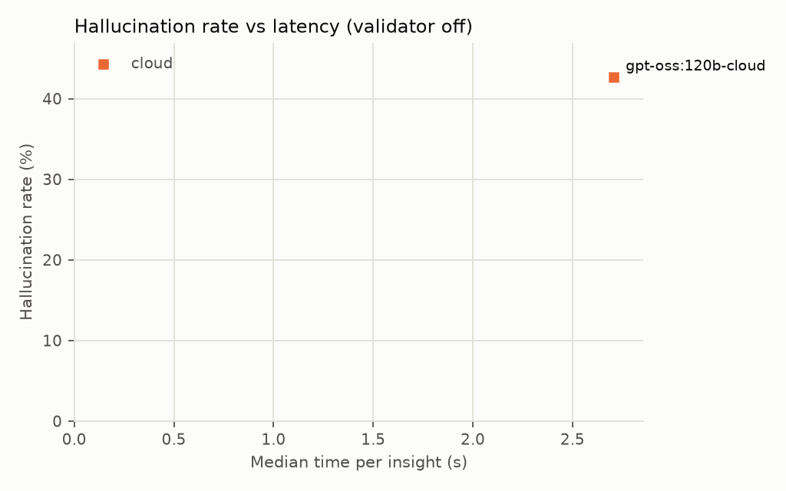
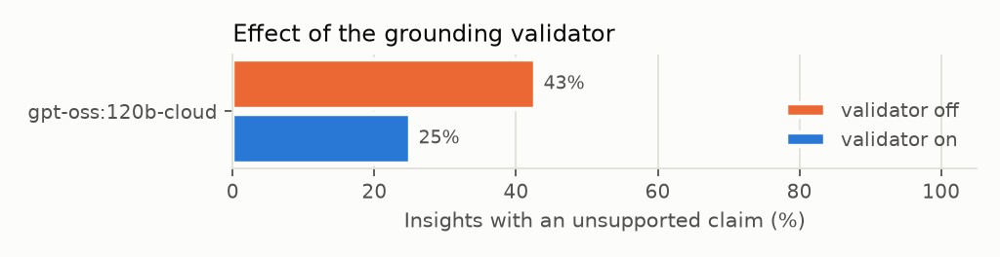

# Insight evaluation — official-gpt-oss-120b-cloud.csv

50 scenarios, 2 models, 2 repeat(s), prompt insight-v1. Hallucination = the final text has at least one number, work order ID or condition not in the snapshot.

## Per model and validator setting

| Model | Mode | Validator | Runs | Grounding accuracy | Hallucination | First-attempt halluc. | Coverage | First token (median / p90) | Total (median / p90) | Errors |
|---|---|---|---|---|---|---|---|---|---|---|
| gpt-oss:120b-cloud | cloud | off | 68 | 93.6% ± 7.9 | 42.6% | 42.6% | 98.5% | 2.3 s / 3.8 s | 2.7 s / 4.3 s | 0 |
| gpt-oss:120b-cloud | cloud | on | 68 | 96.2% ± 7.1 | 25.0% | 42.6% | 98.5% | 2.1 s / 3.5 s | 3.6 s / 5.5 s | 0 |

## Validator effect (RQ3)

| Model | Hallucination off → on | Accuracy off → on | Regeneration rate (on) | Median total off → on |
|---|---|---|---|---|
| gpt-oss:120b-cloud | 42.6% → 25.0% | 93.6% → 96.2% | 42.6% | 2.7 s → 3.6 s |

## By scenario category (all models)

| Category | Validator | Runs | Hallucination | Coverage |
|---|---|---|---|---|
| all_clear | off | 20.0 | 0.0% | 100.0% |
| all_clear | on | 20.0 | 0.0% | 100.0% |
| steady | off | 18.0 | 50.0% | 94.4% |
| steady | on | 18.0 | 44.4% | 94.4% |
| to_critical | off | 10.0 | 90.0% | 100.0% |
| to_critical | on | 10.0 | 60.0% | 100.0% |
| to_degraded | off | 10.0 | 70.0% | 100.0% |
| to_degraded | on | 10.0 | 10.0% | 100.0% |
| to_optimal | off | 10.0 | 40.0% | 100.0% |
| to_optimal | on | 10.0 | 20.0% | 100.0% |

## Most frequent unsupported claims

| Claim | Times |
|---|---|
| `0044` | 7 |
| `0019` | 5 |
| `0052` | 5 |
| `0011` | 4 |
| `0012` | 4 |
| `0027` | 4 |
| `0045` | 4 |
| `0041` | 4 |
| `0020` | 3 |
| `0036` | 3 |

