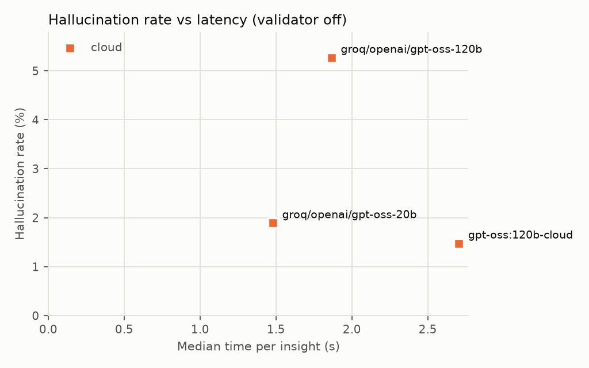
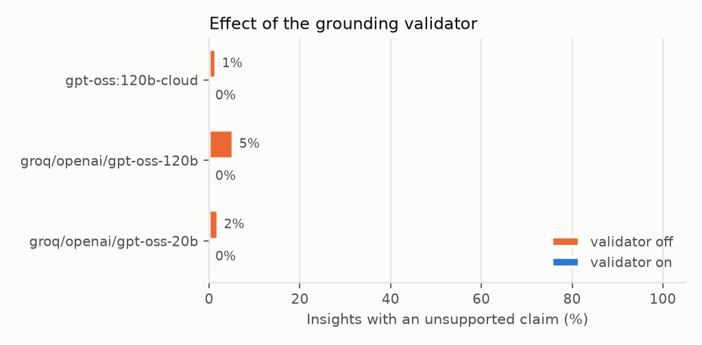

# Insight evaluation — official-groq-gptoss-20b-120b.csv, official-gpt-oss-120b-cloud-rescored.csv

50 scenarios, 4 models, 3 repeat(s), prompt insight-v1. Hallucination = the final text has at least one number, work order ID or condition not in the snapshot.

## Per model and validator setting

| Model | Mode | Validator | Runs | Grounding accuracy | Hallucination | First-attempt halluc. | Coverage | First token (median / p90) | Total (median / p90) | Errors |
|---|---|---|---|---|---|---|---|---|---|---|
| gpt-oss:120b-cloud | cloud | off | 68 | 99.8% ± 1.7 | 1.5% | 42.6% | 98.5% | 2.3 s / 3.8 s | 2.7 s / 4.3 s | 0 |
| gpt-oss:120b-cloud | cloud | on | 68 | 100.0% ± 0.0 | 0.0% | 42.6% | 98.5% | 2.1 s / 3.5 s | 3.6 s / 5.5 s | 0 |
| groq/openai/gpt-oss-120b | cloud | off | 57 | 99.3% ± 3.1 | 5.3% | 5.3% | 100.0% | 1.6 s / 2.1 s | 1.9 s / 2.5 s | 0 |
| groq/openai/gpt-oss-120b | cloud | on | 54 | 100.0% ± 0.0 | 0.0% | 0.0% | 100.0% | 1.6 s / 2.4 s | 1.9 s / 2.7 s | 0 |
| groq/openai/gpt-oss-20b | cloud | off | 53 | 99.7% ± 2.3 | 1.9% | 1.9% | 96.2% | 1.4 s / 2.3 s | 1.5 s / 2.4 s | 0 |
| groq/openai/gpt-oss-20b | cloud | on | 54 | 100.0% ± 0.0 | 0.0% | 0.0% | 94.4% | 1.3 s / 2.5 s | 1.4 s / 2.6 s | 0 |

## Validator effect (RQ3)

| Model | Hallucination off → on | Accuracy off → on | Regeneration rate (on) | Median total off → on |
|---|---|---|---|---|
| gpt-oss:120b-cloud | 1.5% → 0.0% | 99.8% → 100.0% | 42.6% | 2.7 s → 3.6 s |
| groq/openai/gpt-oss-120b | 5.3% → 0.0% | 99.3% → 100.0% | 0.0% | 1.9 s → 1.9 s |
| groq/openai/gpt-oss-20b | 1.9% → 0.0% | 99.7% → 100.0% | 0.0% | 1.5 s → 1.4 s |

## By scenario category (all models)

| Category | Validator | Runs | Hallucination | Coverage |
|---|---|---|---|---|
| all_clear | off | 41.0 | 0.0% | 100.0% |
| all_clear | on | 43.0 | 0.0% | 100.0% |
| steady | off | 40.0 | 2.5% | 92.5% |
| steady | on | 39.0 | 0.0% | 89.7% |
| to_critical | off | 32.0 | 9.4% | 100.0% |
| to_critical | on | 31.0 | 0.0% | 100.0% |
| to_degraded | off | 33.0 | 0.0% | 100.0% |
| to_degraded | on | 31.0 | 0.0% | 100.0% |
| to_optimal | off | 32.0 | 3.1% | 100.0% |
| to_optimal | on | 32.0 | 0.0% | 100.0% |

## Most frequent unsupported claims

| Claim | Times |
|---|---|
| `Pump: Degraded` | 2 |
| `45 bar` | 1 |
| `Cooler: Degraded` | 1 |
| `Valve: Degraded` | 1 |

